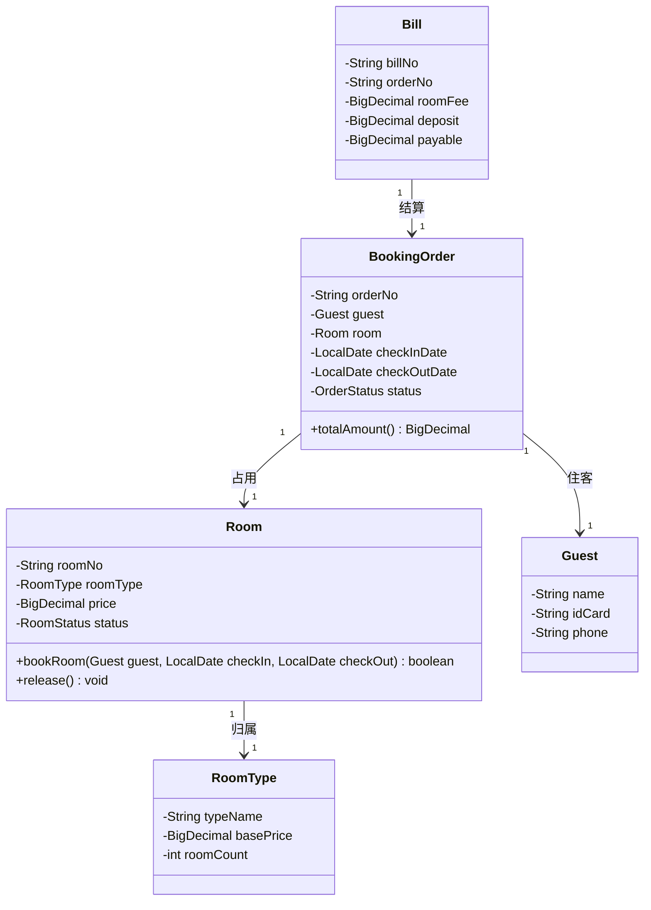

# 接口契约（草案）

> **文件作用**：约定成员A（后端）与成员B（前端）之间共同遵守的核心类名、方法签名与数据存储格式，避免并行开发后联调冲突。本文件是日常开发依据，不是最终提交文档。
> **课程**：CST9301 软件工程
> **作者**：易雨杰（成员A）
> **创建时间**：2026-10-23
> **最后修改**：2026-10-23
> **版本**：v0.1（草案，仅锁定最核心的类名与关键方法，签名细节待 A-3 类图定稿后细化为 v1.0）
> **状态**：草案。双方确认后生效，之后修改需在 PR 中标注 `CONTRACT-CHANGE` 并通知对方。
> **关联任务**：A-3（类图）、A-5（实体与 DAO）、A-6（Service）、B-5（前端事件绑定）

## 一、总体约定

1. 包根为 `com.hotel`，分为 `entity`（实体）、`dao` + `dao.impl`（持久化）、`service` + `service.impl`（业务逻辑）、`ui`（Swing 界面）、`util`（工具）。
2. 前端只依赖 `service` 层接口，**不得直接操作 DAO 或实体内部字段**；后端不依赖任何 Swing 类。
3. 金额统一使用 `java.math.BigDecimal`，日期统一使用 `java.time.LocalDate`（格式 `yyyy-MM-dd`）。
4. 业务异常统一抛 `com.hotel.service.BusinessException`（继承 `RuntimeException`，含 `code` 与 `message`），前端捕获后弹窗提示。
5. 命名约定：类名大驼峰；方法名小驼峰；房号 `roomNo`（如 `"801"`）；订单号 `orderNo`（如 `"ORD20261023001"`）。

## 二、核心实体类（类名锁定）

| 类名 | 职责 | 关键属性 |
|---|---|---|
| `Room` | 具体房间，承载房态与预订动作 | `roomNo`、`roomType`、`price`、`status` |
| `RoomType` | 房型定义（标准间/大床房等） | `typeName`、`basePrice`、`roomCount` |
| `Guest` | 住客信息 | `name`、`idCard`、`phone` |
| `BookingOrder` | 预订/入住订单 | `orderNo`、`guest`、`room`、`checkInDate`、`checkOutDate`、`status` |
| `Bill` | 退房账单 | `billNo`、`orderNo`、`roomFee`、`deposit`、`payable` |

> `Room.bookRoom(...)` 的方法名按分工要求**已锁定**，后续类图（A-3）、代码（A-5/A-6）、前端调用（B-5）必须使用该名称。

## 三、枚举（锁定）

```java
public enum RoomStatus {
    FREE,        // 空闲
    OCCUPIED,    // 在住
    CLEANING,    // 清洁中
    MAINTENANCE  // 维修
}

public enum OrderStatus {
    BOOKED,       // 已预订
    CHECKED_IN,   // 已入住
    CHECKED_OUT,  // 已退房
    CANCELLED     // 已取消
}
```

## 四、类关系（预演 A-3 类图）



## 五、Service 接口（前端调用入口）

```java
package com.hotel.service;

public interface BookingService {

    // 查询指定日期区间内某房型的可用房间（roomTypeName 传 null 表示不限房型）
    List<Room> listAvailableRooms(LocalDate checkIn, LocalDate checkOut, String roomTypeName);

    // 在线预订：校验房态后生成订单并置房间为已占用
    BookingOrder bookRoom(String roomNo, Guest guest, LocalDate checkIn, LocalDate checkOut)
            throws BusinessException;

    // 取消预订：仅允许入住前取消 BOOKED 状态的订单
    BookingOrder cancelBooking(String orderNo) throws BusinessException;

    // 办理入住：订单状态 BOOKED -> CHECKED_IN
    BookingOrder checkIn(String orderNo) throws BusinessException;

    // 退房结算：核算房费、生成账单、释放房间，订单状态 -> CHECKED_OUT
    Bill checkOut(String orderNo) throws BusinessException;
}
```

```java
package com.hotel.service;

public interface RoomService {

    List<Room> listAllRooms();

    Room findByNo(String roomNo) throws BusinessException;

    void updateRoomStatus(String roomNo, RoomStatus status) throws BusinessException;
}
```

> 前端获取实例：`com.hotel.service.ServiceFactory.getBookingService()` / `getRoomService()`（A-5 实现，具体装配方式待定）。

## 六、DAO 接口（后端内部使用）

```java
package com.hotel.dao;

public interface RoomDao {
    List<Room> findAll();
    Room findByNo(String roomNo);
    void update(Room room);
}

public interface OrderDao {
    void save(BookingOrder order);
    BookingOrder findByNo(String orderNo);
    List<BookingOrder> findAll();
    void update(BookingOrder order);
    String nextOrderNo();   // 生成唯一订单号
}
```

## 七、数据存储约定

| 文件 | 用途 | 字段（表头） |
|---|---|---|
| `data/rooms.csv` | 房间数据 | `roomNo,typeName,price,status` |
| `data/room_types.csv` | 房型数据 | `typeName,basePrice,roomCount` |
| `data/orders.csv` | 订单数据 | `orderNo,guestName,idCard,phone,roomNo,checkInDate,checkOutDate,status` |

- 编码 UTF-8，首行为表头，逗号分隔，日期 `yyyy-MM-dd`，枚举保存英文常量名。
- 首次启动若文件不存在，由 DAO 初始化示例数据并写回。

## 八、前端交互约定（B-5）

1. 所有按钮事件只调用第五节中的 Service 方法，禁止在 UI 中写业务校验逻辑。
2. 调用返回 `BusinessException` 时，用 `JOptionPane.showMessageDialog` 展示 `message`。
3. 操作成功后重新查询列表刷新 `JTable`，不手工维护界面缓存。
4. 房态展示颜色：`FREE` 绿色、`OCCUPIED` 红色、`CLEANING` 黄色、`MAINTENANCE` 灰色（待 B 确认）。

## 九、待确认事项

- [ ] 是否需要登录与角色权限（顾客/前台/管理员），若需要则补充 `User`、`Role` 类。
- [ ] 房间分配策略：预订时直接锁定具体房间（当前方案）还是入住时再分配。
- [ ] 押金规则与账单字段是否计入额外消费（如损坏赔偿）。
- [ ] `Room.bookRoom(...)` 的参数列表最终形态（A-3 类图定稿时确认）。
- [ ] 数据文件是否需要支持并发写入（当前按单用户本地运行设计）。

## 十、变更记录

| 版本 | 日期 | 修改人 | 说明 |
|---|---|---|---|
| v0.1 | 2026-10-23 | 易雨杰 | 初稿，锁定核心类名、枚举与 Service 方法签名 |
