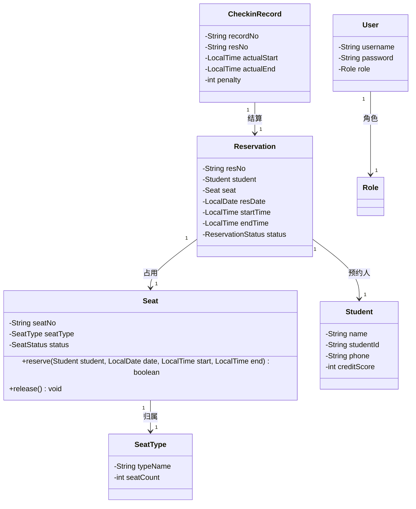

# 接口契约（草案）

> **文件作用**：约定成员A（后端）与成员B（前端）之间共同遵守的核心类名、方法签名与数据存储格式，避免并行开发后联调冲突。本文件是日常开发依据，不是最终提交文档。
> **课程**：CST9301 软件工程
> **作者**：易雨杰（成员A）
> **创建时间**：2026-10-23
> **最后修改**：2026-10-29
> **版本**：v0.4（免费公共自习室模式，引入信用分机制，去除费率与费用结算）
> **状态**：已确认（v0.4），之后修改需在 PR 中标注 `CONTRACT-CHANGE` 并通知对方。
> **关联任务**：A-3（类图）、A-5（实体与 DAO）、A-6（Service）、B-5（前端事件绑定）

## 一、总体约定

1. 包根为 `com.studyroom`，分为 `entity`（实体）、`dao` + `dao.impl`（持久化）、`service` + `service.impl`（业务逻辑）、`ui`（Swing 界面）、`util`（工具）。
2. 前端只依赖 `service` 层接口，不得直接操作 DAO 或实体内部字段；后端不依赖任何 Swing 类。
3. 本系统为高校免费公共自习室，不涉及费用结算，以信用分机制约束预约行为。
4. 业务异常统一抛 `com.studyroom.service.BusinessException`（继承 `RuntimeException`，含 `code` 与 `message`），前端捕获后弹窗提示。
5. 命名约定：类名大驼峰；方法名小驼峰；座位号 `seatNo`（如 `"A01"`）；预约号 `resNo`（如 `"RES20261029001"`）。

## 二、信用分规则（已与 B 确认）

| 规则 | 取值 |
|---|---|
| 初始信用分 | 100 分 |
| 预约后未签到（爽约） | 扣 5 分，自动取消预约并释放座位 |
| 签到后超时未签退 | 扣 1 分，自动释放座位 |
| 禁止预约阈值 | 信用分低于 80 分时不可预约 |
| 续时功能 | 不做，到时间签退，需继续使用则重新查询并预约 |

## 三、核心实体类（类名锁定）

| 类名 | 职责 | 关键属性 |
|---|---|---|
| `Seat` | 具体座位，承载座位状态与预约动作 | `seatNo`、`seatType`、`status` |
| `SeatType` | 座位区域定义（靠窗区/普通区/沙发区等） | `typeName`、`seatCount` |
| `Student` | 学生信息 | `name`、`studentId`、`phone`、`creditScore` |
| `Reservation` | 预约记录 | `resNo`、`student`、`seat`、`resDate`、`startTime`、`endTime`、`status` |
| `CheckinRecord` | 签到/签退记录 | `recordNo`、`resNo`、`actualStart`、`actualEnd`、`penalty` |
| `User` | 系统用户（登录用） | `username`、`password`、`role` |
| `Role` | 角色枚举 | `STUDENT`（学生）、`DUTY_ADMIN`（值班管理员）、`SYS_ADMIN`（系统管理员） |

## 四、枚举（锁定）

```java
public enum SeatStatus {
    AVAILABLE,    // 可用
    RESERVED,     // 已预约
    OCCUPIED,     // 使用中
    CLOSED        // 维修/关闭
}

public enum ReservationStatus {
    BOOKED,       // 已预约
    CHECKED_IN,   // 已签到
    CHECKED_OUT,  // 已签退
    CANCELLED     // 已取消
}

public enum Role {
    STUDENT,     // 学生
    DUTY_ADMIN,  // 值班管理员
    SYS_ADMIN    // 系统管理员
}
```

## 五、类关系（预演 A-3 类图）



## 六、Service 接口（前端调用入口）

```java
package com.studyroom.service;

public interface ReservationService {

    // 查询指定日期与时间段内某区域的可用座位（typeName 传 null 表示不限区域）
    List<Seat> listAvailableSeats(LocalDate date, LocalTime start, LocalTime end, String typeName);

    // 在线预约：校验信用分>=80、座位可用后生成预约记录
    Reservation reserve(String seatNo, Student student, LocalDate date, LocalTime start, LocalTime end)
            throws BusinessException;

    // 取消预约：仅允许签到前取消 BOOKED 状态的预约，释放座位
    Reservation cancelReservation(String resNo) throws BusinessException;

    // 签到登记：预约状态 BOOKED -> CHECKED_IN，座位 -> OCCUPIED
    Reservation signIn(String resNo) throws BusinessException;

    // 签退释放：释放座位，判定是否超时（实际结束>预约结束则扣学生1分），返回签退记录
    CheckinRecord signOut(String resNo, LocalTime actualEnd) throws BusinessException;
}
```

```java
package com.studyroom.service;

public interface SeatService {

    List<Seat> listAllSeats();

    Seat findByNo(String seatNo) throws BusinessException;

    void updateSeatStatus(String seatNo, SeatStatus status) throws BusinessException;
}
```

```java
package com.studyroom.service;

public interface AuthService {

    // 登录：校验用户名/密码，失败抛 BusinessException
    User login(String username, String password) throws BusinessException;

    // 退出登录，清空当前会话
    void logout();
}
```

> 前端获取实例：`com.studyroom.service.ServiceFactory.getReservationService()` / `getSeatService()` / `getAuthService()`（A-5 实现，具体装配方式待定）。

## 七、DAO 接口（后端内部使用）

```java
package com.studyroom.dao;

public interface SeatDao {
    List<Seat> findAll();
    Seat findByNo(String seatNo);
    void update(Seat seat);
}

public interface ReservationDao {
    void save(Reservation reservation);
    Reservation findByNo(String resNo);
    List<Reservation> findAll();
    void update(Reservation reservation);
    String nextResNo();
}

public interface StudentDao {
    Student findByStudentId(String studentId);
    void update(Student student);
    List<Student> findAll();
}

public interface UserDao {
    User findByUsername(String username);
    void save(User user);
}

public interface CheckinRecordDao {
    void save(CheckinRecord record);
    CheckinRecord findByResNo(String resNo);
}
```

## 八、数据存储约定

| 文件 | 用途 | 字段（表头） |
|---|---|---|
| `data/seats.csv` | 座位数据 | `seatNo,typeName,status` |
| `data/seat_types.csv` | 座位区域数据 | `typeName,seatCount` |
| `data/reservations.csv` | 预约记录 | `resNo,studentName,studentId,phone,seatNo,resDate,startTime,endTime,status` |
| `data/students.csv` | 学生与信用分 | `name,studentId,phone,creditScore` |
| `data/users.csv` | 系统用户 | `username,password,role` |
| `data/checkin_records.csv` | 签到签退记录 | `recordNo,resNo,actualStart,actualEnd,penalty,createTime` |

- 编码 UTF-8，首行为表头，逗号分隔，日期 `yyyy-MM-dd`，时间 `HH:mm`，枚举保存英文常量名。
- 首次启动若文件不存在，由 DAO 初始化示例数据并写回。

## 九、前端交互约定（B-5）

1. 所有按钮事件只调用第六节中的 Service 方法，禁止在 UI 中写业务校验逻辑。
2. 调用返回 `BusinessException` 时，用 `JOptionPane.showMessageDialog` 展示 `message`。
3. 操作成功后重新查询列表刷新 `JTable`，不手工维护界面缓存。
4. 座位状态展示颜色：`AVAILABLE` 绿色、`RESERVED` 橙色、`OCCUPIED` 红色、`CLOSED` 灰色（B-5 实现时按界面主题确定）。
5. 学生界面需展示当前信用分；低于 80 分时预约按钮置灰并提示。

## 十、业务闭环（已确认）

1. 在线预约前校验学生信用分 >= 80，通过后锁定座位置为 `RESERVED`，生成 `BOOKED` 预约记录；
2. 签到登记时预约置为 `CHECKED_IN`，座位置为 `OCCUPIED`，记录实际开始时间；
3. 签退释放时：座位置为 `AVAILABLE`，预约置为 `CHECKED_OUT`；若实际结束时间晚于预约结束时间，扣学生 1 分；
4. 预约后未在规定时间内签到，系统判定爽约，扣学生 5 分，预约置为 `CANCELLED`，座位释放；
5. 签退时不做任何费用计算，全程免费。

## 十一、变更记录

| 版本 | 日期 | 修改人 | 说明 |
|---|---|---|---|
| v0.1 | 2026-10-23 | 易雨杰 | 初稿（原酒店选题） |
| v0.2 | 2026-10-26 | 易雨杰 | 按 B 评审意见确认登录与角色、额外消费、退房流程 |
| v0.3 | 2026-10-28 | 易雨杰 | 选题切换为自习室预约系统：实体改为 Seat/SeatType/Student/Reservation/CheckinRecord（CONTRACT-CHANGE） |
| v0.4 | 2026-10-29 | 易雨杰 | 免费公共自习室模式：去除费率与费用结算，引入信用分机制（初始100，爽约扣5，超时扣1，低于80禁约）；CheckinRecord.fee/extraFee改为penalty；Student新增creditScore（CONTRACT-CHANGE） |
