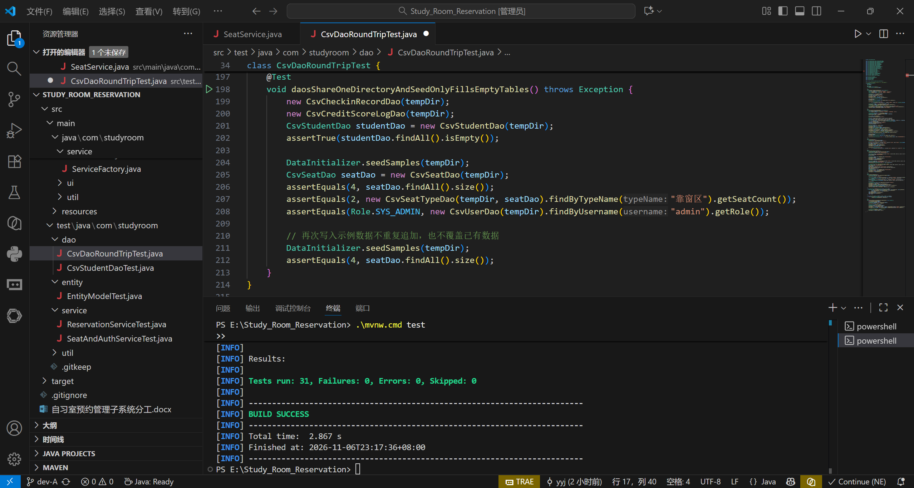

# A-6 Service 业务逻辑实现记录

> **文件作用**：记录 A-6 的实现范围、关键规则落点、与契约的一致性核对、测试结果与遗留项，供 B 联调与报告撰写引用。
> **课程**：CST9301 软件工程  
> **作者**：易雨杰（成员A）  
> **创建时间**：2026-11-06  
> **最后修改**：2026-11-06  
> **版本**：v1.1（测试截图入库、签到记录改为签到即落盘签退回填）  
> **关联契约**：`docs/contract/接口契约.md` v1.1（第一、二、六、七、十节）

## 一、实现范围

| 契约第六节接口 | 实现类 | 说明 |
|---|---|---|
| `ReservationService` | `service/impl/ReservationServiceImpl` | `listAvailableSeats`、`reserve`、`cancelReservation`、`signIn`、`signOut`、`handleNoShow` 六个方法全部实现 |
| `SeatService` | `service/impl/SeatServiceImpl` | `listAllSeats`、`findByNo`、`updateSeatStatus` |
| `AuthService` | `service/impl/AuthServiceImpl` | `login`、`logout`，实现类另有 `currentUser()` 供界面按角色渲染 |
| 装配入口 | `service/ServiceFactory` | 契约第六节末尾约定的三个静态方法 |

辅助类：`service/BusinessException`（`code` + `message`，继承 `RuntimeException`）、`util/DateTimes`（`java.time` 与 `Date` 互转，精确到分钟）。

装配方式：`ServiceFactory.getReservationService()/getSeatService()/getAuthService()` 首次调用时按依赖顺序创建七个 DAO 并复用同一份文件句柄；`ServiceFactory.configure(Path)` 可指定数据目录（默认 `data/`），切换后实例作废、下次获取重建。首次装配会调 `DataInitializer.initialize` + `seedSamples`，因此界面首次启动即有 4 个座位、2 个区域、2 名学生、`admin`/`duty` 两个账号。

## 二、业务规则落点

| 契约/A-4 规则 | 落点 | 说明 |
|---|---|---|
| 信用分 < 80 不可预约 | `reserve` | 抛 `BusinessException("CREDIT_LOW")`，先查学生档案再判断，避免用界面传入的过期分数 |
| 座位必须可用 | `reserve` | 非 `AVAILABLE` 抛 `SEAT_UNAVAILABLE`；另做时段重叠校验，冲突抛 `SEAT_CONFLICT` |
| 预约成功锁座 | `reserve` | `ReservationDao.save` 成功后才把座位置 `RESERVED`，避免半条记录 |
| 签到截止 = 开始 + 15 分钟 | `reserve` | `signInDeadline = startTime + 15`，读取时由 DAO 按同规则还原 |
| 取消仅限签到前 | `cancelReservation` | 状态非 `BOOKED` 或已过截止时间均拒绝（`STATE` / `DEADLINE`） |
| 签到：BOOKED → CHECKED_IN、座位 → OCCUPIED | `signIn` | 已过截止时间拒绝（`DEADLINE`），T-04 只允许从预约态进入 |
| 签退：座位 → AVAILABLE、预约 → CHECKED_OUT | `signOut` | 释放座位后写 `CheckinRecord` 落盘 |
| 签退超时扣 1 分 | `signOut` | 实际结束晚于预约结束：扣 1 分 + 写 `CreditScoreLog(LATE_CHECKOUT, -1)`，并在记录 `penalty` 记 1 |
| 爽约扣 5 分置 NO_SHOW | `handleNoShow` | 扫描 `BOOKED` 且 `now` 已过截止时间的记录：置 `NO_SHOW`、释放座位、扣 5 分并写 `CreditScoreLog(NO_SHOW, -5)`，返回处理条数 |
| OCCUPIED 不得直接改 AVAILABLE | `SeatService.updateSeatStatus` | 抛 `BusinessException("SEAT_IN_USE", "座位使用中，须先办理签退")`；OCCUPIED → CLOSED 允许，对应 T-08 |

## 三、实现取舍（需 B 知悉）

1. **签到即落盘，签退回填**（契约 v0.9）：`CheckinRecordDao` 新增 `update(CheckinRecord)`。`signIn` 时立即写一条记录（`actualStart` = 签到时刻，`actualEnd` 为空，`penalty` = 0），`signOut` 时按 `resNo` 取出同一条记录，回填 `actualEnd` 与 `penalty` 后 `update`，`recordNo` 保持不变。好处是签到到签退之间 `checkin_records` 里已有行，管理员可以实时查在座名单；再签退时不会产生第二条记录（`save` 仍拒绝同 `resNo` 重复）。
2. **座位释放带状态守卫**：取消、爽约、签退释放座位时，只有座位仍处于预期状态（`RESERVED` / `OCCUPIED`）才改回 `AVAILABLE`，避免把维修中的座位误放为可用。
3. **预约号生成修正**：A-5 的 `CsvReservationDao` 用 `yyyy-MM-dd` 拼预约号，产生 `RES2026-11-06001`；已改为 `yyyyMMdd`，现在是 `RES20261106001`，与契约第一节与 `对接-A5` 文档一致。
4. **信用分不做下限截断**：扣分后可为负，如实反映违约次数，统计口径更清晰。

## 四、测试结果

`mvn test`：**34 个用例全部通过**（A-5 原有 19 个 + A-6 新增 13 个 + A-8 前补的 7 天预约窗口与列表查询 2 个），`BUILD SUCCESS`。

| 测试类 | 用例数 | 覆盖 |
|---|---|---|
| `service/ReservationServiceTest` | 8 | 预约成功锁座与截止时间、信用分不足拒绝、座位不可用拒绝、可用座位按区域/时段过滤、取消释放与重复取消拒绝、签到即写记录且签退更新同一条记录、签退超时扣 1 分并写流水、爽约扫描扣 5 分释放座位且重复扫描为 0 |
| `service/SeatAndAuthServiceTest` | 4 | OCCUPIED 不能直接改 AVAILABLE 且提示文案一致、OCCUPIED → CLOSED 允许、未知座位抛 `SEAT_NOT_FOUND`、登录成功/密码错/用户不存在、登出清空会话 |
| `dao` + `entity` + `util`（A-5 原有） | 19 | 七张表读写往返、实体状态方法、CSV 工具函数 |

`CsvDaoRoundTripTest` 在签到记录用例里补了 `update` 往返断言（签到写一条 `actualEnd` 为空的记录 → `update` 回填结束时间与处罚 → 仍是一条记录），只并入原有用例，不新增用例数。

截图（VSCode 内 `.\mvnw.cmd test`，删掉冗余 import 后的干净结果）：

## 五、遗留项

1. 契约里“爽约扫描时机为启动时一次 + 之后定时触发”，A-6 只提供 `handleNoShow(now)` 方法，**未在代码里起定时器**；已与 B 约定由界面启动时调一次、再用 `javax.swing.Timer` 每小时触发（B 确认前按此实现）。
2. 签到记录已改为签到即落盘、签退回填（契约 v0.9），`CheckinRecordDao` 也已补 `findAll()`、`ReservationService` 补 `listSeated()`（契约 v1.1），在座名单可以一次查出，不必遍历预约。
3. `AuthService` 无状态（契约第六节无 `currentUser` 接口）：`login` 返回 `User` 由界面保存，`logout` 仅承载登出语义；未做会话超时与权限分级，`Role` 仅供界面渲染。
4. 预约已补「只能预约今天起 7 天内」的窗口校验（契约 v1.0 第十节第 7 条，A-8 前补），过去日期与超窗日期均抛 `PARAM`；仍**未限制「同一学生时段重叠」**，契约未规定，暂不实现。
5. A-6 测试截图已入库 `docs/assets/A6_测试通过截图.png`，进度看板同步。
6. **同一座位在预约被占用期内无法被其他时段复用**：`seats.csv` 的 `status` 是单值字段（契约第八节），座位一旦被预约就置为 `RESERVED`，`listAvailableSeats` 只返回 `AVAILABLE` 的座位，所以“A01 上午被约、下午再约”在界面上查不到该座位，尽管时段并不重叠。这是契约表结构的限制，A-6 未擅自改表；若课程演示需要按时段复用座位，需按 `CONTRACT-CHANGE` 调整座位状态口径（例如座位状态不再随预约变化，仅按当日占用情况实时计算），由用户与 B 一起拍板。
7. `BusinessException` 是 `RuntimeException` 子类，契约第六节中 `listAvailableSeats` 未声明 `throws`，因此该方法抛出的 `PARAM` 异常靠运行时机制传递，界面仍需按第三节的异常码表统一 `catch`。
