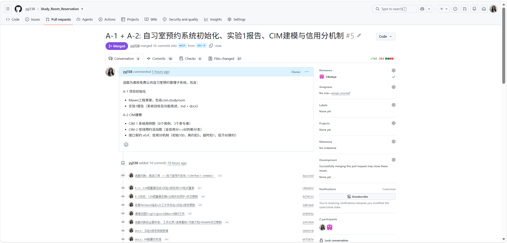
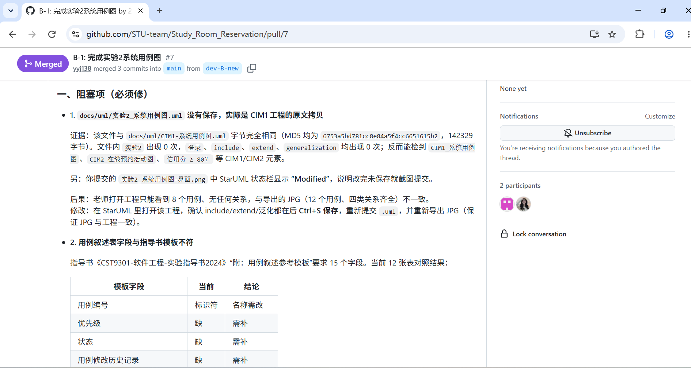

# 05 个人任务及感想（成员 B）

| 项目 | 内容 |
|---|---|
| 课程 | CST9301 软件工程 |
| 项目 | 自习室预约管理子系统 |
| 姓名 | 叶梅冰 |
| 学号 | 2024611038 |
| 项目角色 | 交互设计、Swing 前端、文档统筹 |
| 对应任务 | B-8 个人文档与交叉审查 |
| 日期 | 2026-11-13 |

---

## 一、实验目的

1. 汇总本人在 B-1～B-8 中实际承担的任务、产出与依据，形成个人任务索引。
2. 说明本人负责的交互、前端与文档工作如何接入团队从 CIM 到 PIM、再到 PSM 的建模链路。
3. 对成员 A 的 UML 图与实验报告做一次最终一致性审查，把可直接核对的事实写入附录，供后续修改和答辩追溯。
4. 复盘个人在协作、返工和时间安排上的不足，提出可执行的改进方向。

## 二、实验要求

1. 以个人实际完成的工作为范围，不重复实验7 已展开的 MDA 建模内容。
2. 任务、产出和结论尽量落到具体文件、提交或 PR，避免只写“已完成”“已沟通”。
3. 交叉审查只记录可复核的事实，区分“已确认”与“待确认”，不把个人推测写成结论。
4. 交付一份 Markdown 文档和一份同名 DOCX，内容保持一致。

## 三、主要实验工具与协作环境

- **建模**：StarUML 5.0，导出用例图、活动图、状态图、类图和序列图；实验7 另用 Mermaid 表达部分结构图。
- **前端**：Java Swing，按学生、值班管理员、系统管理员三类角色组织窗口和事件。
- **版本控制与评审**：Git、GitHub PR。A 在 `dev-A` 提交，我在 `dev-B-new` 提交，通过 PR 互审后合入 `main`。
- **文档**：Markdown 作为源文件，Word 作为定稿格式；接口与状态口径以 `docs/contract/接口契约.md` 的 v1.3 为准。

## 四、实验内容及实验数据记录

### 4.1 个人任务索引

| 编号 | 我承担的内容 | 主要产出 | 在实验7 中的位置 |
|---|---|---|---|
| B-1 | 实验2 系统用例图与用例叙述 | `实验2-系统用例图与用例叙述.md/.docx`、`实验2_系统用例图.uml` | （五）CIM-3 定义系统范围，细化用例叙述 |
| B-2 | 实验4 签退释放活动图 | `实验4-签退活动图.md/.docx`、`实验4_签退活动图.uml` | （四）2. 签退释放活动图 |
| B-3 | 实验6 在线预约时序图 | `实验6-在线预约时序图.md/.docx`、`实验6_在线预约时序图.uml` | （九）2. 在线预约序列图 |
| B-4 | Swing 主窗口骨架 | `src/main/java/com/studyroom/ui/`、`B4-B5-实现记录.md` | （十）从 PIM 到 PSM 的映射 |
| B-5 | 按钮事件绑定与调用 Service、列号常量拆分、转维修改走 `closeSeatForRepair` | 前端代码与实现记录 | （十）从 PIM 到 PSM 的映射 |
| B-6 | UML 图、运行截图归档与演示材料 | `docs/assets/汇总/`、图表索引 | 附录　图表索引 |
| B-7 | 实验7 MDA 综合大报告统稿 | `实验7-MDA综合大报告.md/.docx` | 全文 |
| B-8 | 个人文档与交叉审查 | 本文件 | — |

### 4.2 任务衔接与个人体会

#### 1. 图不是交作业的插图，而是下一步工作的索引

B-1 的用例编号和顺序返工过一次。第一版把表头写成“标识符”，用例也按写作先后排列；A 指出后，我改成与实验1 功能表一致的 `Study-` 编号，并按学生、值班管理员、系统管理员、通用、系统内部的顺序重排。改完后我才真正体会到，用例编号不是排版细节：B-2 画签退活动图时要靠它确认触发者，B-3 画预约时序图时要靠它确认前置条件，B-7 统稿时也要靠它把图和文字对上。

#### 2. 界面可以暴露规则问题，但不应该在界面里补规则

B-4/B-5 做的是把界面动作逐个接到 Service 方法。过程中我逐渐形成一个判断：Swing 窗口只负责收集输入、展示结果和提示异常，真正的状态判断必须留在 Service。界面上多写几个 `if` 看似能挡住错误操作，实际只是把同一套规则复制到另一个地方，后续契约一改就会再次不一致。

B-5 中我还返工过一次列号常量。两张表的状态列恰好都在第 2 列，我一开始复用了同一个 `COL_SEAT_STATUS`；A 指出这只是数值相同，不是语义相同。后来我按表拆成 `SEAT_LIST_COL_STATUS`、`MY_RESV_COL_SEAT_STATUS` 等常量，并逐一替换引用。

#### 3. 文档统稿的重点是统一口径，不是把六份报告拼起来

B-7 我没有直接把实验1～6 拼接，而是补了三类衔接内容：PIM-1 的用例细化与业务异常码、PIM-4 的签到/签退/爽约消息规格、PIM 到 PSM 的映射与图表索引。这样做的原因是我在整理时发现，同一件事在不同实验里的说法并不完全一致，例如座位状态到底由谁维护、预约取消后座位回到哪个状态。统稿如果只做复制粘贴，这些差异会被原样带进最终报告。

因此B-7 的原则是：正文只保留一条主口径，旧报告作为阶段性材料保留原文；两者不一致时，以接口契约 v1.3 和实验7 为准。这样既尊重每份报告定稿时的历史状态，也避免最终交付出现两套说法。

#### 4. 互相评审最有价值的部分，是把“我觉得”变成“可核对”

两人项目里，评审很容易变成“这里感觉不对”。我和 A 的互审能推动修改，是因为每次尽量把意见落到具体位置：哪张图的哪条转移、哪个类的哪个字段、哪次提交的哪一行。A 审我的材料时更关注“实现时到底怎么执行”，我审 A 的材料时更关注“模型和数据是否自洽”，两种视角刚好互补。

这次 B-8 的交叉审查，我也沿用同一方法：先查文件中的原句，再对契约和 Git 记录，最后只把能直接复核的差异写进附录。

## 五、实验数据分析与讨论

### 5.1 交叉审查范围与结论

本次审查覆盖 A 侧的实验1、实验3、实验5、实验8 报告及对应 UML 图，重点看三件事：功能编号是否前后一致、状态流转是否与契约 v1.3 一致、报告中的提交与 PR 描述是否与仓库现状一致。

总体结论是：A侧材料的建模主线完整，类图、状态图、活动图与实验7的MDA链路能够对应，未发现影响交付的结构性缺陷。审查发现的四处事实差异集中在“旧报告的文字口径”和“PR状态快照”上，已在附录A逐条列出。成员A已在随后的提交（PR #17）中完成了全部修订，闭环情况见附录A。

### 5.2 个人不足与改进

1. **早期对“版本”的敏感度不够。** 分阶段定稿时，旧报告保留当时的契约版本号是正常的；但我作为文档统筹，应该在 B-7 统稿时主动加一句“本文以 v1.3 为准”，而不是等到 B-8 审查才发现读者可能误读。后续再做多人文档，我会在每份报告开头固定写“适用版本”和“最后核对日期”。
2. **有些返工本可以提前避免。** B-1 的编号顺序、B-5 的列号常量，是动手前没有先确认“这个命名/顺序/常量是给谁看的”。以后我会先读上游文档和现有代码，再开始写。

## 六、实验总结与心得

这个项目里，我做得最多的事情是“把模糊的东西说清楚”：把用例说到能验收，把活动图说到能对应代码顺序，把界面动作说到能落到 Service 方法，把六份阶段报告组织成一条 MDA 链路。技术难度不算高，但两人协作会把“说清楚”的成本放大——一句含糊的描述，最后往往会变成一次返工或一次误解。

## 七、交付物与证据索引

| 类别 | 内容 |
|---|---|
| 个人文档 | 本文件 `docs/reports/05_个人任务及感想-B.md` 及同名 `.docx` |
| 个人报告 | `实验2-系统用例图与用例叙述`、`实验4-签退活动图`、`实验6-在线预约时序图`、`实验7-MDA综合大报告` |
| 前端代码 | `src/main/java/com/studyroom/ui/` |
| 图表与截图 | `docs/assets/汇总/`、`docs/assets/实验1_PR评审-1.png`、`docs/assets/实验2_PR评审-1.png` |
| 过程记录 | `docs/工作记录.md`、`docs/进度看板.md`、`docs/development/B4-B5-实现记录.md` |

---

## 附录 A　交叉审查记录（已闭环）

> 说明：本轮交叉审查共提出 4 项问题。经成员 A 逐行复核：3 项属实，1 项（A-02）属表述不严谨。A 已在 PR #17 中全部修订完毕，具体闭环情况如下。

| 编号 | 位置 | 可复核的事实（复核结论） | 落实情况（经截图核对，已闭环） |
|---|---|---|---|
| A-01 | `实验3-UML类图.md` 第 197 行 | **属实**。Seat 状态流转写“任意状态 → CLOSED”并标注 v0.6，与契约 v1.3 的“仅 AVAILABLE ↔ CLOSED 可手动改”冲突。 | 已修改描述。现为“手动维护只允许 AVAILABLE ↔ CLOSED... 转维修须先签退或经 `closeSeatForRepair` 编排”，版本标注更新为 v1.3。 |
| A-02 | `实验5-状态图.md` 第 68、82 行 | **措辞偏重（表述不严谨）**。L82 的 T-08 已写明“先办理签退再置 CLOSED”，L68 的状态清单漏了前提，读着像允许直接改。 | 已消除歧义。状态清单（L66-L68）中所有涉及转维修的描述均补充了“须先办理签退再置 CLOSED”的前提。 |
| A-03 | `实验5-状态图.md` 第 77、79 行 | **属实**。原审查漏点了 T-03，经复核，T-03（L77）与 T-05（L79）存在同一毛病：目标列写 AVAILABLE，动作列却写“仍有 BOOKED 则回 RESERVED”。 | 已修改。截图确认 T-03、T-05 目标状态列的 `AVAILABLE` 均成功修正为 `AVAILABLE 或 RESERVED`，与动作列动态重算逻辑一致。 |
| A-04 | `实验8-版本控制.md` 第 50、61、134 行 | **属实**。PR #12 已合并，相对第一父的提交范围是 41 个，报告仍写“40 个提交…状态 Open”。数字已复算确认。 | 已更新。报告头部版本号升至 v1.4，明确写为“已合并 `bef565c`、合并时 41 个提交”，并注明第五节为截至 `2ba49c4` 的 40 条快照。 |

> 说明：以上四项只记录文字与状态口径差异，不涉及功能实现；A 侧代码与契约 v1.3 的对应关系以仓库当前版本为准。

## 附录 B 评审与审查记录

> **说明**：附录 A 的 A-01～A-04 为本轮直接核对文件原文得出的结论，未在 GitHub 单独留存行级评论截图。

*图 B-1 B 对 A 侧实验1材料的 PR 评审记录*

*图 B-2 A 对 B 侧实验2材料的 PR 评审记录*
