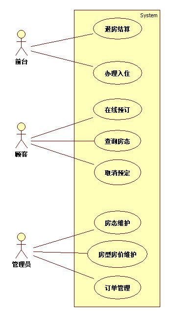
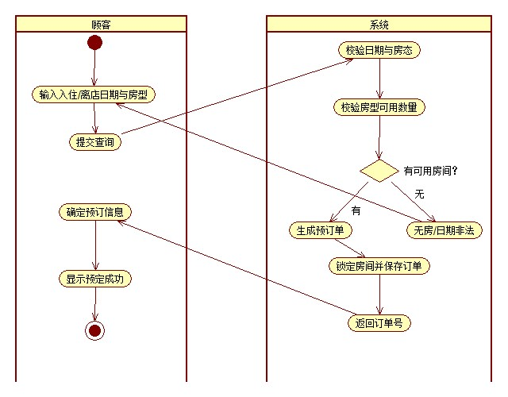

# CIM 阶段建模说明（CIM-1 系统用例图 / CIM-2 在线预订活动图）

> **文件作用**：记录成员A（A-2）完成的两张 CIM 阶段图，说明元素、关系与后续实验的对应关系；写实验4、实验7 时可直接引用本文件的文字与图。
> **课程**：CST9301 软件工程　｜　**作者**：易雨杰（成员A，2024611209）　｜　**日期**：2026-10-25
> **关联任务**：A-2（CIM-1/2）；**上游**：实验1 功能简述表；**下游**：实验2（B-1）、实验4、实验7

## 一、CIM-1 系统用例图

*图 1　CIM-1 系统用例图（系统边界：酒店订房管理子系统）*

### 1.1 参与者（3 个）

| 参与者 | 说明 |
|---|---|
| 顾客 | 查询房态、在线预订、取消预订 |
| 前台 | 办理入住、退房结算 |
| 管理员 | 房型房价维护、房态维护、订单管理 |

### 1.2 用例（8 个）

| 编号 | 用例名称 | 参与者 | 简述 |
|---|---|---|---|
| Hotel-C01 | 查询房态 | 顾客 | 按入住/离店日期与房型查询剩余房间、房价与可订状态 |
| Hotel-C02 | 在线预订 | 顾客 | 选择房型与日期提交预订，校验房态后生成订单号 |
| Hotel-C03 | 取消预订 | 顾客 | 入住前取消未入住订单，更新状态并释放房间 |
| Hotel-F01 | 办理入住 | 前台 | 核验订单与证件，登记入住并分配具体房间 |
| Hotel-F02 | 退房结算 | 前台 | 按实际入住天数核算房费与押金，生成账单并释放房间 |
| Hotel-M01 | 房型房价维护 | 管理员 | 新增/修改房型、价格与房间数量 |
| Hotel-M02 | 房态维护 | 管理员 | 更新房间状态（空闲/在住/清洁/维修） |
| Hotel-M03 | 订单管理 | 管理员 | 按日期、房型、状态查询与统计订单 |

### 1.3 关系说明

- 本图**只画参与者与用例之间的关联（无箭头实线）**，共 8 条；
- CIM-1 阶段不画 `«include»` / `«extend»` / 泛化——这些属于 CIM-3（实验2），由成员B 在总览版上细化，见 `docs/contract/对接-A2到B1.md`；
- 系统边界框把 8 个用例圈定在系统内，3 个参与者位于边界外。

## 二、CIM-2 在线预订活动图

*图 2　CIM-2 “在线预订”活动图（泳道：顾客 / 系统）*

### 2.1 泳道

| 泳道 | 承担的活动 |
|---|---|
| 顾客 | 输入条件、提交查询、确认预订、查看结果 |
| 系统 | 校验、判断、生成订单、锁定房间、返回订单号 |

### 2.2 活动节点

| 序号 | 活动 | 泳道 |
|---|---|---|
| 1 | 开始（Initial） | 顾客 |
| 2 | 输入入住/离店日期与房型 | 顾客 |
| 3 | 提交查询 | 顾客 |
| 4 | 校验日期与房态 | 系统 |
| 5 | 校验房型可用数量 | 系统 |
| 6 | 判断：有可用房间？ | 系统 |
| 7 | 生成预订单 | 系统 |
| 8 | 锁定房间并保存订单 | 系统 |
| 9 | 返回订单号 | 系统 |
| 10 | 无房/日期非法（提示） | 系统 |
| 11 | 确认预订信息 | 顾客 |
| 12 | 显示预订成功 | 顾客 |
| 13 | 结束（Final） | 顾客 |

### 2.3 控制流与分支

1. 开始 → 输入入住/离店日期与房型 → 提交查询；
2. 提交查询 → 校验日期与房态 → 校验房型可用数量 → 判断“有可用房间？”；
3. **[有可用房间]** → 生成预订单 → 锁定房间并保存订单 → 返回订单号 → 确认预订信息 → 显示预订成功 → 结束；
4. **[无可用房间]** → 提示“无房/日期非法” → 返回“输入入住/离店日期与房型”，由顾客重新输入条件。

### 2.4 范围说明

支付以线下押金与账单处理，**不接入支付网关**；活动图只描述“查询—预订”主流程与无房异常，入住/退房流程在实验4 的另一张活动图（成员B）中描述。

## 三、与后续实验的对应

| 本文件产出 | 用于 | 说明 |
|---|---|---|
| CIM-1 系统用例图 | 实验7（CIM 阶段）、实验2 的输入 | 实验2 在其基础上加 include/extend/泛化与 8 条用例叙述 |
| CIM-2 在线预订活动图 | **实验4**（A 负责的那张活动图）、实验7（CIM-2） | 一图两用，报告里注明 |
| 8 个用例编号 | 实验3 类图、后续代码 | 编号与实验1 功能简述表一致 |

## 四、待办

- [ ] 实验2 系统用例图与用例叙述（B-1，叶梅冰）——见 `docs/contract/对接-A2到B1.md`；
- [ ] 实验4 报告由 B 汇总两张活动图（A 的本图 + B 的退房活动图）；
- [ ] 实验7 大报告引用本文件文字时，按 MDA 顺序重排（CIM-1 → CIM-2 → CIM-3）。
