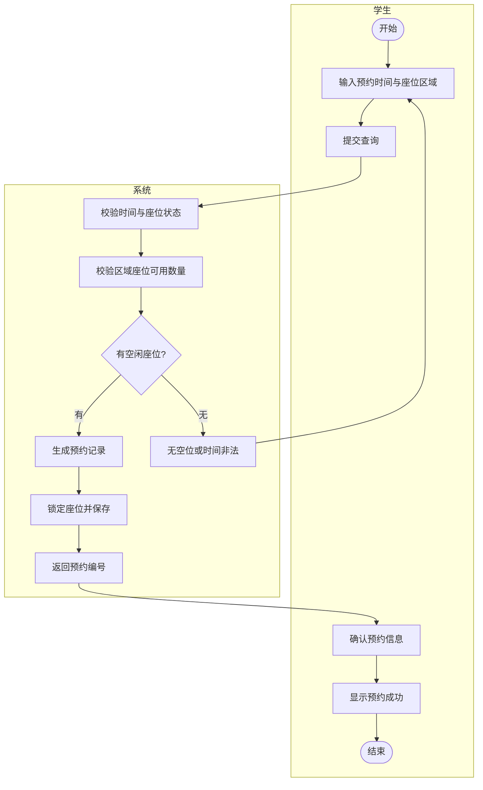

# CIM 阶段建模说明（CIM-1 系统用例图 / CIM-2 在线预约活动图）

> **文件作用**：记录成员A（A-2）完成的两张 CIM 阶段图，说明元素、关系与后续实验的对应关系；写实验4、实验7 时可直接引用本文件的文字与图。
> **课程**：CST9301 软件工程　｜　**作者**：易雨杰（成员A，2024611209）　｜　**日期**：2026-10-28
> **关联任务**：A-2（CIM-1/2）；**上游**：实验1 功能简述表；**下游**：实验2（B-1）、实验4、实验7
> **状态**：文字部分已完成，StarUML 工程与导出图待按本说明重画。

## 一、CIM-1 系统用例图

*图 1　CIM-1 系统用例图（系统边界：自习室预约管理子系统；待 A 在 StarUML 中重画后导出新图）*

> 说明：Mermaid 没有原生的用例图语法，本图保留 StarUML 导出图；元素清单见下表。

### 1.1 参与者（3 个）

| 参与者 | 说明 |
|---|---|
| 学生 | 查询座位、在线预约、取消预约 |
| 值班管理员 | 签到登记、签退结算 |
| 系统管理员 | 座位区域与费率维护、座位状态维护、预约记录管理 |

### 1.2 用例（8 个）

| 编号 | 用例名称 | 参与者 | 简述 |
|---|---|---|---|
| Study-C01 | 查询座位 | 学生 | 按日期、时间段与座位区域查询可用座位、费率与占用状态 |
| Study-C02 | 在线预约 | 学生 | 选择座位与时间段提交预约，校验可用性后生成预约号 |
| Study-C03 | 取消预约 | 学生 | 签到前取消未使用的预约，更新状态并释放座位 |
| Study-F01 | 签到登记 | 值班管理员 | 核验预约记录与学生证件，登记签到并将座位置为使用中 |
| Study-F02 | 签退结算 | 值班管理员 | 按实际使用时长核算费用与额外费用，生成签到记录并释放座位 |
| Study-M01 | 座位区域与费率维护 | 系统管理员 | 新增/修改座位区域、费率与座位数量 |
| Study-M02 | 座位状态维护 | 系统管理员 | 更新座位状态（可用/已预约/使用中/维修） |
| Study-M03 | 预约记录管理 | 系统管理员 | 按日期、区域、状态查询与统计预约记录 |

### 1.3 关系说明

- 本图只画参与者与用例之间的关联（无箭头实线），共 8 条；
- CIM-1 阶段不画 `<<include>>` / `<<extend>>` / 泛化——这些属于 CIM-3（实验2），由成员B 在总览版上细化，见 `docs/contract/对接-A2到B1.md`；
- 系统边界框把 8 个用例圈定在系统内，3 个参与者位于边界外。

## 二、CIM-2 在线预约活动图

*图 2　CIM-2 "在线预约"活动图（Mermaid 源码；泳道：学生 / 系统。Word 版使用 StarUML 导出的图片）*

### 2.1 泳道

| 泳道 | 承担的活动 |
|---|---|
| 学生 | 输入条件、提交查询、确认预约、查看结果 |
| 系统 | 校验、判断、生成预约记录、锁定座位、返回预约号 |

### 2.2 活动节点

| 序号 | 活动 | 泳道 |
|---|---|---|
| 1 | 开始（Initial） | 学生 |
| 2 | 输入日期、时间段与座位区域 | 学生 |
| 3 | 提交查询 | 学生 |
| 4 | 校验日期与时段 | 系统 |
| 5 | 校验座位可用性 | 系统 |
| 6 | 判断：有可用座位？ | 系统 |
| 7 | 生成预约记录 | 系统 |
| 8 | 锁定座位并保存预约 | 系统 |
| 9 | 返回预约号 | 系统 |
| 10 | 无座/时段非法（提示） | 系统 |
| 11 | 确认预约信息 | 学生 |
| 12 | 显示预约成功 | 学生 |
| 13 | 结束（Final） | 学生 |

### 2.3 控制流与分支

1. 开始 -> 输入日期、时间段与座位区域 -> 提交查询；
2. 提交查询 -> 校验日期与时段 -> 校验座位可用性 -> 判断"有可用座位？"；
3. **[有可用座位]** -> 生成预约记录 -> 锁定座位并保存预约 -> 返回预约号 -> 确认预约信息 -> 显示预约成功 -> 结束；
4. **[无可用座位]** -> 提示"无座/时段非法" -> 返回"输入日期、时间段与座位区域"，由学生重新输入条件。

### 2.4 范围说明

费用结算以线下签到签退形式处理，不接入支付网关；活动图只描述"查询-预约"主流程与无座异常，签到/签退流程在实验4 的另一张活动图（成员B）中描述。

## 三、与后续实验的对应

| 本文件产出 | 用于 | 说明 |
|---|---|---|
| CIM-1 系统用例图 | 实验7（CIM 阶段）、实验2 的输入 | 实验2 在其基础上加 include/extend/泛化与 8 条用例叙述 |
| CIM-2 在线预约活动图 | **实验4**（A 负责的那张活动图）、实验7（CIM-2） | 一图两用，报告里注明 |
| 8 个用例编号 | 实验3 类图、后续代码 | 编号与实验1 功能简述表一致 |

## 四、待办

- [ ] 在 StarUML 中按本说明重画 CIM-1 与 CIM-2，导出新的 JPG 覆盖旧文件；
- [ ] 实验2 系统用例图与用例叙述（B-1，叶梅冰）——见 `docs/contract/对接-A2到B1.md`；
- [ ] 实验4 报告由 B 汇总两张活动图（A 的本图 + B 的签退活动图）；
- [ ] 实验7 大报告引用本文件文字时，按 MDA 顺序重排（CIM-1 -> CIM-2 -> CIM-3）。
