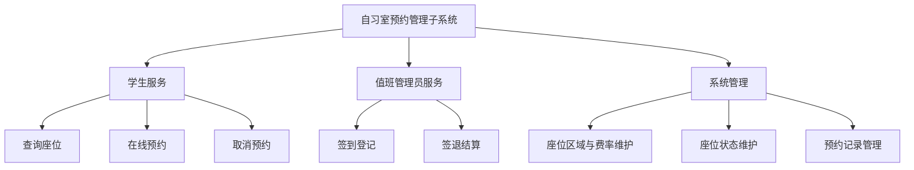

# 实验1　UML概念及UML开发工具的安装，完成自选项目的详细目标及功能简述

> **课程**：CST9301 软件工程　｜　**版本**：v2.0（2026-10-28 选题切换为自习室预约系统后重写）
> **文件作用**：实验1 报告（Markdown 版），供 GitHub 在线浏览与团队协作；Word 版为提交用的最终版。两版内容一致。
> **撰写**：易雨杰（成员A，2024611209）　｜　**评审**：叶梅冰（成员B，2024611038）

## 实验基本信息

| 项目 | 内容 |
|---|---|
| 学院 | 数学与计算机学院 |
| 系 | 计算机系 |
| 专业 | 计算机科学与技术 |
| 姓名 | 易雨杰（2024611209）、叶梅冰（2024611038） |
| 实验时间 | 2026 年 10 月 28 日 |
| 实验题目 | 实验1　UML概念及UML开发工具的安装，完成自选项目的详细目标及功能简述 |
| 成绩 | |

## 一、实验目的

1. 了解面向对象的 UML 建模方法，理解 UML 图及其特征、UML 语法。
2. 安装并配置 StarUML 开发工具。
3. 完成自选项目的详细目标叙述及功能简述。

## 二、实验要求

1. 理解基本的面向对象 UML 建模方法、UML 图及特征、UML 语法。
2. 掌握 UML 开发工具的安装。
3. 完成自选项目的详细目标及功能简述。

## 三、主要实验工具

- **StarUML 5.0（with cm）**：安装路径 `D:\StarUML`，用于本项目全部 UML 图的建模与导出。
- **Git / GitHub**：版本控制与团队协作，主干 `main`，成员A（易雨杰）使用 `dev-A`、成员B（叶梅冰）使用 `dev-B`。
- **IntelliJ IDEA + JDK 17 + Maven**：后续编码阶段使用（Maven Wrapper 已随仓库提供）。
- **Microsoft Word**：实验报告的排版与提交。

**StarUML 安装与配置记录**：按指导书要求运行 `StarUML-5.0-with-cm.exe` 完成安装；安装后右键 `StarUML.exe` ->「属性」->「兼容性」，勾选「以兼容模式运行这个程序」并选择 Windows XP (Service Pack 2)，确定，再启动工具；启动后选择 **Empty Project**，新建工程。

## 四、实验内容及实验数据记录

### （一）选题

**自习室预约管理子系统**：面向高校自习室使用场景，替代人工登记座位与预约的纸质流程，为学生提供在线的座位查询与预约入口，为值班管理员提供签到与签退结算支持，为系统管理员提供座位区域、费率与座位状态维护能力。

### （二）系统目标

1. 系统能够将座位区域、具体座位及其费率统一建档，并实时反映每个座位的当前状态。
2. 学生可以按日期、时间段与座位区域查询可用座位，并完成在线预约，生成唯一的预约记录。
3. 值班管理员可以核验预约信息办理签到，签退时自动核算使用时长费用、生成签到记录并释放座位。
4. 学生可以在签到前取消尚未使用的预约，系统同步释放座位。
5. 系统管理员可以维护座位区域、费率与座位数量，调整座位状态（可用、已预约、使用中、维修），并按条件查询与统计预约记录。
6. 系统采用本地文件持久化数据，保证关闭后数据不丢失，且无需安装数据库即可运行。

### （三）系统功能结构图

*图 3　自习室预约管理子系统功能结构图（Mermaid 源码，GitHub 直接渲染；Word 版使用同一结构导出的图片）*

### （四）功能简述表

| 功能名称 | 功能编号 | 操作者 | 功能简述 |
|---|---|---|---|
| 查询座位 | Study-C01 | 学生 | 学生按日期、时间段与座位区域查询可用座位数量、费率及占用状态 |
| 在线预约 | Study-C02 | 学生 | 学生选择座位与时间段并提交预约，系统校验可用性后生成预约号 |
| 取消预约 | Study-C03 | 学生 | 学生在签到前取消未使用的预约，系统更新预约状态并释放座位 |
| 签到登记 | Study-F01 | 值班管理员 | 值班管理员核验预约记录与学生证件，登记签到并将座位置为使用中 |
| 签退结算 | Study-F02 | 值班管理员 | 值班管理员按实际使用时长核算费用与额外费用，生成签到记录，预约完结并释放座位 |
| 座位区域与费率维护 | Study-M01 | 系统管理员 | 系统管理员新增、修改座位区域及其费率与座位数量，维护座位基础信息 |
| 座位状态维护 | Study-M02 | 系统管理员 | 系统管理员更新座位状态（可用、已预约、使用中、维修），保证座位状态与实际一致 |
| 预约记录管理 | Study-M03 | 系统管理员 | 系统管理员按日期、区域、状态查询与统计预约记录 |

> 编号规则：`Study-` + 角色首字母（C 学生 / F 值班管理员 / M 系统管理员）+ 两位序号，与后续实验的用例编号一一对应。

## 五、实验数据分析与讨论

### （一）UML 学习要点

1. UML 的定义包含两部分：**UML 语义**用元模型精确描述所有元素的语法与含义，保证不同开发者对同一模型的理解一致；**UML 表示法**规定图形符号与文本语法，是语义在应用层的可视化实例。
2. UML 的图分为结构型与行为型：结构型描述系统的静态组成（类图、对象图、包图、组件图、部署图），行为型描述系统随时间的动态行为（用例图、活动图、状态图、时序图、通信图等）。
3. 课程涉及的 9 种常用图各有分工：用例图回答"系统为谁做什么"，类图回答"系统由哪些类构成、类间是什么关系"，对象图是类图在某一时刻的快照，活动图描述业务流程与控制流，状态图描述单个对象在事件驱动下的状态迁移，时序图描述对象间按时间排列的消息交互，协作图强调对象间的结构联系，组件图与部署图描述实现与物理部署。
4. 本项目的建模主线是 MDA：CIM 阶段用**业务用例图**确定业务范围、用**活动图**梳理业务流程；PIM 阶段用**系统用例图 + 用例叙述**细化需求，用**类图**定义静态结构，用**状态图**刻画座位与预约记录的生命周期，用**时序图**描述一次预约/签到签退中的对象协作，最后按 PIM 编写代码。
5. 五张图之间是"范围-流程-结构-状态-协作"的递进关系：用例图定边界，活动图理清先后，类图定职责归属，状态图定对象行为约束，时序图定消息顺序；缺一张就会出现"有结构没行为"或"有流程没数据"的断点。
6. UML 是"语言"而不是"画图软件"：StarUML 只是把语义固化成模型元素的载体，因此建模时必须先想清楚元素语义（关联还是聚合、包含还是扩展），再考虑排版美观。

### （二）选题与功能划分思路

1. **角色划分先行**：先确定"学生、值班管理员、系统管理员"三类参与者，再围绕角色梳理功能，避免出现无归属的功能点，保证每个用例都能落到明确的参与者上。
2. **功能粒度控制**：将"预约"拆分为"查询座位-在线预约-取消预约"，将"使用周期"拆分为"签到登记-签退结算"，使每个功能都对应一次可观察的完整业务结果，便于后续实验2 用例图的展开。
3. **范围收敛**：本期只做单自习室、单币种、无支付网关的桌面系统，费用以线下签到签退结算形式处理，避免范围蔓延影响实验进度。
4. **与后续实验的衔接**：本实验的功能编号（Study-C/F/M 系列）将直接沿用为实验2 用例编号与实验3 类职责划分的依据；核心类名与接口在 `docs/contract/接口契约.md` 中先行约定，降低双人并行开发时的返工风险。

**结论**：系统目标清晰、功能边界可控，UML 的图种与 MDA 阶段对应关系已经明确，可以作为后续 CIM 业务建模与 PIM 静态结构建模的输入。

## 六、分工与评审说明

| 姓名 | 学号 | 本报告承担工作 |
|---|---|---|
| 易雨杰 | 2024611209 | 选题与系统目标、功能划分、功能结构图、StarUML 建模、报告撰写与排版 |
| 叶梅冰 | 2024611038 | 需求讨论、报告评审与修改意见、Git 分支协作 |

本报告由成员A 撰写，成员B 参与评审。

仓库：https://github.com/yyj138/Study_Room_Reservation
