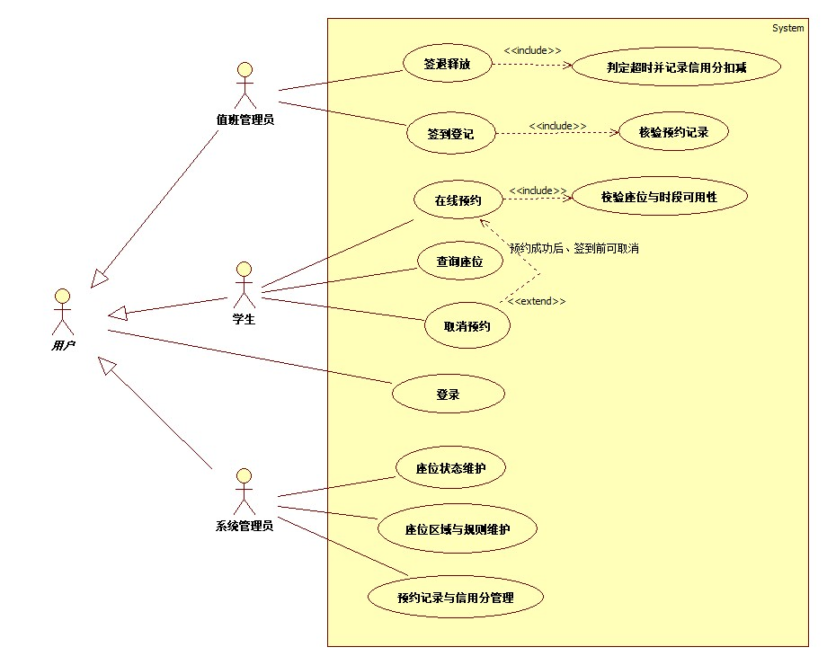

# 实验2　UML用例图及用例叙述

> **课程**：CST9301 软件工程　｜　**版本**：v2.1（2026-10-30 适配自习室预约系统）
> **文件作用**：实验2 报告（Markdown 版），供 GitHub 在线浏览与团队协作；Word 版用于提交。正文结构一致。
> **撰写**：叶梅冰（成员B，2024611038）　｜　**评审**：易雨杰（成员A，2024611209）

## 实验基本信息

| 项目 | 内容 |
|---|---|
| 学院 | 数学与计算机学院 |
| 系 | 计算机系 |
| 专业 | 计算机科学与技术 |
| 姓名 | 易雨杰（2024611209）、叶梅冰（2024611038） |
| 实验时间 | 2026 年 10 月 30 日 |
| 实验题目 | 实验2　UML用例图及用例叙述 |
| 成绩 | |

## 一、实验目的

1. 理解 UML 用例及用例图；理解参与者的概念；练习使用 StarUML 绘制出项目的系统 UML 图。
2. 理解用例图间的各种关系（包括关联关系、包含关系、扩展关系以及泛化关系）并标示出来。
3. 编写系统用例叙述。

## 二、实验要求

1. 根据 CIM-1 总览版，使用 StarUML 绘制出包含完整关系的系统用例图。
2. 补全被包含用例，画出包含、扩展与泛化关系。
3. 编写每个用例的详细叙述。

## 三、主要实验工具

- **StarUML 5.0（with cm）**：用于绘制并导出系统用例图。
- **Git / GitHub**：版本控制与团队协作，主干 `main`，成员B 在 `dev-B-exp2` 分支开发并通过 PR 合并。
- **Markdown / Microsoft Word**：实验报告的排版与提交。

## 四、实验内容及实验数据记录

### （一）系统用例图

在成员A提供的 CIM-1 系统用例总览图基础上，我进行了细化。补充了「登录」用例，并添加了 `<<include>>`、`<<extend>>` 以及参与者之间的泛化关系。

*图 1　自习室预约管理子系统用例图*

### （二）用例图关系说明

本图包含以下四类关系：
1. **关联关系（Association）**：参与者与用例之间的连线。如「学生」关联「查询座位」、「值班管理员」关联「签到登记」。
2. **泛化关系（Generalization）**：参与者之间的继承关系。图中抽离出抽象参与者「用户」，学生、值班管理员、系统管理员均泛化自「用户」，共同继承「登录」用例，避免了用例的重复。
3. **包含关系（Include）**：基用例必须执行的内部行为。如「在线预约」包含「校验座位与时段可用性」，「签到登记」包含「核验预约记录」，「签退释放」包含「判定超时并记录信用分扣减」。
4. **扩展关系（Extend）**：特定条件下才会发生的可选用例。如「取消预约」扩展自「在线预约」，扩展点为“预约成功后、签到前可取消”。

### （三）用例叙述

#### 1. 登录 (Study-U01)
| 字段 | 内容 |
| :--- | :--- |
| **用例名称** | 登录 |
| **标识符** | Study-U01 |
| **用例描述** | 用户通过账号密码进入系统，系统根据角色分配权限。 |
| **参与者** | 用户（学生、值班管理员、系统管理员） |
| **前置条件** | 系统已启动并显示登录界面。 |
| **后置条件** | 成功登录，跳转至对应角色的主界面。 |
| **基本操作流程** | 1) 用户输入账号和密码。 2) 系统校验账号密码。 3) 验证通过，系统根据角色跳转至相应面板。 |
| **可选操作流程** | 账号或密码错误，系统提示“登录失败”，要求重新输入。 |
| **被泛化的用例** | 无 |
| **被包含的用例** | 无 |
| **被扩展的用例** | 无 |

#### 2. 查询座位 (Study-C01)
| 字段 | 内容 |
| :--- | :--- |
| **用例名称** | 查询座位 |
| **标识符** | Study-C01 |
| **用例描述** | 学生按日期、时间段与座位区域查询可用座位数量及占用状态。 |
| **参与者** | 学生 |
| **前置条件** | 学生已登录系统。 |
| **后置条件** | 系统返回符合条件的可用座位列表。 |
| **基本操作流程** | 1) 学生选择查询日期、时间段及意向区域。 2) 系统查询该时间段内空闲的座位。 3) 系统展示可用座位及占用状态。 |
| **可选操作流程** | 1) 该时间段座位不可使用（已被预约、使用中或维修中），系统提示“该时段无可用座位”。 |
| **被泛化的用例** | 无 |
| **被包含的用例** | 无 |
| **被扩展的用例** | 无 |

#### 3. 在线预约 (Study-C02)
| 字段 | 内容 |
| :--- | :--- |
| **用例名称** | 在线预约 |
| **标识符** | Study-C02 |
| **用例描述** | 学生选择座位与时间段提交预约，校验信用分达标与座位可用后生成预约号。 |
| **参与者** | 学生 |
| **前置条件** | 学生已登录，且当前信用分 ≥ 80 分。 |
| **后置条件** | 系统生成预约记录，座位状态更新为“已预约”。 |
| **基本操作流程** | 1) 学生选择具体座位并点击预约。 2) 系统校验学生信用分是否达标。 3) 系统执行“校验座位与时段可用性”。 4) 学生确认预约信息并提交。 5) 系统生成唯一预约号，保存记录并将座位状态置为“已预约”。 |
| **可选操作流程** | 1) 信用分低于80，系统提示“信用分不足，禁止预约”。 2) 提交瞬间座位被他人抢约，提示“预约失败，座位已被占用”。 |
| **被泛化的用例** | 无 |
| **被包含的用例** | 校验座位与时段可用性 |
| **被扩展的用例** | 取消预约（扩展点：预约成功后、签到前可取消） |

#### 4. 取消预约 (Study-C03)
| 字段 | 内容 |
| :--- | :--- |
| **用例名称** | 取消预约 |
| **标识符** | Study-C03 |
| **用例描述** | 学生在签到前取消未使用的预约，系统更新状态并释放座位。 |
| **参与者** | 学生 |
| **前置条件** | 存在状态为“已预约”且尚未签到的记录。 |
| **后置条件** | 预约状态更新为“已取消”，系统释放该座位。 |
| **基本操作流程** | 1) 学生选择要取消的预约记录。 2) 系统校验该记录是否处于“可取消”状态。 3) 系统将预约状态改为“已取消”，并释放座位。 |
| **可选操作流程** | 1) 已超过预约的签到时间，系统提示“已过签到时间，无法取消预约”（按爽约处理）。|
| **被泛化的用例** | 无 |
| **被包含的用例** | 无 |
| **被扩展的用例** | 无（本用例扩展自“在线预约”） |

#### 5. 签到登记 (Study-F01)
| 字段 | 内容 |
| :--- | :--- |
| **用例名称** | 签到登记 |
| **标识符** | Study-F01 |
| **用例描述** | 值班管理员核验预约记录与学生证件，登记签到并将座位置为使用中。 |
| **参与者** | 值班管理员 |
| **前置条件** | 学生到达自习室，且存在有效预约。 |
| **后置条件** | 预约状态变更为“已签到”，座位状态变更为“使用中”。 |
| **基本操作流程** | 1) 值班管理员输入学生预约号。 2) 系统执行“核验预约记录”。 3) 管理员核对预约状态并登记。 4) 系统将预约状态改为“已签到”，座位状态改为“使用中”。 |
| **可选操作流程** | 1) 预约不存在或状态异常，系统提示“无有效预约信息”。 2) 学生证件不符，拒绝签到。 |
| **被泛化的用例** | 无 |
| **被包含的用例** | 核验预约记录 |
| **被扩展的用例** | 无 |

#### 6. 签退释放 (Study-F02)
| 字段 | 内容 |
| :--- | :--- |
| **用例名称** | 签退释放 |
| **标识符** | Study-F02 |
| **用例描述** | 值班管理员办理签退，系统释放座位并判定是否超时，超时则扣学生信用分。 |
| **参与者** | 值班管理员 |
| **前置条件** | 预约状态为“已签到”（座位处于使用中）。 |
| **后置条件** | 座位状态变更为“可用”，系统记录信用分变动。 |
| **基本操作流程** | 1) 值班管理员输入要签退的座位号或预约号。 2) 系统执行“判定超时并记录信用分扣减”。 3) 系统将预约状态更新为“已签退”，并将座位状态更新为“可用”。 |
| **可选操作流程** | 1) 输入错误的座位号或预约号，系统提示“未找到有效签退信息”。 |
| **被泛化的用例** | 无 |
| **被包含的用例** | 判定超时并记录信用分扣减 |
| **被扩展的用例** | 无 |

#### 7. 座位区域与规则维护 (Study-M01)
| 字段 | 内容 |
| :--- | :--- |
| **用例名称** | 座位区域与规则维护 |
| **标识符** | Study-M01 |
| **用例描述** | 系统管理员新增/修改座位区域、座位数量，维护信用分规则参数。 |
| **参与者** | 系统管理员 |
| **前置条件** | 系统管理员已登录。 |
| **后置条件** | 系统保存新的区域信息或规则参数。 |
| **基本操作流程** | 1) 管理员选择“区域与规则管理”。 2) 管理员新增区域或修改座位数量，设置信用分规则（如初始100，爽约扣5，超时扣1，禁约阈值80）。 3) 系统更新数据并提示成功。 |
| **可选操作流程** | 1) 输入的数量或规则参数非法（如负数），系统拒绝保存并提示。 |
| **被泛化的用例** | 无 |
| **被包含的用例** | 无 |
| **被扩展的用例** | 无 |

#### 8. 座位状态维护 (Study-M02)
| 字段 | 内容 |
| :--- | :--- |
| **用例名称** | 座位状态维护 |
| **标识符** | Study-M02 |
| **用例描述** | 系统管理员更新座位状态（可用、已预约、使用中、维修），保证座位状态与实际一致。 |
| **参与者** | 系统管理员 |
| **前置条件** | 系统管理员已登录。 |
| **后置条件** | 座位状态被手动更新。 |
| **基本操作流程** | 1) 管理员查看座位列表。 2) 选择需要更改状态的座位。 3) 提交修改，系统更新并刷新界面。 |
| **可选操作流程** | 1) 若座位处于“使用中”状态，禁止直接改为“可用”，提示“请先办理签退”。 2) 若发生损坏，管理员可将其改为“维修”。 |
| **被泛化的用例** | 无 |
| **被包含的用例** | 无 |
| **被扩展的用例** | 无 |

#### 9. 预约记录与信用分管理 (Study-M03)
| 字段 | 内容 |
| :--- | :--- |
| **用例名称** | 预约记录与信用分管理 |
| **标识符** | Study-M03 |
| **用例描述** | 按日期、区域、状态查询与统计预约记录，查看学生信用分变动情况。 |
| **参与者** | 系统管理员 |
| **前置条件** | 系统管理员已登录。 |
| **后置条件** | 系统展示符合条件的预约记录及信用分流水。 |
| **基本操作流程** | 1) 管理员进入管理页面。 2) 输入查询条件（日期、区域、状态）。 3) 系统查询并展示结果及信用分变动记录。 |
| **可选操作流程** | 1) 没有符合条件的记录，显示空白并提示。 |
| **被泛化的用例** | 无 |
| **被包含的用例** | 无 |
| **被扩展的用例** | 无 |

#### 10. 被包含用例：校验座位与时段可用性 (Study-I01)
| 字段 | 内容 |
| :--- | :--- |
| **用例名称** | 校验座位与时段可用性 |
| **标识符** | Study-I01 |
| **用例描述** | 系统内部校验学生提交的预约请求是否满足座位可用条件。 |
| **参与者** | 无（系统内部调用） |
| **前置条件** | 学生触发预约操作。 |
| **后置条件** | 返回校验结果。 |
| **基本操作流程** | 1) 接收预约请求。 2) 检查座位是否处于“可用”状态。 3) 检查时间段是否冲突。 |
| **可选操作流程** | 1) 座位非空闲或时段冲突，返回“校验失败”。 |
| **被泛化的用例** | 无 |
| **被包含的用例** | 无 |
| **被扩展的用例** | 无 |

#### 11. 被包含用例：核验预约记录 (Study-I02)
| 字段 | 内容 |
| :--- | :--- |
| **用例名称** | 核验预约记录 |
| **标识符** | Study-I02 |
| **用例描述** | 系统内部核验值班管理员输入的预约号是否有效。 |
| **参与者** | 无（系统内部调用） |
| **前置条件** | 值班管理员触发签到操作。 |
| **后置条件** | 返回预约信息及校验结果。 |
| **基本操作流程** | 1) 读取预约信息。 2) 校验预约状态是否为“已预约”。 3) 返回校验结果。 |
| **可选操作流程** | 1) 预约不存在或状态不是“已预约”，返回“无效预约”。 |
| **被泛化的用例** | 无 |
| **被包含的用例** | 无 |
| **被扩展的用例** | 无 |

#### 12. 被包含用例：判定超时并记录信用分扣减 (Study-I03)
| 字段 | 内容 |
| :--- | :--- |
| **用例名称** | 判定超时并记录信用分扣减 |
| **标识符** | Study-I03 |
| **用例描述** | 系统内部判定学生是否超时未签退，并按规则扣减信用分。 |
| **参与者** | 无（系统内部调用） |
| **前置条件** | 值班管理员触发签退操作。 |
| **后置条件** | 扣减该学生信用分（若超时），并记录变动日志。 |
| **基本操作流程** | 1) 读取签退时间与预约时间。 2) 计算是否超时。 3) 若超时，扣减1分，并记录信用分变动日志。 |
| **可选操作流程** | 1) 数据缺失，返回错误信息。 |
| **被泛化的用例** | 无 |
| **被包含的用例** | 无 |
| **被扩展的用例** | 无 |

## 五、实验数据分析与讨论

### （一）CIM-1 总览版如何细化为本图
在成员A完成的 CIM-1 总览版中，系统用例图仅展示了参与者与 8 个核心用例之间的“关联关系”。在本实验（CIM-3 细化阶段）中，我进行了三个维度的结构化推导：
1. **辨析并细化包含关系（Include）**：在细化时，我重点区分了“查询座位”与“校验座位与时段可用性”这两个极易混淆的用例。“查询座位”是面向学生展示列表的独立主用例；而“校验座位”面向系统内部，用于在点击提交时防止并发抢座与时段冲突。将其作为“在线预约”的 `<<include>>` 被包含用例，体现了“单一职责”与“强制依赖”的设计原则。
2. **处理可选分支，补充扩展关系（Extend）**：将仅在特定条件下发生的“取消预约”设计为扩展用例。通过显式标注“预约成功后、签到前可取消”的扩展点，清晰界定了主流程与备选流。
3. **消除重复关联，补充泛化关系（Generalization）**：为了避免“学生、值班管理员、系统管理员”都去重复连接“登录”用例，本图抽象出一个父级参与者“用户”。三个子角色通过泛化关系继承了登录功能，极大提升了模型的可维护性。

### （二）业务逻辑漏洞的排查与契约对齐
在撰写用例叙述的过程中，我对系统内部的业务流转进行了深度推演。其中最具代表性的是对“签退释放与信用分扣减”的分析：
1. **问题发现**：初步构思时，直觉是签退只需将座位释放即可。但在复核《接口契约 v0.4》时发现，系统采用了**信用分机制**来约束违约行为。
2. **逻辑修正**：结合业务规则，在用例叙述中强制规定：签退释放用例必须 `<<include>>` “判定超时并记录信用分扣减”。如果学生超时未签退，系统必须自动判定并扣 1 分；若是爽约未签到，则另按规则扣 5 分；低于 80 分则在前置条件中拦截其预约操作。
3. **意外情况处理**：若座位在签退或使用中发现损坏，系统管理员在“座位状态维护”中可将其转为“维修”状态，防止系统将其分配给新学生。
4. **分析结论**：这一推敲过程确保了前端界面与后端实体类（Seat, Reservation, Student）的状态流转能够完美闭环，消除了后续开发中极大概率会出现的“状态不一致”或“信用分乱扣”的 Bug。

## 六、分工与评审说明

| 姓名 | 学号 | 本报告承担工作 |
|---|---|---|
| 易雨杰 | 2024611209 | 提供 CIM-1 总览图、接口契约设计，实验2的 PR 评审 |
| 叶梅冰 | 2024611038 | 细化系统用例图（补充 include/extend/泛化）、撰写全部用例叙述、本报告排版 |

本报告由成员B 叶梅冰主笔撰写，成员A 易雨杰参与评审。

> **图 2（提交前补入）**：成员A、成员B 在 GitHub 上针对实验2 PR 互相 Review 并合并的截图，用于佐证团队协作过程。

## 七、参考资料

1. CST9301《软件工程实验指导书》（2024）实验二。
2. 《UML 基础教程》。
3. A 同学编写的《对接-A2到B1》说明与《接口契约 v0.4》。