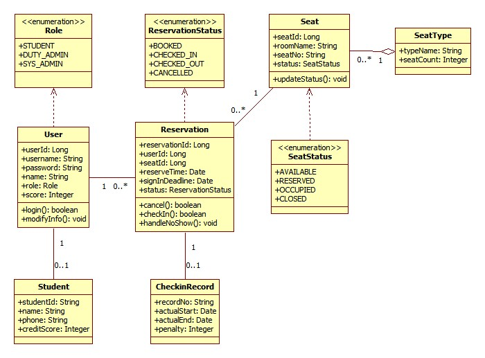

# 实验3　UML 类图

> **课程**：CST9301 软件工程　｜　**版本**：v1.1（2026-11-03 按 StarUML 5.0 手画版类图对齐）
> **文件作用**：实验3 报告（Markdown 版），供 GitHub 在线浏览与团队协作；Word 版为提交用的最终版。两版内容一致。
> **撰写**：易雨杰（成员A，2024611209）　｜　**评审**：叶梅冰（成员B，2024611038）

## 实验基本信息

| 项目 | 内容 |
|---|---|
| 学院 | 数学与计算机学院 |
| 系 | 计算机系 |
| 专业 | 计算机科学与技术 |
| 姓名 | 易雨杰（2024611209）、叶梅冰（2024611038） |
| 实验时间 | 2026 年 11 月 3 日 |
| 实验题目 | 实验3　UML 类图 |
| 成绩 | |

## 一、实验目的

1. 掌握从业务需求与系统功能中识别类与对象的方法，理解名词法提取候选类的完整过程。
2. 掌握类的属性、操作的定义方式，以及职责分配的基本原则。
3. 掌握类间关联、聚合、依赖关系的表达，能在 StarUML 中绘制完整类图并导出。
4. 形成与接口契约一致的系统静态结构，为后续状态图、时序图与编码提供依据。

## 二、实验要求

1. 分析系统业务流程与系统功能，定义系统的初步静态结构，找出重要的类和对象。
2. 使用 StarUML 建模工具绘制类图，并描述和建立类间关系。
3. 为每个类补充分析文档（类字典），说明职责、属性、操作与关联。
4. 提交实验报告。

## 三、主要实验工具

- **StarUML 5.0（with cm）**：安装路径 `D:\StarUML`，用于本项目全部 UML 图的建模与导出，启动前需设置 Windows XP (Service Pack 2) 兼容模式。
- **Git / GitHub**：版本控制与团队协作，主干 `main`，成员A（易雨杰）使用 `dev-A`，成员B（叶梅冰）使用 `dev-B-new`。
- **IntelliJ IDEA + JDK 17 + Maven**：后续编码阶段使用（Maven Wrapper 已随仓库提供）。
- **接口契约 v0.5**（`docs/contract/接口契约.md`）：本实验的业务字段、枚举取值、关键方法签名以契约为准，类图不另造名词。

## 四、实验内容及实验数据记录

### （一）名词法提取候选类

按指导书的建模步骤，先从需求文本中提取名词，再逐层筛选。

**第一步：从需求中找出名词（候选对象）**

自习室、座位、座位号、座位区域、座位类型、学生、学号、手机号、预约、预约记录、预约号、预约时间、签到截止时间、签到、签退、签到记录、实际开始时间、实际结束时间、信用分、罚分、违约、值班管理员、系统管理员、用户、账号、用户名、密码、角色。

**第二步：合并含义相同的名词，排除范围以外的名词**

| 处理方式 | 名词 | 说明 |
|---|---|---|
| 合并 | 预约 / 预约记录 / 预约号 | 统一为「预约」这一对象，预约编号是它的标识属性 |
| 合并 | 签到记录 / 签退记录 | 统一为「签到签退记录」，同一次使用只产生一条 |
| 合并 | 座位区域 / 座位类型 | 统一为「座位类型」，类型名称即分类名称 |
| 合并 | 违约 / 罚分 / 信用分扣减 | 都是信用分机制的表现，归入「信用分」属性与罚分字段 |
| 排除 | 自习室 | 是整个系统本身，不是系统内的对象 |
| 排除 | 值班管理员 / 系统管理员 | 不作为独立类，由「用户」对象的角色属性区分 |

**第三步：去掉只能作为类属性的名词**

日期、座位号、学号、手机号、用户名、密码、信用分、罚分、签到截止时间——这些都依附于某个对象存在，作为属性保留，不单独成类。

**第四步：剩下的名词就是分析类**

用户、学生、座位类型、座位、预约、签到签退记录，共 6 个业务类；角色、座位状态、预约状态作为 3 个枚举。

### （二）类的属性

属性来源分三类：业务直接给出的字段（如座位号、学号）、状态类属性（如座位状态、预约状态）、关联类属性（如预约中的用户与座位引用）。

| 类 | 属性 | 类型 | 说明 |
|---|---|---|---|
| User | userId | Long | 用户唯一编号 |
| User | username | String | 登录名 |
| User | password | String | 登录密码 |
| User | name | String | 用户姓名 |
| User | role | Role | 角色，取值为枚举 |
| User | score | Integer | 信用分，学生角色使用，初始 100 |
| Student | studentId | String | 学号，唯一标识 |
| Student | name | String | 学生姓名 |
| Student | phone | String | 联系电话 |
| Student | creditScore | Integer | 信用分，爽约扣 5、超时扣 1、低于 80 禁约 |
| SeatType | typeName | String | 区域名称，如「单人自习区」 |
| SeatType | seatCount | Integer | 该类型座位总数 |
| Seat | seatId | Long | 座位唯一编号 |
| Seat | roomName | String | 所在房间名称 |
| Seat | seatNo | String | 座位号，唯一标识 |
| Seat | status | SeatStatus | 座位状态，取值为枚举 |
| Reservation | reservationId | Long | 预约唯一编号 |
| Reservation | userId | Long | 预约人编号 |
| Reservation | seatId | Long | 预约座位编号 |
| Reservation | reserveTime | Date | 预约时间 |
| Reservation | signInDeadline | Date | 签到截止时间（预约开始 + 15 分钟） |
| Reservation | status | ReservationStatus | 预约状态，取值为枚举 |
| CheckinRecord | recordNo | String | 记录号，唯一标识 |
| CheckinRecord | actualStart | Date | 实际签到时间 |
| CheckinRecord | actualEnd | Date | 实际签退时间 |
| CheckinRecord | penalty | Integer | 本次扣减信用分，无扣分为 0 |

**状态与枚举补充**（对应指导书「补充该类动态属性，如状态」）：

| 枚举 | 取值 | 含义 |
|---|---|---|
| Role | STUDENT / DUTY_ADMIN / SYS_ADMIN | 学生 / 值班管理员 / 系统管理员 |
| SeatStatus | AVAILABLE / RESERVED / OCCUPIED / CLOSED | 可用 / 已预约 / 使用中 / 维修关闭 |
| ReservationStatus | BOOKED / CHECKED_IN / CHECKED_OUT / CANCELLED | 已预约 / 已签到 / 已签退 / 已取消 |

### （三）类的操作与职责分配

按指导书「从动词、功能或系统责任中寻找操作，再合并筛选、合理分配」，把动词归到职责最贴近的类上。本类图以业务实体为主，把与自身状态直接相关的方法放在实体类上；跨实体的业务编排（如列表查询、多对象事务）在后续 Service 层实现，不在本图展开。

| 类 | 操作 | 说明 |
|---|---|---|
| User | login(): boolean | 校验用户名密码，返回是否登录成功 |
| User | modifyInfo(): void | 修改本人资料 |
| Seat | updateStatus(): void | 更新座位状态 |
| Reservation | cancel(): boolean | 主动取消预约，释放座位 |
| Reservation | checkIn(): boolean | 学生签到，置为已签到 |
| Reservation | handleNoShow(): void | 超时未签到由系统判定爽约，自动取消、释放座位、扣 5 分（契约 v0.5 新增） |

> 说明：`handleNoShow` 是接口契约 v0.5 相对 v0.4 的关键补充。如果只靠学生点取消或管理员点签退，学生既不签到也不取消时座位会被永久占用，因此必须有一个独立的爽约判定入口。

### （四）类间关系

本图共 6 条业务关系 + 3 条枚举依赖，如下：

| 关系 | 两端 | 多重性 | 说明 |
|---|---|---|---|
| 聚合（空心菱形） | SeatType → Seat | 1 : 0..* | 一种座位类型包含 0 或多个座位；座位删除不影响类型 |
| 关联 | User → Reservation | 1 : 0..* | 一个用户可以有 0 或多条预约；一条预约只属于一个用户 |
| 关联 | Seat → Reservation | 1 : 0..* | 一个座位在不同时段可被多次预约；一条预约对应一个座位 |
| 关联 | User → Student | 1 : 0..1 | 学生角色的登录账户对应一份学生档案；管理员账户无学生档案 |
| 关联 | Reservation → CheckinRecord | 1 : 0..1 | 只有完成签到的预约才有签到签退记录 |
| 依赖（虚线） | User → Role | — | User 的 role 属性引用 Role 枚举 |
| 依赖（虚线） | Seat → SeatStatus | — | Seat 的 status 属性引用 SeatStatus 枚举 |
| 依赖（虚线） | Reservation → ReservationStatus | — | Reservation 的 status 属性引用 ReservationStatus 枚举 |

> 关于泛化：用例图中「学生／值班管理员／系统管理员」泛化到抽象参与者「用户」，这是参与者层次；在类图中三者合并为 `User` 类，用 `Role` 枚举区分权限，因此类图不出现类之间的泛化箭头。这是本次建模相对用例图的一个有意简化。

### （五）类图

本图在 StarUML 5.0 中按上述 6 个业务类、3 个枚举、5 条关联（含 1 条聚合）、3 条依赖建模，工程文件为 `docs/uml/实验3_总类图.uml`，导出的图片为 `docs/assets/实验3_总类图.jpg`。

图3-1 自习室预约管理子系统总类图

**图例说明**：黄色矩形为类，顶部带 `<<enumeration>>` 标签的为枚举；实线为关联，空心菱形为聚合（贴在整体端），虚线箭头为依赖；线上数字为多重性。

### （六）类字典

按指导书「补充每个类的分析文档」的要求，逐类说明。

#### 1. User（用户账户）

- **职责**：保存系统登录账户，区分三种角色，承载登录与资料修改。
- **属性**：userId、username、password、name、role、score。
- **操作**：`login()` 校验用户名密码；`modifyInfo()` 修改本人资料。
- **关联**：与 Reservation 为 1 : 0..*；与 Student 为 1 : 0..1；依赖 Role 枚举。
- **支撑用例**：Study-U01 登录、Study-C02 在线预约、Study-C03 取消预约。

#### 2. Student（学生档案）

- **职责**：保存学生基本信息与信用分，是信用分扣分与禁约判定的落点。
- **属性**：studentId、name、phone、creditScore。
- **操作**：本类不绑方法，信用分校验在预约流程中由系统读取 creditScore 完成。
- **关联**：与 User 为 0..1 : 1。
- **支撑用例**：Study-C02 在线预约（信用分校验）、Study-M03 预约记录与信用分管理。

#### 3. SeatType（座位类型）

- **职责**：描述一类座位及其规模，是 M01 维护规则时的操作对象。
- **属性**：typeName、seatCount。
- **操作**：无业务操作。
- **关联**：与 Seat 为聚合 1 : 0..*，空心菱形在 SeatType 端。
- **支撑用例**：Study-M01 座位区域与规则维护、Study-C01 查询座位（按类型筛选）。

#### 4. Seat（座位）

- **职责**：保存单个座位的编号、所在房间、类型与状态。
- **属性**：seatId、roomName、seatNo、status。
- **操作**：`updateStatus()` 更新座位状态。
- **关联**：与 SeatType 为 0..* : 1 聚合；与 Reservation 为 1 : 0..*；依赖 SeatStatus 枚举。
- **状态流转**：AVAILABLE → RESERVED（预约成功）→ OCCUPIED（签到）→ AVAILABLE（签退释放）；任意状态 → CLOSED（转维修）；OCCUPIED 不得直接改为 AVAILABLE，必须先签退（契约 v0.5 约束）。
- **支撑用例**：Study-C01、Study-C02、Study-F01、Study-F02、Study-M02。

#### 5. Reservation（预约记录）

- **职责**：保存一次预约的用户、座位、时段、签到截止时间与状态。
- **属性**：reservationId、userId、seatId、reserveTime、signInDeadline、status。
- **操作**：`cancel()` 主动取消；`checkIn()` 签到；`handleNoShow()` 超时未签到由系统自动取消并扣分。
- **关联**：与 User 为 0..* : 1；与 Seat 为 0..* : 1；与 CheckinRecord 为 1 : 0..1；依赖 ReservationStatus 枚举。
- **状态流转**：BOOKED → CHECKED_IN（签到）→ CHECKED_OUT（签退）；BOOKED → CANCELLED（取消或爽约）。
- **支撑用例**：Study-C02、Study-C03、Study-F01、Study-F02、Study-M03。

#### 6. CheckinRecord（签到签退记录）

- **职责**：保存一次实际使用的起止时间与本次扣分，作为信用分变动的凭据。
- **属性**：recordNo、actualStart、actualEnd、penalty。
- **操作**：无业务操作。
- **关联**：与 Reservation 为 0..1 : 1。
- **支撑用例**：Study-F01、Study-F02、Study-M03。

#### 7. Role / SeatStatus / ReservationStatus（枚举）

- **职责**：替代大量布尔属性，把状态取值固定下来，防止出现非法状态字符串。
- **取值**：见（二）状态与枚举补充。
- **说明**：持久化时按英文常量名写入 CSV，与契约第八节一致。

### （七）实验2 十二个用例到类的映射

| 用例编号 | 用例名称 | 主要承载类 |
|---|---|---|
| Study-U01 | 登录 | User、Role |
| Study-C01 | 查询座位 | Seat、SeatType、SeatStatus |
| Study-C02 | 在线预约 | User、Student、Reservation、Seat |
| Study-C03 | 取消预约 | Reservation.cancel、Seat.status |
| Study-F01 | 签到登记 | Reservation.checkIn、Seat.status、CheckinRecord |
| Study-F02 | 签退释放 | Reservation、Seat.status、CheckinRecord |
| Study-M01 | 座位区域与规则维护 | SeatType、Seat |
| Study-M02 | 座位状态维护 | Seat.updateStatus、SeatStatus |
| Study-M03 | 预约记录与信用分管理 | Reservation、Student.creditScore、CheckinRecord.penalty |
| Study-I01 | 校验座位与时段可用性 | Seat.status、Reservation |
| Study-I02 | 核验预约记录 | Reservation.status、ReservationId |
| Study-I03 | 判定超时并记录信用分扣减 | Reservation.handleNoShow、CheckinRecord.penalty |

> 说明：用例中的跨对象业务编排（如「列出某时段全部可用座位」「扫描全部超时未签到预约」）在本类图中体现为相关实体的协作；具体服务类（ReservationService / SeatService / AuthService）与 DAO 层将在 A-5、A-6 编码阶段补出，不在本业务类图展开，避免分析阶段过早引入技术分层。

## 五、实验数据分析与讨论

### （一）从用例图到类图的推导

用例图回答「谁做什么」，类图回答「用什么做」。本实验的推导路径有三条：

1. **参与者收敛为类**：用例图里的四个参与者（学生、值班管理员、系统管理员、抽象用户）在类图中收敛为 `User` 一个类加 `Role` 枚举。三个角色的差别只是权限，用枚举表达比建三个类更省，也避免出现只有 role 字段不同的重复类。
2. **用例动词分配到类**：把「取消」「签到」「爽约判定」这些与预约自身状态强相关的动词放在 `Reservation` 上；把「更新状态」放在 `Seat` 上；把「登录」「改资料」放在 `User` 上。跨对象编排（如扫描全部超时预约）以方法形式 `handleNoShow` 挂在预约类上，后续再抽服务类。
3. **被包含用例落到方法内部**：用例图中的三个被包含用例（校验座位与时段可用性、核验预约记录、判定超时并扣分）在类图中不是独立的类，而是预约/座位相关方法内部的一段校验逻辑。这与 include 关系的语义一致——被包含用例是被调用方，在代码里就是一段被复用的方法体。

### （二）信用分机制的类图落点

契约 v0.5 引入信用分后，类图上有三处必须同时对齐：

1. **分存在哪里**：`User.score` 与 `Student.creditScore`。前者是账户级展示，后者是学生档案的权威值，学生预约时以 Student.creditScore 为准。
2. **扣多少由谁决定**：爽约扣 5、超时扣 1、低于 80 禁约、签到宽限 15 分钟——这些参数在 M01 维护用例中集中配置，类图上不单独建配置类，避免分析阶段过度设计；编码阶段再抽到常量类。
3. **爽约由谁触发**：`Reservation.handleNoShow()`。这是本实验相对 v0.4 的关键补充——如果只靠学生点「取消」或管理员点「签退」，学生既不签到也不取消时座位会被永久占用，所以必须有一个独立判定入口。

### （三）分析类图与设计类图的边界

本类图刻意只画业务实体与枚举，没有画 Service、DAO、Factory 这些技术分层类。理由是：

- 实验3 的指导书要求是「从业务与功能中找出重要的类和对象」，重点是业务静态结构；
- Service/DAO 属于设计阶段的技术决策，过早画进类图会把分析产物和设计产物混在一起；
- 后续 A-5（实体与 DAO）、A-6（Service 业务逻辑）会在编码阶段补出这些类，届时再画设计类图或时序图。

这是一种「分析类图先瘦、设计类图再补」的分层做法，与课程指导书从 CIM 到 PIM 的演进路径一致。

### （四）与契约的一致性核对

类图中的 6 个业务类、3 个枚举，其属性名、关键方法名（`cancel` / `checkIn` / `handleNoShow` / `updateStatus` / `login` / `modifyInfo`）、枚举取值，逐项对照 `docs/contract/接口契约.md` v0.5，未发现不一致。特别是 `handleNoShow` 与 `SeatStatus.OCCUPIED` 不可直接改 AVAILABLE 的状态约束，均已体现在类图与方法说明中。

## 六、分工与评审说明

| 姓名 | 学号 | 本报告承担工作 |
|---|---|---|
| 易雨杰 | 2024611209 | 名词法分析、类的属性与操作设计、类图在 StarUML 中手画、类字典撰写、报告排版 |
| 叶梅冰 | 2024611038 | 需求复核、类图与类字典评审、与接口契约的一致性检查 |

本报告由成员A 易雨杰主笔撰写，成员B 叶梅冰参与评审。

仓库：https://github.com/STU-team/Study_Room_Reservation
