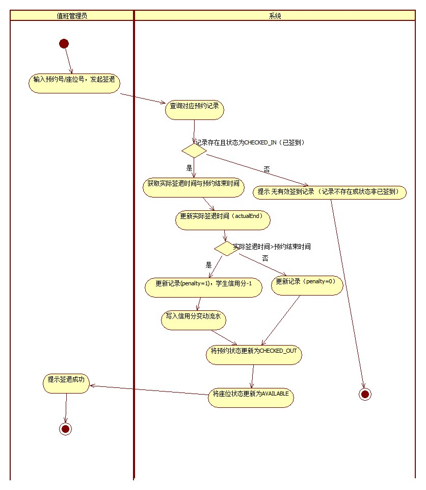

# 实验4　UML 活动图

> **课程**：CST9301 软件工程　｜　**版本**：v1.0
> **文件作用**：实验4 报告（Markdown 版），供 GitHub 在线浏览与团队协作；Word 版为提交用的最终版。两版内容一致。
> **撰写**：叶梅冰（成员B，2024611038）　｜　**评审**：易雨杰（成员A，2024611209）

## 实验基本信息

| 项目 | 内容 |
|---|---|
| 学院 | 数学与计算机学院 |
| 系 | 计算机系 |
| 专业 | 计算机科学与技术 |
| 姓名 | 易雨杰（2024611209）、叶梅冰（2024611038） |
| 实验时间 | 2026 年 11 月 5 日 |
| 实验题目 | 实验4　UML 活动图 |
| 成绩 | |

## 一、实验目的

1. 理解UML活动图（Activity Diagram）的基本概念，掌握其在系统动态建模中的作用。
2. 掌握活动图中初始节点、活动终点、动作状态（ActionState）、分支（Decision）、泳道（Swimlane）等核心元素的画法。
3. 能够根据系统业务流程与用例叙述，使用 StarUML 绘制出逻辑严谨、符合规范的活动图。

## 二、实验要求

1. 通过分析系统业务流程及系统用例的活动过程，使用 StarUML 绘制 UML 活动图。
2. 结合实验2的用例叙述与实验3的类图，确保活动图中的动作节点、状态变更与数据流转保持一致。
3. 提交实验报告。

## 三、主要实验工具

- **StarUML 5.0（with cm）**：用于绘制并导出系统活动图。
- **Git / GitHub**：版本控制与团队协作，主干 `main`，成员A（易雨杰）使用 `dev-A`，成员B（叶梅冰）使用 `dev-B-new`。
- **接口契约 v0.6**（`docs/contract/接口契约.md`）：本实验的判定条件、状态枚举及动作命名以契约为准。

## 四、实验内容及实验数据记录

### （一）活动图概述

1. **活动图与交互图的区别**：交互图（如时序图）强调的是对象到对象的控制流；而活动图强调的是**从活动到活动的控制流**，是表述过程基理、业务过程以及工作流的技术。
2. **活动图的主要元素**：
   - **初始节点和活动终点**：实心圆表示初始节点，圆圈内加一个实心圆表示活动终点。
   - **活动节点**：表示一个具体的活动（在 StarUML 中使用 ActionState）。
   - **转换**：用一条带箭头的直线表示，表示活动结束时控制流马上传递给下一个节点。
   - **分支与监护条件**：用菱形表示分支，每个离开转换上都有一个监护条件，用来表示满足什么条件时执行该转换。
3. **建模策略**：绘制时首先决定是否采用泳道（根据是否要体现活动的不同实施者）；然后尽量使用分支描述控制流；核心是**表示出控制流**，其他元素均为补充。

### （二）活动图建模对象选择

本实验选择 **「Study-F02 签退释放」** 这一核心用例进行活动图建模。该流程涉及值班管理员的交互操作、系统的内部校验、超时判定、信用分扣减以及多对象状态（预约记录、座位）的联动更新，是系统中最具代表性的业务控制流之一。

### （三）活动图元素与泳道划分

根据实验指导书的要求，本图采用了以下建模元素：

1. **泳道（Swimlane）**：划分为「值班管理员」和「系统」两个垂直泳道，清晰界定人机交互边界。
2. **动作状态（ActionState）**：使用 StarUML 的 ActionState 表示具体的业务动作（如“查询对应预约记录”）。
3. **分支与监护条件（Decision）**：使用菱形表示分支，并在流出的箭头上标注监护条件（如 `记录存在且状态为CHECKED_IN`）。
4. **初始与结束节点**：使用实心圆表示初始节点；报错分支与正常结束分支各自指向独立的结束节点（FinalState），保证流程闭环。

### （四）StarUML 绘制步骤

1. 打开 StarUML 5.0，在 Model Explorer 中新建 `ActivityDiagram`。
2. 从左侧工具栏拖拽 `Swimlane(Vertical)` 到工作区，建立“值班管理员”和“系统”两个泳道。
3. 选中 `InitialState`（初始节点）放入泳道。
4. 选中 `ActionState` 图标，在工作窗口合适位置点击放置动作节点，并调节合适大小，输入业务动作名称。
5. 使用 `Decision` 放置菱形分支节点，使用 `Transition` 绘制带箭头的直线连接各节点，并标注监护条件。
6. 最后放置 `FinalState`（活动终点），完成流程闭环。

### （五）业务控制流详细说明

1. **发起签退**：值班管理员在系统前台输入预约号或座位号，发起签退请求。
2. **有效性校验**：系统查询对应记录，判断 `记录是否存在且状态为 CHECKED_IN(已签到)`。若校验失败（未签到/爽约/已签退等），系统提示“无有效签到记录”并直接结束流程。
3. **超时判定与信用分扣减**：
   - 校验通过后，系统获取实际签退时间（actualEnd）与预约结束时间（endTime）。
   - 判断是否超时（`actualEnd > endTime`）。
   - **若超时（是）**：更新签到记录 `penalty=1`，学生信用分 `-1`，并写入信用分变动流水。
   - **若未超时（否）**：更新签到记录 `penalty=0`。
4. **状态更新**：两条分支汇合后，系统将预约状态更新为 `CHECKED_OUT`，接着将座位状态更新为 `AVAILABLE`。
5. **完成**：系统提示“签退成功”，流程走向结束节点。

### （六）活动图

本图在 StarUML 5.0 中绘制，工程文件为 `docs/uml/实验4_签退活动图.uml`，导出的图片为 `docs/assets/实验4_签退活动图.jpg`。

图4-1 签退活动图（Study-F02）

## 五、实验数据分析与讨论

### （一）活动图与类图、用例叙述的一致性

在绘制本图时，严格遵守了实验3类图定义的静态结构和实验2的用例叙述：

1. **状态枚举直接引用**：判定条件使用了 `CHECKED_IN`，最终状态更新使用了 `CHECKED_OUT` 和 `AVAILABLE`，与 `ReservationStatus` 和 `SeatStatus` 枚举完全对应。
2. **数据字段精准对应**：动作节点中使用的 `actualEnd`、`penalty` 直接来源于 `CheckinRecord` 类的属性定义。
3. **业务规则的落地**：实验3讨论中提到“签退超时扣1分并写流水”，在本活动图中通过两个顺序的动作节点（“学生信用分-1”和“写入信用分变动流水”）精确表达。

### （二）异常分支处理的合理性

在系统设计中，异常流（Exception Flow）的处理至关重要。本图在初始校验阶段（记录存在且状态为 CHECKED_IN）设计了一个否分支：当管理员输入错误号码或针对已签退的记录操作时，系统立即中断主流程，提示错误并指向独立的结束节点。这有效避免了“无效操作导致座位被错误释放”的 Bug，体现了业务流程的严谨性。

### （三）动作粒度的取舍

本图在“系统”泳道中，将“扣除信用分”与“写入流水”拆分为两个动作节点，是为了体现类图中 `Student.creditScore` 与 `CreditScoreLog` 两个实体的联动；而将“更新预约状态”与“更新座位状态”分离，则体现了 `Reservation` 和 `Seat` 对象的生命周期变化。虽然活动图将这两个状态更新动作拆开表达以体现对象生命周期，但在实际的代码设计（接口契约）中，它们被封装在同一个 ReservationService.signOut() 方法内，作为一次业务事务同步完成，以保证数据一致性。

## 六、分工与评审说明

| 姓名 | 学号 | 本报告承担工作 |
|---|---|---|
| 易雨杰 | 2024611209 | 评审活动图逻辑、核对与接口契约及类图的一致性 |
| 叶梅冰 | 2024611038 | 设计并绘制签退释放活动图、撰写实验报告及排版 |

本报告由成员B 叶梅冰主笔撰写，成员A 易雨杰参与评审。

仓库：https://github.com/STU-team/Study_Room_Reservation