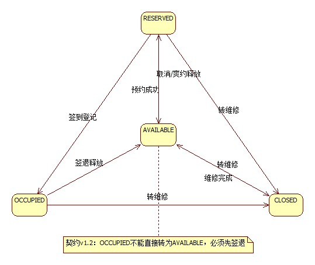
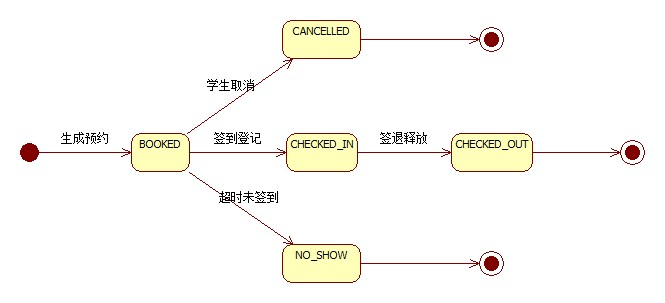

# 实验5　UML 状态图（自习室预约管理子系统）

> **课程**：CST9301 软件工程　｜　**版本**：v1.3（2026-11-07 按 B 评审修正座位状态图：T-04 源状态改 `RESERVED`、事件改「签到登记」，正文改为循环生命周期并删座位图图例的终止伪状态，契约依据升 v1.2）
> **文件作用**：实验5 报告（Markdown 版），供 GitHub 在线浏览与团队协作；Word 版为提交用的最终版。两版内容一致。
> **撰写**：易雨杰（成员A，2024611209）　｜　**评审**：叶梅冰（成员B，2024611038）

## 实验基本信息

| 项目 | 内容 |
|---|---|
| 学院 | 数学与计算机学院 |
| 系 | 计算机系 |
| 专业 | 计算机科学与技术 |
| 姓名 | 易雨杰（2024611209）、叶梅冰（2024611038） |
| 实验时间 | 2026 年 11 月 7 日 |
| 实验题目 | 实验5　UML 状态图（自习室预约管理子系统） |
| 成绩 | |

## 一、实验目的

1. 掌握状态图的基本要素：状态、事件、监护条件、动作与转移，理解状态图描述对象生命周期的方式。
2. 掌握从类图中识别「有状态、有生命周期」的对象，并为它建立状态图的方法。
3. 掌握初始伪状态、终止伪状态、自转移与备注（Note）在 StarUML 中的表达方式。
4. 使状态图与实验3 类图中的状态枚举、接口契约的状态流转约束保持一致，为后续时序图与编码提供依据。

## 二、实验要求

1. 从系统的类图与用例叙述中找出状态变化明显、对业务有影响的对象。
2. 使用 StarUML 建模工具为每个选定对象绘制状态图，标出状态、事件与转移。
3. 对每个状态说明含义与进入/退出条件，对每条转移说明触发事件与动作。
4. 提交实验报告。

## 三、主要实验工具

- **StarUML 5.0（with cm）**：安装路径 `D:\StarUML`，用于本项目全部 UML 图的建模与导出，启动前需设置 Windows XP (Service Pack 2) 兼容模式。
- **Git / GitHub**：版本控制与团队协作，主干 `main`，成员A（易雨杰）使用 `dev-A`，成员B（叶梅冰）使用 `dev-B-new`。
- **IntelliJ IDEA + JDK 17 + Maven**：后续编码阶段使用（Maven Wrapper 已随仓库提供）。
- **接口契约 v1.2**（`docs/contract/接口契约.md`）：本实验的状态取值、状态流转约束以契约为准，状态图不另造状态名。

## 四、实验内容及实验数据记录

### （一）状态图对象的选择依据

状态图不是给每个类都画，只给「生命周期中有多个互斥状态、且状态变化受业务规则约束」的对象画。对照实验3 的 7 个业务类与 4 个枚举，筛选过程如下：

| 类 | 是否有状态枚举 | 是否画状态图 | 理由 |
|---|---|---|---|
| Seat | 有，`SeatStatus` 四值 | 画 | 座位是整个系统的核心资源，状态直接决定能否被预约，且存在「使用中不能直接改可用」的业务约束 |
| Reservation | 有，`ReservationStatus` 五值 | 画 | 预约记录从生成到终止有多条互斥分支（签到、取消、爽约），是信用分扣减的触发点 |
| User | 有 `Role`，但角色是静态属性 | 不画 | 角色在账户创建后不随业务变化，属于属性而非生命周期状态 |
| Student | 无独立状态枚举 | 不画 | 信用分是数值而非状态，用规则表约束即可 |
| SeatType | 无 | 不画 | 类型定义不随业务变化 |
| CheckinRecord | 无 | 不画 | 一次使用只写一条记录，写入即终态 |
| CreditScoreLog | 有 `CreditChangeReason`，但记录即终态 | 不画 | 流水是不可变记录，没有状态迁移 |

结论：本实验为 `Seat` 与 `Reservation` 各画一张状态图，共 2 张。

### （二）座位状态图（SeatStatus）

座位状态图描述一个座位从入库、可用、预约、使用到维修关闭，再重新启用的循环生命周期，工程文件为 `docs/uml/实验5_状态图.uml` 中的 `座位状态图`，导出图为 `docs/assets/实验5_座位状态图.jpg`。

**1. 状态清单**

| 状态 | 含义 | 进入条件 | 退出条件 |
|---|---|---|---|
| AVAILABLE | 可用，可被学生查询并预约 | 系统初始即为此态；预约取消或爽约释放后回到此态；签退释放后回到此态；维修完成后回到此态 | 被预约成功转 RESERVED；转维修转 CLOSED |
| RESERVED | 已预约，已被某条预约锁定但尚未签到 | 在线预约成功，座位置 RESERVED | 学生取消或系统判定爽约后回到 AVAILABLE；被签到登记转 OCCUPIED；转维修转 CLOSED |
| OCCUPIED | 使用中，学生已签到入座 | 值班管理员签到登记成功 | 签退释放回到 AVAILABLE；转维修转 CLOSED |
| CLOSED | 维修关闭，不可预约 | 管理员转维修 | 维修完成后回到 AVAILABLE |

**2. 状态转移表**

| 编号 | 源状态 | 事件 | 监护条件 | 动作 | 目标状态 |
|---|---|---|---|---|---|
| T-01 | 初始伪状态 | — | — | 系统启动加载座位数据 | AVAILABLE |
| T-02 | AVAILABLE | 预约成功 | 信用分 >= 80、时段未被占用 | 锁定座位置 RESERVED | RESERVED |
| T-03 | RESERVED | 取消 / 爽约释放 | 预约处于 BOOKED 且被学生取消或被系统判定爽约 | 释放座位 | AVAILABLE |
| T-04 | RESERVED | 签到登记 | 预约状态为 BOOKED 且未过签到截止时间 | 座位置 OCCUPIED | OCCUPIED |
| T-05 | OCCUPIED | 签退释放 | 值班管理员执行签退 | 释放座位，判定是否超时 | AVAILABLE |
| T-06 | AVAILABLE | 转维修 | 管理员发现座位损坏 | 座位置 CLOSED | CLOSED |
| T-07 | RESERVED | 转维修 | 管理员发现座位损坏 | 先撤销关联预约再置 CLOSED | CLOSED |
| T-08 | OCCUPIED | 转维修 | 管理员发现座位在使用中损坏 | 先办理签退再置 CLOSED | CLOSED |
| T-09 | CLOSED | 维修完成 | 维修结束 | 座位置 AVAILABLE | AVAILABLE |

**3. 状态图**

图5-1 座位状态图

图例说明：实心圆为初始伪状态；圆角矩形为状态；带箭头的实线为转移，线上文字为触发事件；右下方黄色备注框标出契约 v1.2 的状态约束。

**4. 说明**

- 本图以 AVAILABLE 为中心组织：AVAILABLE 只接受「预约成功」一个占用类事件（转 RESERVED），「签到登记」只能从 RESERVED 出发（转 OCCUPIED），体现「先预约、后签到」的次序约束；取消与爽约释放则由 RESERVED 回到 AVAILABLE。
- OCCUPIED 到 AVAILABLE 的转移标注为「签退释放」而不是「直接改状态」，这正是契约 v1.2 中 `SeatService.updateSeatStatus` 的约束：座位处于使用中时不允许直接把状态字段改成 AVAILABLE，必须先走签退流程释放。图右下角的备注框把这条约束写在图上，避免后续编码时误用。
- 三条「转维修」转移是从 AVAILABLE、RESERVED、OCCUPIED 分别指向 CLOSED，表示任何在用或空闲的座位都可能被发现损坏而转维修；从 RESERVED 和 OCCUPIED 转维修时，图上动作里写明要先撤销预约或先办签退，避免留下悬挂的预约记录。

### （三）预约记录状态图（ReservationStatus）

预约记录状态图描述一条预约从生成到终止的生命周期，工程文件为 `docs/uml/实验5_状态图.uml` 中的 `预约记录状态图`，导出图为 `docs/assets/实验5_预约记录状态图.jpg`。

**1. 状态清单**

| 状态 | 含义 | 进入条件 | 退出条件 |
|---|---|---|---|
| BOOKED | 已预约，等待签到 | 在线预约成功生成预约记录 | 签到登记转 CHECKED_IN；学生取消转 CANCELLED；超时未签到转 NO_SHOW |
| CHECKED_IN | 已签到，使用中 | 值班管理员签到登记成功 | 签退释放转 CHECKED_OUT |
| CHECKED_OUT | 已签退，正常结束 | 值班管理员签退成功 | 终态，不可再迁移 |
| CANCELLED | 已取消，学生主动取消 | 学生在签到前主动取消 | 终态，不可再迁移 |
| NO_SHOW | 爽约，超时未签到 | 后台定时任务扫描到 BOOKED 且已过签到截止时间 | 终态，不可再迁移 |

**2. 状态转移表**

| 编号 | 源状态 | 事件 | 监护条件 | 动作 | 目标状态 |
|---|---|---|---|---|---|
| R-01 | 初始伪状态 | 生成预约 | 信用分 >= 80、座位可用 | 生成预约记录并置 BOOKED，座位锁定 | BOOKED |
| R-02 | BOOKED | 学生取消 | 未过签到截止时间 | 预约置 CANCELLED，释放座位 | CANCELLED |
| R-03 | BOOKED | 签到登记 | 未过签到截止时间、预约号核验通过 | 预约置 CHECKED_IN，座位置 OCCUPIED，写 CheckinRecord | CHECKED_IN |
| R-04 | CHECKED_IN | 签退释放 | 值班管理员执行签退 | 预约置 CHECKED_OUT，座位释放；实际结束晚于预约结束则扣 1 分并写 `CreditScoreLog(LATE_CHECKOUT, -1)` | CHECKED_OUT |
| R-05 | BOOKED | 超时未签到 | 当前时间已过签到截止时间（预约开始 + 15 分钟） | 预约置 NO_SHOW，释放座位，扣 5 分并写 `CreditScoreLog(NO_SHOW, -5)` | NO_SHOW |
| R-06 | CANCELLED | — | — | 流程结束 | 终止伪状态 |
| R-07 | CHECKED_OUT | — | — | 流程结束 | 终止伪状态 |
| R-08 | NO_SHOW | — | — | 流程结束 | 终止伪状态 |

**3. 状态图**

图5-2 预约记录状态图

图例说明：实心圆为初始伪状态，带圆环的黑点为终止伪状态；圆角矩形为状态；带箭头的实线为转移，线上文字为触发事件。

**4. 说明**

- BOOKED 是唯一的「活动状态」，所有业务分支都从它出发分成三条：正常使用（CHECKED_IN → CHECKED_OUT）、学生主动终止（CANCELLED）、系统判定终止（NO_SHOW）。这种「一个入口、三条出口」的结构和实验2 用例叙述里 C02 / C03 / F01 / F02 / I03 的分工完全对应。
- 三个终止态各自单独连到终止伪状态，而不是三条线合并成一条，是为了让读者一眼看出「取消」「爽约」「正常签退」三种结束方式是互斥的，不存在从 CANCELLED 再走到 CHECKED_IN 的可能。
- NO_SHOW 与 CANCELLED 分开画，而不是合并成一个「已终止」，是 B 在实验3 类图评审时提出的关键修改：学生主动取消与系统判定爽约在统计口径上完全不同，前者是正常行为，后者要计入爽约率并触发扣 5 分。状态图把这个区分可视化，后续做统计报表时可以直接按状态计数。

### （四）两张状态图与类图、契约的一致性

| 核对项 | 类图（实验3） | 契约（v1.2） | 状态图（本实验） |
|---|---|---|---|
| 座位状态取值 | `SeatStatus`：AVAILABLE / RESERVED / OCCUPIED / CLOSED | 同 | 四个状态全部出现，无多余状态 |
| 预约状态取值 | `ReservationStatus`：BOOKED / CHECKED_IN / CHECKED_OUT / CANCELLED / NO_SHOW | 同 | 五个状态全部出现，无多余状态 |
| 座位状态约束 | OCCUPIED 不得直接改为 AVAILABLE | `updateSeatStatus` 抛 `BusinessException` | OCCUPIED→AVAILABLE 的转移标注为「签退释放」并加备注 |
| 爽约处理 | `Reservation.handleNoShow()` 置 NO_SHOW 并写流水 | `handleNoShow(now)` 扫描 BOOKED | R-05 转移写明监护条件与扣 5 分写流水动作 |
| 签退超时扣分 | `Reservation.checkOut()` 写 `CreditScoreLog(LATE_CHECKOUT, -1)` | 同 | R-04 转移写明超时扣 1 分动作 |

## 五、实验数据分析与讨论

### （一）为什么只给 Seat 和 Reservation 画状态图

状态图的价值在于把「一个对象在生命周期内可能处于哪些互斥状态、什么事件导致切换」讲清楚。判断标准有两条：一是有没有独立的枚举型状态属性，二是状态切换是否受业务规则约束。Seat 和 Reservation 两条都满足：它们各自对应一个状态枚举，且切换条件绑定了信用分、签到截止时间、签退超时等业务规则。反过来，User 的 Role 虽然也是枚举，但它在账户创建后不再变化，用属性表达比用状态图表达更直接；CheckinRecord 和 CreditScoreLog 是一次写入不再变更的记录，没有生命周期可言。这说明状态图的「选择性绘制」本身就是分析能力的体现，不是画得越多越好。

### （二）NO_SHOW 从 CANCELLED 里独立出来的意义

实验3 首版类图里，预约状态只有四个值，爽约被并入 CANCELLED，描述写成「BOOKED → CANCELLED（取消或爽约）」。这在状态图上会直接暴露问题：CANCELLED 一个状态要接收两个语义完全不同的事件（学生主动取消、系统判定爽约），而这两件事的责任方、扣分规则、统计口径都不一样。把它们画在同一条转移上，读者无法判断到底谁会触发扣分。v0.6 契约把 NO_SHOW 独立成第五个状态后，状态图上 BOOKED 自然分出两条独立的出边，事件分别是「学生取消」和「超时未签到」，监护条件分别由学生操作和后台定时任务满足。这是「状态图反过来检验类图设计是否合理」的一个实例。

### （三）OCCUPIED 不能直接回 AVAILABLE 的约束怎么在图上表达

状态图本身只能表达「有这条转移」，无法表达「这条转移必须经由某个方法」。本实验的处理办法是双管齐下：一是把转移事件名写成「签退释放」而不是「释放座位」或「改状态」，让读者知道这是走 `checkOut()` 流程；二是在图右下角加一个备注框，直接写上契约 v1.2 的原文约束「OCCUPIED 不能直接转为 AVAILABLE，必须先签退」。这样图面既保持了状态图的简洁（不引入额外的动作节点），又把约束落到了可查的位置。

### （四）与契约的一致性核对

两张状态图共 4 个座位状态、5 个预约状态、17 条转移（其中 2 条为初始伪状态出发的转移，3 条为指向终止伪状态的转移），状态名、事件名、监护条件逐项对照 `docs/contract/接口契约.md` v1.2 第八节与第十节，未发现不一致。特别是 `ReservationStatus.NO_SHOW`、`SeatStatus` 的 OCCUPIED 约束、以及爽约扣 5 与超时扣 1 两条独立扣分链路，均在转移的事件与动作中体现，与类图中的 `checkOut()`、`handleNoShow()` 方法一一对应。

## 六、分工与评审说明

| 姓名 | 学号 | 本报告承担工作 |
|---|---|---|
| 易雨杰 | 2024611209 | 状态对象筛选、状态与转移设计、状态图在 StarUML 中手画、状态清单与转移表撰写、报告排版 |
| 叶梅冰 | 2024611038 | 需求复核、状态图与状态表评审、与接口契约的一致性检查 |

本报告由成员A易雨杰主笔撰写，成员B叶梅冰参与评审。

仓库：https://github.com/STU-team/Study_Room_Reservation
