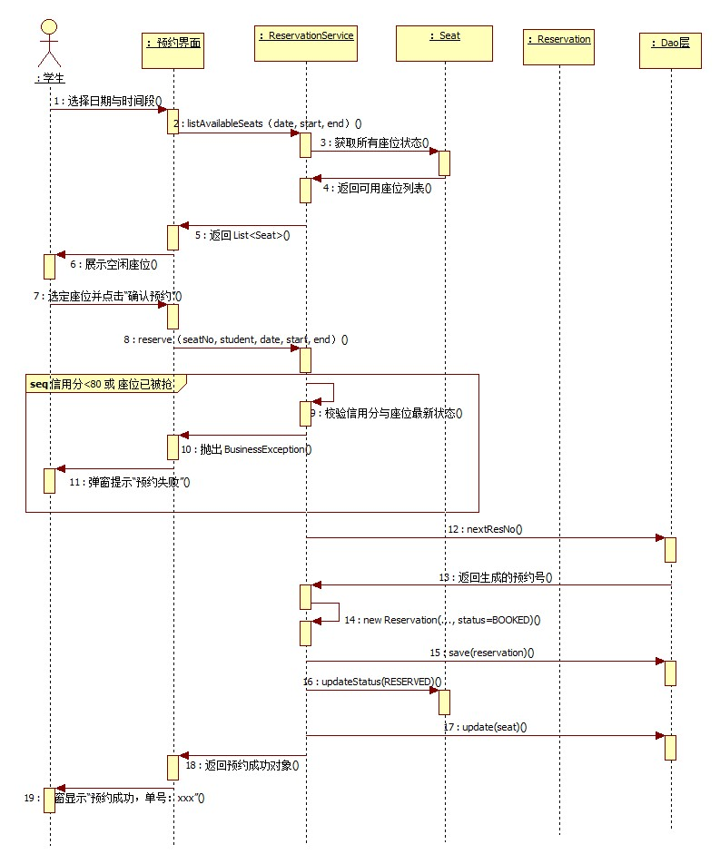

# 实验6　UML 时序图（自习室预约管理子系统）

> **课程**：CST9301 软件工程　｜　**版本**：v1.0（2026-11-08 首版，基于契约 v1.2 与实验3/4/5 设计成果）
> **文件作用**：实验6 报告（Markdown 版），供 GitHub 在线浏览与团队协作；Word 版为提交用的最终版。两版内容一致。
> **撰写**：叶梅冰（成员B，2024611038）　｜　**评审**：易雨杰（成员A，2024611209）

## 实验基本信息

| 项目 | 内容 |
|---|---|
| 学院 | 数学与计算机学院 |
| 系 | 计算机系 |
| 专业 | 计算机科学与技术 |
| 姓名 | 易雨杰（2024611209）、叶梅冰（2024611038） |
| 实验时间 | 2026 年 11 月 8 日 |
| 实验题目 | 实验6　UML 时序图（自习室预约管理子系统） |
| 成绩 | |

## 一、实验目的

1. 掌握时序图的基本要素：角色、对象、生命线、激活期与消息，理解时序图描述对象间动态交互的方式。
2. 掌握从用例叙述和类图中识别参与交互的对象，并按时序排列消息的方法。
3. 掌握同步消息、异步消息、返回消息、自调用及组合片段（如 `alt` 分支）在 StarUML 中的表达方式。
4. 通过时序图，验证实验3 类图分配的职责与实验5 状态图的流转规则是否自洽，为后续编码提供详细设计依据。

## 二、实验要求

1. 分析用例所涉及到的类或对象。
2. 根据用例中的类或对象的关系和行为顺序绘制顺序图（时序图）。
3. 对时序图中的每条消息说明含义、发送者与接收者。
4. 提交实验报告。

## 三、主要实验工具

- **StarUML 5.0（with cm）**：用于本项目全部 UML 图的建模与导出。
- **Git / GitHub**：版本控制与团队协作，主干 `main`，成员A（易雨杰）使用 `dev-A`，成员B（叶梅冰）使用 `dev-B-new`。
- **接口契约 v1.2**（`docs/contract/接口契约.md`）：时序图中的方法、异常抛出、对象职责以契约为准。

## 四、实验内容及实验数据记录

### （一）时序图用例与参与对象的选择依据

时序图不是流水账，而是为了展示特定用例下对象间的动态协作。本实验选取**“在线预约（C02）”**这一核心用例进行时序图建模。该用例涉及前端交互、业务校验、持久化写入等多个环节，最具有代表性。

对照实验3 的类图与契约第六节，参与交互的对象及职责如下：

| 对象（类/角色） | 类型 | 职责说明 |
|---|---|---|
| 学生 | Actor（角色） | 启动用例，选择时段与座位，触发预约请求 |
| :预约界面 | Object（边界类） | 前端 Swing 界面，收集用户输入并调用 Service 层接口，展示结果 |
| :ReservationService | Object（控制类） | 核心业务逻辑，负责信用分校验、座位状态校验、防并发控制与编排 |
| :Seat | Object（实体类） | 座位实体，承载座位可用状态 |
| :Reservation | Object（实体类） | 预约实体，承载预约记录的状态流转 |
| :Dao层 | Object（持久化） | 统一代表 ReservationDao、SeatDao 等，负责与 CSV 文件交互 |

### （二）在线预约时序图设计

**1. 交互流程说明**

本系统采用“先查询过滤，再提交防重”的设计方案，既保证用户体验，又保证并发安全：
- **阶段一（查询过滤）**：学生选择日期时段后，界面调用 `listAvailableSeats`，系统过滤掉已被预约的座位，只展示可用座位，避免用户“盲选”报错。
- **阶段二（提交与二次校验）**：学生选定座位点击“确认预约”后，界面调用 `reserve`。为了防止并发抢座（如两人同时点同一座位），服务层必须进行二次校验（信用分 >= 80 且座位仍为 AVAILABLE）。
- **阶段三（落库与锁定）**：校验通过后，系统生成唯一预约号，先写入预约记录（状态为 BOOKED），再将座位状态锁定为 RESERVED。

**2. 消息清单**

| 编号 | 发送者 | 接收者 | 消息 | 说明 |
|---|---|---|---|---|
| 1 | 学生 | :预约界面 | 选择日期与时段 | 用户输入查询条件 |
| 2 | :预约界面 | :ReservationService | listAvailableSeats() | 请求查询可用座位列表 |
| 3 | :ReservationService | :Seat | 获取所有座位状态 | 读取当前座位状态 |
| 4 | :Seat | :ReservationService | 返回可用座位列表 | 返回过滤后的可用座位集合 |
| 5 | :ReservationService | :预约界面 | 返回 List<Seat> | 返回查询结果 |
| 6 | :预约界面 | 学生 | 展示空闲座位 | 界面渲染可用座位列表 |
| 7 | 学生 | :预约界面 | 选定座位并确认 | 用户选定具体的座位（如 A01） |
| 8 | :预约界面 | :ReservationService | reserve() | 提交预约请求 |
| 9 | :ReservationService | :ReservationService | 二次校验 | 内部校验信用分与座位最新状态 |
| 10 | :ReservationService | :预约界面 | 抛出 BusinessException | 若信用分不足或座位被抢，抛出异常 |
| 11 | :预约界面 | 学生 | 弹窗提示失败原因 | 界面展示异常信息 |
| 12 | :ReservationService | :Dao层 | nextResNo() | 生成唯一预约号（如 RES2026...） |
| 13 | :Dao层 | :ReservationService | 返回生成的预约号 | 返回主键字符串 |
| 14 | :ReservationService | :ReservationService | new Reservation(...) | 创建预约实体，状态置为 BOOKED |
| 15 | :ReservationService | :Dao层 | save(reservation) | 写入预约记录（CSV） |
| 16 | :ReservationService | :Seat | updateStatus(RESERVED) | 修改座位实体状态 |
| 17 | :ReservationService | :Dao层 | update(seat) | 更新座位状态（CSV） |
| 18 | :ReservationService | :预约界面 | 返回预约成功对象 | 返回预约信息 |
| 19 | :预约界面 | 学生 | 弹窗显示预约成功 | 提示成功并显示单号 |

**3. 时序图**

图6-1 在线预约时序图

图例说明：带箭头的实线表示发送消息（请求）；生命线上的矩形条表示激活期；大方框表示 `alt` 组合片段（条件分支）。

**4. 说明**

1. **阶段分离**：步骤 1-6 为前端的查询逻辑，步骤 7-19 为后端的提交逻辑。两者分离是为了落实“界面不写业务逻辑，只负责调用和展示”的分层原则。
2. **二次校验（步骤 9-11）**：时序图中使用 `alt` 组合片段标出了异常分支。虽然前端已经展示了可用座位，但 `reserve` 方法内部必须再次判断座位状态。这体现了对并发冲突的防御，与实验2 的用例可选操作流程 2（座位被抢）及契约第十节业务闭环完全对应。
3. **先写预约，再锁座位（步骤 15-17）**：代码设计中，必须先调用 `save` 持久化 `BOOKED` 状态的预约记录，成功后再调用 `update` 修改座位置为 `RESERVED`。这种顺序可以防止“座位被锁死但无预约记录”的脏数据产生。

### （三）时序图与类图、契约的一致性

| 核对项 | 类图/契约 | 时序图体现 |
|---|---|---|
| 职责分配 | 界面只调 Service，Service 调实体与 DAO | 消息严格沿 :预约界面 -> :ReservationService -> :Dao层 传递 |
| 方法签名 | 契约第六节 `reserve`、`listAvailableSeats` | 时序图调用名与契约完全一致 |
| 异常流转 | 抛 `BusinessException` | 步骤 10 明确画出了异常抛回界面的路径 |
| 状态流转 | 预约先为 BOOKED，座位先为 RESERVED | 步骤 14、16 明确标注了状态变化结果 |

## 五、实验数据分析与讨论

### （一）为什么系统设计将“查询”与“预约”拆分为两个接口
在时序图的阶段一与阶段二中，严格对应了契约第六节的两个独立方法：`listAvailableSeats`（查询可用座位）与 `reserve`（提交预约）。
这是后端 Service 层在定义接口时的重要架构考量。如果直接提供一个“全量座位列表”，让学生自己点选后再去后端报错，会严重影响用户体验。因此，后端专门设计了 `listAvailableSeats` 接口，在查询阶段就通过状态过滤，仅向前端返回状态为 `AVAILABLE` 的座位。时序图将这一过程显式画出（步骤 1-6），不仅体现了前后端的职责分离，也如实反映了系统在提升交互友好度上的设计。

### （二）为什么时序图中必须包含 `alt` 异常分支
后端在 `reserve()` 方法的实现中，内置了严谨的防并发与二次校验逻辑（检查信用分是否 >= 80，以及座位是否仍为 `AVAILABLE`）。虽然阶段一已经过滤了可用座位，但考虑到真实场景中可能出现的并发抢座（如两人同时点选同一座位），后端必须履行兜底职责。
因此，时序图中的 `alt` 组合片段并非可有可无的补充，而是直接映射了后端代码中的 `if-else` 逻辑与 `BusinessException` 抛出机制。这告诉前端开发者：界面层不仅要处理“预约成功”的返回结果，还必须通过 `catch` 捕获异常并向用户展示失败原因（步骤 9-11）。

### （三）消息参数省略的规范
在步骤 14 `new Reservation(...)` 中，参数使用了省略号。这是因为时序图的核心是表达对象的交互顺序，而非代码的逐字翻译。只要表达出“这里创建了实体，且置为 BOOKED”即可，无需将实体类中的十余个属性全部列在线上，保持图面整洁。

## 六、分工与评审说明

| 姓名 | 学号 | 本报告承担工作 |
|---|---|---|
| 易雨杰 | 2024611209 | 提供接口契约与方法、复核时序图与后端代码（如并发校验、异常分支）的一致性、评审 |
| 叶梅冰 | 2024611038 | 对象与消息设计、StarUML 时序图绘制、报告撰写 |

本报告由成员B叶梅冰主笔撰写，成员A易雨杰参与评审。

仓库：https://github.com/STU-team/Study_Room_Reservation