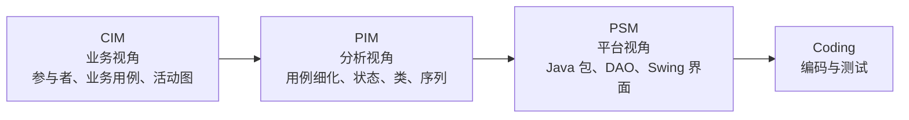
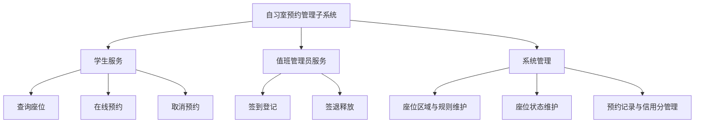
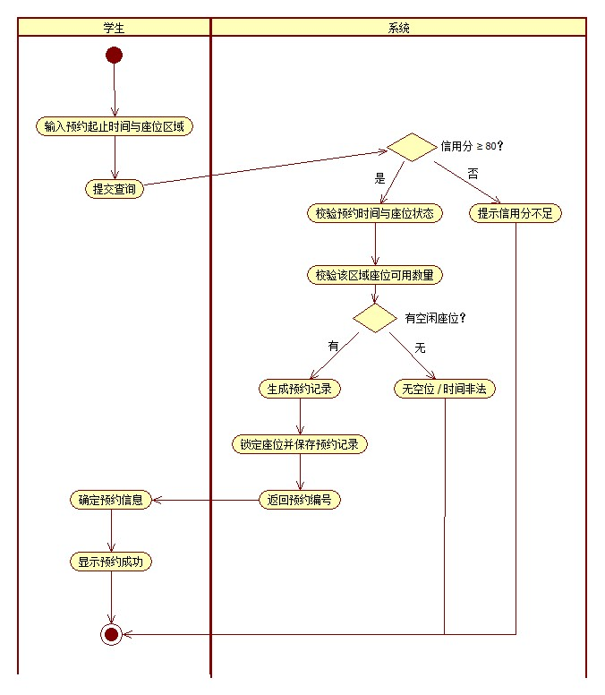
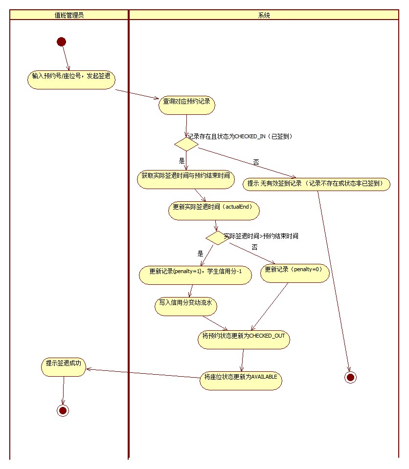
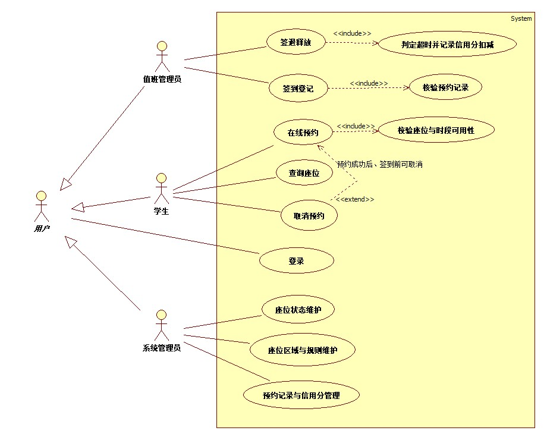
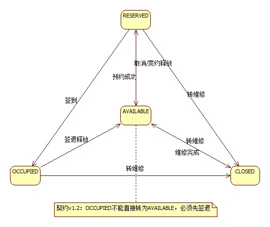
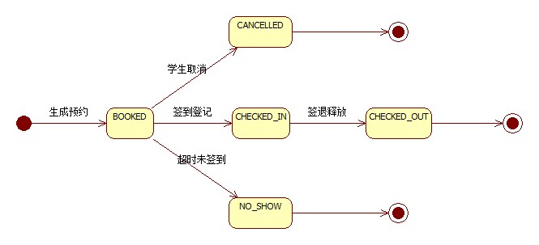
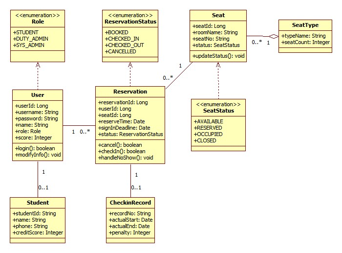
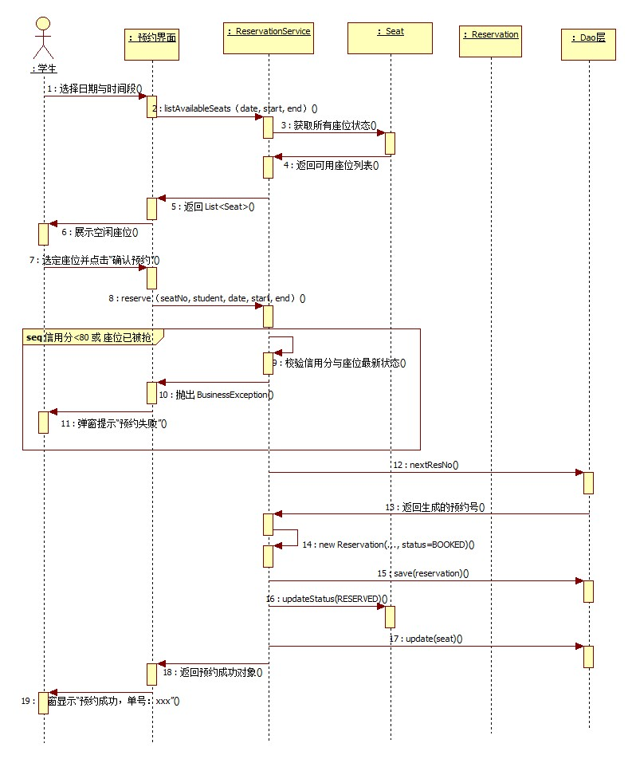

# 实验7　MDA 综合建模（自习室预约管理子系统）

> **课程**：CST9301 软件工程　｜　**报告版本**：v1.1（2026-11-12）
> **文件作用**：实验7 综合报告（Markdown 版），按实验指导书 CIM-1 → CIM-2 → CIM-3 → PIM-1 → PIM-2 → PIM-3 → PIM-4 的七个步骤，把前六个实验的建模成果组织成一条完整的 MDA 链路。Word/PDF 版为提交用最终版，内容与本文件一致。
> **撰写**：叶梅冰（成员B，2024611038）　｜　**评审**：易雨杰（成员A，2024611209）
> **契约基线**：`docs/contract/接口契约.md` v1.3

## 实验基本信息

| 项目 | 内容 |
|---|---|
| 学院 | 数学与计算机学院 |
| 系 | 计算机系 |
| 专业 | 计算机科学与技术 |
| 姓名 | 叶梅冰（2024611038）、易雨杰（2024611209） |
| 实验时间 | 2026 年 11 月 10 日 |
| 实验题目 | 实验7　MDA 综合建模（自习室预约管理子系统） |
| 成绩 | |
| 教师签字 | |

## 一、实验目的

1. 理解模型驱动架构（MDA）的基本思想，掌握 CIM、PIM、PSM 三个建模层次的分工与递进关系，能够说明每一层的模型分别回答"业务做什么""系统怎么做""平台怎么落地"中的哪一个问题。
2. 掌握计算无关模型（CIM）的建模方法：从业务流程出发确定系统范围，识别参与者，绘制业务用例图与活动图，并给出系统用例图与用例叙述。
3. 掌握平台无关模型（PIM）的建模方法：在 CIM 的基础上细化用例流程与业务规则，绘制状态图、类图和序列图，形成与具体编程语言、框架无关的分析模型。
4. 掌握从一个阶段的模型推导下一阶段模型的方法，特别是"用例叙述 → 类与方法 → 序列图"这条可追溯的推导链，避免各类模型各画各的、互相对不上。
5. 通过一个完整的自习室预约管理子系统案例，体验从业务调研到模型定稿的全过程，为后续编码与测试提供可验证的依据。

## 二、实验要求

1. 以小组为单位确定一个业务系统，说明系统的业务目标与范围，明确系统边界之外的业务由谁承担。
2. 按 CIM-1 要求定义业务流程，找出参与者，给出系统用例简述与系统用例图。
3. 按 CIM-2 要求分析业务流程，至少给出一条核心业务流程的活动图，图中要有泳道、判断节点与异常分支。
4. 按 CIM-3 要求定义系统范围，给出系统详细用例叙述与用例之间的关系（包含、扩展、泛化）。
5. 按 PIM-1 要求完善用例，进一步细化用例叙述，补充触发条件、业务规则与异常处理。
6. 按 PIM-2 要求分析业务规则，为状态变化明显的业务对象绘制状态图。
7. 按 PIM-3 要求从用例叙述的名词与词组中提取类，绘制类图并说明类间关系。
8. 按 PIM-4 要求从用例叙述中提取操作与方法，绘制序列图。
9. 撰写综合报告，图表连续编号，模型之间能够相互印证。

## 三、主要实验工具

- **StarUML 5.0（with cm）**：用于用例图、活动图、状态图、类图、序列图的建模与 JPG 导出。启动前需设置 Windows XP (Service Pack 2) 兼容模式。
- **Git / GitHub**：版本控制与团队协作。主干为 `main`，成员A 使用 `dev-A`，成员B 使用 `dev-B-new`；所有模型文件与报告通过 Pull Request 合并，评审意见留在 PR 对话中。
- **IntelliJ IDEA + JDK 17 + Maven Wrapper**：用于核对模型与接口契约、后续编码阶段使用；本报告不涉及运行截图。
- **接口契约 v1.3**（`docs/contract/接口契约.md`）：PIM 阶段的类名、属性名、状态枚举、服务接口与异常码均以契约为准，报告中的模型不另造名词。
- **Markdown + Word**：Markdown 用于 GitHub 在线浏览与协作，Word 用于排版提交；两版内容一致。

## 四、实验内容及实验数据记录

### （一）MDA 建模路线与阶段产物

MDA 把建模工作分成三个层次。CIM（Computation Independent Model，计算无关模型）只描述业务，不出现任何软件概念；PIM（Platform Independent Model，平台无关模型）把业务语言翻译成软件对象语言，但仍然不绑定 Java、Swing、CSV 等具体平台；PSM（Platform Specific Model，平台相关模型）才落入具体技术选型。本系统的技术选型是 Java 17 + Swing + CSV 文件持久化，PSM 层体现为包结构、DAO 实现与界面类；本报告的重点是 CIM 与 PIM 两层，PSM 只在最后做映射说明，不展开实现细节。

图1　MDA 三个建模层次与本项目的递进关系

七个建模步骤与阶段产物的对应关系如表1所示。表中"前序实验"一列说明该步骤的素材来源，保证本报告不是另起炉灶，而是对已有成果的重新组织与补充。

表1　MDA 七个步骤与本项目产物的对应关系

| 步骤 | 建模问题 | 本报告产物 | 前序实验 |
|---|---|---|---|
| CIM-1 | 业务由谁做、做哪几件事 | 3 个参与者、8 个业务用例、CIM-1 用例图（图3） | 实验1 功能简述 |
| CIM-2 | 业务按什么顺序做、在哪里分支 | 在线预约活动图（图4，A-2）、签退活动图（图5，B-2） | 实验4（B）、CIM 建模说明（A） |
| CIM-3 | 系统边界内细化成哪些用例 | 系统用例图（图6）、12 条用例叙述（表9—表20） | 实验2 |
| PIM-1 | 每个用例的规则与异常是什么 | 12 条用例的细化表（表22）、异常码表（表23） | 实验2、契约 v1.3 |
| PIM-2 | 哪些对象有生命周期、状态如何迁移 | 座位状态图（图7）、预约状态图（图8）、17 条转移 | 实验5 |
| PIM-3 | 系统由哪些类构成、类间什么关系 | 类图（图9）、7 个业务类、4 个枚举、类词典（表32） | 实验3 |
| PIM-4 | 每个操作由谁在什么顺序上完成 | 在线预约时序图（图10）；签到、签退、爽约只列交互消息表，未单独绘图 | 实验6、契约 v1.3 |

需要特别说明的是，本系统是课程小组项目，业务范围在实验1 就已锁定，因此 CIM 阶段不是从零访谈，而是把已经确定的需求重新用业务语言表述一遍，并检查其中是否混入了过早的技术决策。例如实验1 中"用 CSV 保存预约记录"属于 PSM 决策，在 CIM/PIM 中一律不出现；PIM 中只保留"预约记录需要持久化"这一平台无关的约束。

### （二）系统目标与功能范围

#### 1. 系统目标

自习室预约管理子系统面向高校图书馆或教学楼的公共自习空间。它的业务目标不是"做一个软件"，而是把原本依靠人工登记、口头协调的座位分配过程，变成学生可以自助查询、自助预约、管理员可以核验与追溯的过程。系统目标如表2所示。

表2　系统目标

| 编号 | 目标 | 说明 |
|---|---|---|
| G1 | 座位信息公开透明 | 学生可以按日期、时段、区域查询座位的可用、已预约、使用中、维修状态，减少到场后才发现无座的情况 |
| G2 | 预约过程自助化 | 学生在 7 天窗口内自行选择座位与时段完成预约，无需到现场排队登记 |
| G3 | 预约行为可约束 | 通过信用分机制约束爽约与超时占用：初始 100 分，爽约扣 5 分，超时签退扣 1 分，低于 80 分暂停预约资格 |
| G4 | 到场核验可执行 | 值班管理员按预约号核验学生身份并登记签到，签到截止时间为预约开始后 15 分钟 |
| G5 | 座位释放及时 | 签退、取消、爽约三种结束方式都能让座位回到可用状态，避免"人走了座位还锁着" |
| G6 | 座位异常可处置 | 座位损坏时可转维修，系统先撤销该座位未使用的预约，避免留下无法履约的记录 |
| G7 | 管理数据可追溯 | 管理员可以查询预约记录、在座记录与信用分变动流水，为纠纷处理与统计提供依据 |

注：表中 G1—G7 由实验1 的 7 条系统目标归并而来，G 取 Goal（目标）的首字母，仅用于本报告内部引用；实验1 目标7（本地文件持久化）属于实现约束，见四（十）PSM 映射。

#### 2. 功能结构

系统功能分为学生服务、值班管理员服务、系统管理三条主线，共 8 项功能，如图2所示。这三条主线与 CIM-1 的三类参与者一一对应，保证"参与者—功能—用例"三者不脱节。

图2　系统功能结构图

8 项功能的简述如表3所示。功能编号采用 `Study-C`（Customer/学生）、`Study-F`（Front desk/值班管理员）、`Study-M`（Manager/系统管理员）三类前缀，后续 CIM-3 的 12 个用例在此基础上增加登录与被包含用例。

表3　系统功能简述

| 编号 | 功能名称 | 使用者 | 功能描述 |
|---|---|---|---|
| Study-C01 | 查询座位 | 学生 | 按日期、时间段与区域查询可用座位及占用状态 |
| Study-C02 | 在线预约 | 学生 | 选择座位与时段提交预约，校验信用分与座位可用性后生成预约号 |
| Study-C03 | 取消预约 | 学生 | 签到截止前取消未使用的预约，释放座位 |
| Study-F01 | 签到登记 | 值班管理员 | 核验预约号与学生身份，登记签到并将座位置为使用中 |
| Study-F02 | 签退释放 | 值班管理员 | 办理签退，释放座位，判定超时并扣减信用分 |
| Study-M01 | 座位区域与规则维护 | 系统管理员 | 维护区域、座位数量与信用分规则参数 |
| Study-M02 | 座位状态维护 | 系统管理员 | 手动维护座位状态，处理损坏转维修 |
| Study-M03 | 预约记录与信用分管理 | 系统管理员 | 查询预约记录、在座记录与信用分流水 |

### （三）CIM-1　定义业务流程，确定系统范围

CIM-1 的任务是用业务人员能听懂的话回答三个问题：谁使用这个系统、他们各自的业务目标是什么、系统负责其中哪一段。这一阶段刻意不画 `<<include>>`、`<<extend>>` 和泛化，因为这些是系统内部的软件结构关系，属于 CIM-3 的细化内容。CIM-1 只保留参与者与业务用例之间的关联，让业务全景保持简单。

#### 1. 参与者

表4　CIM-1 参与者

| 参与者 | 业务职责 | 使用系统的目的 |
|---|---|---|
| 学生 | 在自习室学习，需要获得一个可用座位 | 查询座位、预约座位、取消预约 |
| 值班管理员 | 在现场值守，核验到场学生并管理座位使用 | 签到登记、签退释放 |
| 系统管理员 | 维护座位资源与规则，处理异常与统计 | 维护区域与规则、维护座位状态、查询预约与信用分 |

三类参与者中，学生是系统的服务对象，值班管理员是现场业务的执行者，系统管理员是资源配置与规则维护者。三者没有继承关系，因为它们的业务目标不同，不存在"某类管理员是另一类管理员的特例"这种语义。

#### 2. 业务用例

CIM-1 共识别 8 个业务用例，覆盖表3 的全部功能。业务用例的命名使用业务动词，不使用"数据表维护""接口调用"这类技术语言。

表5　CIM-1 业务用例简述

| 编号 | 业务用例 | 参与者 | 简述 |
|---|---|---|---|
| Study-C01 | 查询座位 | 学生 | 按日期、时段与区域查询可用座位与占用状态 |
| Study-C02 | 在线预约 | 学生 | 选择座位与时段提交预约，校验信用分与座位可用性后生成预约号 |
| Study-C03 | 取消预约 | 学生 | 签到前取消未使用的预约，更新状态并释放座位 |
| Study-F01 | 签到登记 | 值班管理员 | 核验预约记录与学生证件，登记签到并将座位置为使用中 |
| Study-F02 | 签退释放 | 值班管理员 | 释放座位，判定是否超时，超时则扣信用分 |
| Study-M01 | 座位区域与规则维护 | 系统管理员 | 维护区域、座位数量与信用分规则参数 |
| Study-M02 | 座位状态维护 | 系统管理员 | 更新座位状态（可用/已预约/使用中/维修） |
| Study-M03 | 预约记录与信用分管理 | 系统管理员 | 查询预约记录，查看学生信用分变动 |

#### 3. CIM-1 业务用例图

图3　CIM-1 业务用例图

图中矩形框为系统边界，8 个用例位于边界内，3 个参与者位于边界外，参与者与用例之间用无箭头的实线连接，表示关联关系。CIM-1 不区分"主用例"与"被包含用例"，也不画扩展点，原因是一旦在业务全景图上堆叠软件结构关系，业务人员就无法判断哪些是业务本身、哪些是设计选择。

#### 4. 系统边界说明

本系统边界内只负责"座位资源的信息化分配与使用记录"，以下业务明确留在边界外：

- 学生身份认证的源头（学校统一身份认证）不在本系统内，本系统只保存课程项目所需的账号密码；
- 自习室的物理开门、照明、保洁不在本系统内；
- 收费、押金、赔偿不在本系统内，本系统是免费公共自习室，约束手段是信用分而不是费用；
- 座位损坏的实际维修工单不在本系统内，本系统只把座位状态置为维修并撤销未履约预约。

明确边界的好处是：CIM-1 的 8 个用例没有一个是"无法由本系统独立完成"的，后续 PIM 也不会凭空多出跨系统的接口。

### （四）CIM-2　分析业务流程，生成系统活动图

CIM-2 的任务是把 CIM-1 中静态列出的业务用例展开成有时间顺序的流程。本报告选两条流程：一条是学生侧的核心流程"在线预约"，一条是管理员侧的核心流程"签退释放"。前者覆盖"查询—校验—落库"的完整正向路径，后者覆盖"状态判断—超时判定—扣分—释放"的分支路径，两条合起来可以代表系统的主要业务复杂度。

#### 1. 在线预约活动图

图4　CIM-2 在线预约活动图

图中使用"学生"与"系统"两条泳道。学生泳道负责输入条件、确认信息、查看结果；系统泳道负责信用分校验、时间与座位校验、冲突判断、生成记录、锁定座位、返回预约号。活动节点共 14 个，如表6所示。

表6　在线预约活动图节点

| 序号 | 活动节点 | 泳道 | 说明 |
|---|---|---|---|
| 1 | 开始 | 学生 | 流程入口 |
| 2 | 输入日期、时间段与座位区域 | 学生 | 学生设定查询条件 |
| 3 | 提交查询 | 学生 | 触发系统校验 |
| 4 | 校验学生信用分 ≥ 80 | 系统 | 不达标直接终止并提示 |
| 5 | 校验时间与座位状态 | 系统 | 日期不得早于今天、不得超过 7 天，结束时间晚于开始时间；座位存在且未维修 |
| 6 | 校验区域座位可用数量 | 系统 | 统计该区域该时段未被占用的座位数 |
| 7 | 判断：有空闲座位？ | 系统 | 决策节点 |
| 8 | 生成预约记录 | 系统 | 状态置为 BOOKED，计算签到截止时间 |
| 9 | 锁定座位并保存预约 | 系统 | 座位汇总状态置为 RESERVED |
| 10 | 返回预约号 | 系统 | 生成唯一预约号 |
| 11 | 提示无座或时段非法 | 系统 | 异常分支，回到输入条件 |
| 12 | 确认预约信息 | 学生 | 学生核对座位、时段、截止时间 |
| 13 | 显示预约成功 | 学生 | 展示预约号 |
| 14 | 结束 | 学生 | 流程出口 |

控制流可以概括为三条：

1. **主流程**：开始 → 输入条件 → 提交查询 → 校验信用分 → 校验时间与座位状态 → 校验区域座位可用数量 → 有空闲座位 → 生成预约记录 → 锁定座位并保存 → 返回预约号 → 确认信息 → 显示成功 → 结束。
2. **无座/时段非法分支**：判断节点为"否"时进入节点 11，提示后回到节点 2，由学生修改条件重新查询。
3. **信用分不足分支**：节点 4 不通过时直接提示"信用分低于 80，暂不可预约"并结束，不进入后续座位校验，避免无意义的查询开销。

活动图只描述主流程与无座异常，签到、签退、爽约三条流程放在 PIM-2 的状态图与 PIM-4 的消息规格中展开，避免一张图承担过多细节。

#### 2. 签退释放活动图

图5　CIM-2 签退释放活动图

签退活动图同样使用"值班管理员"与"系统"两条泳道，节点如表7所示。

表7　签退释放活动图节点

| 序号 | 活动节点 | 泳道 | 说明 |
|---|---|---|---|
| 1 | 开始 | 值班管理员 | 流程入口 |
| 2 | 输入座位号或预约号 | 值班管理员 | 定位待签退记录 |
| 3 | 查询预约记录 | 系统 | 按预约号查找 |
| 4 | 判断：记录存在且状态为已签到？ | 系统 | 决策节点 |
| 5 | 提示无有效签退信息 | 系统 | 异常分支 |
| 6 | 读取签退时间与预约结束时间 | 系统 | 取当前时间作为实际结束时间 |
| 7 | 判断：实际结束时间晚于预约结束时间？ | 系统 | 超时判定 |
| 8 | 信用分扣 1 分并写流水 | 系统 | 原因记为 LATE_CHECKOUT |
| 9 | 预约状态置为已签退 | 系统 | CHECKED_OUT |
| 10 | 按剩余有效预约重算座位状态 | 系统 | 有 CHECKED_IN 则 OCCUPIED，有 BOOKED 则 RESERVED，否则 AVAILABLE |
| 11 | 更新签到记录 | 系统 | 写入实际结束时间与 penalty |
| 12 | 显示签退成功 | 值班管理员 | 展示是否扣分 |
| 13 | 结束 | 值班管理员 | 流程出口 |

控制流的关键在于节点 7 的判断：只有实际结束时间晚于预约结束时间才扣 1 分；准时或提前签退 penalty 为 0。节点 10 是 v1.3 契约引入的"汇总状态重算"，它保证同一座位在后续时段仍有预约时不会被错误地置为 AVAILABLE。

#### 3. CIM-2 对 PIM 的输入

CIM-2 的两张活动图直接决定了 PIM-2 需要哪些状态、PIM-4 需要哪些操作：

- 在线预约活动图的节点 8、9 对应 `Reservation.reserve` 中"生成 BOOKED 记录 + 座位 RESERVED"两步；
- 签退活动图的节点 7—11 对应 `Reservation.signOut` 中"超时判断 + 扣分 + 状态迁移 + 汇总重算"四步；
- 两张图都出现的"按剩余有效预约重算座位状态"是 v1.3 契约的核心规则，PIM-2 的座位状态图与 PIM-3 的 `Seat` 类都必须体现它。

### （五）CIM-3　定义系统范围，细化用例叙述

CIM-3 把 CIM-1 的 8 个业务用例细化成系统边界内的 12 个系统用例，并补充用例之间的关系。与 CIM-1 相比，CIM-3 增加了 1 个泛化用例（登录）和 3 个被包含用例（校验座位与时段可用性、核验预约记录、判定超时并记录信用分扣减），用例图也从"只有关联"变成"关联 + 包含 + 扩展 + 泛化"。

#### 1. 系统用例图

图6　CIM-3 系统用例图

图中抽象出父级参与者"用户"，学生、值班管理员、系统管理员通过泛化关系继承父级参与者，从而复用"用户"与"登录"用例的关联，避免三条重复的登录关联线。`<<include>>` 用虚线箭头从基用例指向被包含用例，`<<extend>>` 用虚线箭头从扩展用例指向基用例，箭头方向与 UML 规范一致。

#### 2. 用例关系

表8　CIM-3 用例关系

| 关系类型 | 源元素 | 目标元素 | 说明 |
|---|---|---|---|
| 关联 | 学生 | Study-C01 查询座位 | 学生主动发起查询 |
| 关联 | 学生 | Study-C02 在线预约 | 学生主动发起预约 |
| 关联 | 学生 | Study-C03 取消预约 | 学生主动发起取消 |
| 关联 | 值班管理员 | Study-F01 签到登记 | 管理员现场办理 |
| 关联 | 值班管理员 | Study-F02 签退释放 | 管理员现场办理 |
| 关联 | 系统管理员 | Study-M01 座位区域与规则维护 | 管理员维护基础数据 |
| 关联 | 系统管理员 | Study-M02 座位状态维护 | 管理员处理异常 |
| 关联 | 系统管理员 | Study-M03 预约记录与信用分管理 | 管理员查询统计 |
| 泛化 | 学生 / 值班管理员 / 系统管理员 | 用户 | 三个子角色泛化自父级参与者，继承其与登录用例的关联 |
| 关联 | 用户 | Study-U01 登录 | 父级参与者统一关联登录用例 |
| 包含 | Study-C02 在线预约 | Study-I01 校验座位与时段可用性 | 每次预约都必须执行，属强制依赖 |
| 包含 | Study-F01 签到登记 | Study-I02 核验预约记录 | 每次签到都必须核验预约号 |
| 包含 | Study-F02 签退释放 | Study-I03 判定超时并记录信用分扣减 | 每次签退都必须判定是否超时 |
| 扩展 | Study-C03 取消预约 | Study-C02 在线预约 | 扩展点为"预约成功后、签到前"，仅在学生选择取消时发生 |

包含与扩展的区分是本阶段最容易出错的地方。判断标准是：**基用例每次执行都必然发生的行为用包含，只在特定条件下才发生的行为用扩展**。预约必然要校验座位与时段，所以是包含；取消只在学生主动选择时发生，所以是扩展。同理，签到必然核验预约号、签退必然判定超时，二者都是包含。

#### 3. 用例叙述

以下 12 条用例叙述按"主用例在前、支撑用例在后"的顺序排列。每条叙述都包含前置/后置条件、基本流程、可选流程与关系字段，PIM-1 将在此基础上补充业务规则与异常码。

##### （1）查询座位（Study-C01）

表9　Study-C01 用例叙述

| 字段 | 内容 |
|---|---|
| 用例名称 | 查询座位 |
| 用例编号 | Study-C01 |
| 用例描述 | 学生按日期、时间段与座位区域查询可用座位数量及占用状态。 |
| 参与者 | 学生 |
| 优先级 | 1 |
| 状态 | 通过审查 |
| 前置条件 | 学生已登录系统。 |
| 后置条件 | 系统返回符合条件的可用座位列表。 |
| 基本操作流程 | 1) 学生选择查询日期、时间段及意向区域。 2) 系统查询该时间段内空闲的座位。 3) 系统展示可用座位及占用状态。 |
| 可选操作流程 | 该时段无可用座位（已被预约、使用中或维修中），系统提示"该时段无可用座位"。 |
| 被泛化的用例 | 无 |
| 被包含的用例 | 无 |
| 被扩展的用例 | 无 |

##### （2）在线预约（Study-C02）

表10　Study-C02 用例叙述

| 字段 | 内容 |
|---|---|
| 用例名称 | 在线预约 |
| 用例编号 | Study-C02 |
| 用例描述 | 学生选择座位与时间段提交预约，校验信用分达标与座位可用后生成预约号。 |
| 参与者 | 学生 |
| 优先级 | 1 |
| 状态 | 通过审查 |
| 前置条件 | 学生已登录，且当前信用分 ≥ 80 分。 |
| 后置条件 | 系统生成预约记录，座位状态更新为"已预约"。 |
| 基本操作流程 | 1) 学生选择具体座位并点击预约。 2) 系统校验学生信用分是否达标。 3) 系统执行"校验座位与时段可用性"。 4) 学生确认预约信息并提交。 5) 系统生成唯一预约号，保存记录并将座位状态置为"已预约"。 |
| 可选操作流程1 | 信用分低于 80，系统提示"信用分低于 80，暂不能预约"。 |
| 可选操作流程2 | 提交瞬间座位被他人抢约，提示"预约失败，座位已被占用"。 |
| 被泛化的用例 | 无 |
| 被包含的用例 | Study-I01 校验座位与时段可用性 |
| 被扩展的用例 | 无（本用例被 Study-C03 取消预约扩展） |

##### （3）取消预约（Study-C03）

表11　Study-C03 用例叙述

| 字段 | 内容 |
|---|---|
| 用例名称 | 取消预约 |
| 用例编号 | Study-C03 |
| 用例描述 | 学生在签到前取消未使用的预约，系统更新状态并释放座位。 |
| 参与者 | 学生 |
| 优先级 | 1 |
| 状态 | 通过审查 |
| 前置条件 | 存在状态为"已预约"且尚未签到的记录。 |
| 后置条件 | 预约状态更新为"已取消"，系统释放该座位。 |
| 基本操作流程 | 1) 学生选择要取消的预约记录。 2) 系统校验该记录是否处于"可取消"状态。 3) 系统将预约状态改为"已取消"，并按该座位剩余有效预约重算座位状态。 |
| 可选操作流程 | 已超过签到截止时间，系统提示"已过签到时间，无法手动取消预约"；该预约后续由系统扫描判定爽约，释放座位并扣 5 分。 |
| 被泛化的用例 | 无 |
| 被包含的用例 | 无 |
| 被扩展的用例 | 无（本用例扩展 Study-C02 在线预约） |

##### （4）签到登记（Study-F01）

表12　Study-F01 用例叙述

| 字段 | 内容 |
|---|---|
| 用例名称 | 签到登记 |
| 用例编号 | Study-F01 |
| 用例描述 | 值班管理员核验预约记录与学生证件，登记签到并将座位置为使用中。 |
| 参与者 | 值班管理员 |
| 优先级 | 1 |
| 状态 | 通过审查 |
| 前置条件 | 学生到达自习室，且存在有效预约。 |
| 后置条件 | 预约状态变更为"已签到"，座位状态变更为"使用中"，生成签到记录。 |
| 基本操作流程 | 1) 值班管理员输入学生预约号。 2) 系统执行"核验预约记录"。 3) 管理员核对预约状态并登记。 4) 系统将预约状态改为"已签到"，座位状态改为"使用中"。 |
| 可选操作流程1 | 预约不存在或状态异常，系统提示"无有效预约信息"。 |
| 可选操作流程2 | 学生证件不符，拒绝签到。 |
| 可选操作流程3 | 当前时间已超过签到截止时间，系统提示"该预约已超时失效"并拒绝签到；爽约状态由系统扫描统一处理。 |
| 被泛化的用例 | 无 |
| 被包含的用例 | Study-I02 核验预约记录 |
| 被扩展的用例 | 无 |

##### （5）签退释放（Study-F02）

表13　Study-F02 用例叙述

| 字段 | 内容 |
|---|---|
| 用例名称 | 签退释放 |
| 用例编号 | Study-F02 |
| 用例描述 | 值班管理员办理签退，系统释放座位并判定是否超时，超时则扣学生信用分。 |
| 参与者 | 值班管理员 |
| 优先级 | 1 |
| 状态 | 通过审查 |
| 前置条件 | 预约状态为"已签到"，座位处于使用中。 |
| 后置条件 | 座位状态按剩余有效预约重算，系统记录信用分变动。 |
| 基本操作流程 | 1) 值班管理员输入要签退的座位号或预约号。 2) 系统执行"判定超时并记录信用分扣减"。 3) 系统将预约状态更新为"已签退"，并按剩余有效预约重算座位状态。 |
| 可选操作流程 | 输入错误的座位号或预约号，系统提示"未找到有效签退信息"。 |
| 被泛化的用例 | 无 |
| 被包含的用例 | Study-I03 判定超时并记录信用分扣减 |
| 被扩展的用例 | 无 |

##### （6）座位区域与规则维护（Study-M01）

表14　Study-M01 用例叙述

| 字段 | 内容 |
|---|---|
| 用例名称 | 座位区域与规则维护 |
| 用例编号 | Study-M01 |
| 用例描述 | 系统管理员新增/修改座位区域、座位数量，维护信用分规则参数。 |
| 参与者 | 系统管理员 |
| 优先级 | 1 |
| 状态 | 通过审查 |
| 前置条件 | 系统管理员已登录。 |
| 后置条件 | 系统保存新的区域信息或规则参数。 |
| 基本操作流程 | 1) 管理员选择"区域与规则管理"。 2) 管理员新增区域或修改座位数量，设置信用分规则。 3) 系统更新数据并提示成功。 |
| 可选操作流程 | 输入的数量或规则参数非法（如负数），系统拒绝保存并提示。 |
| 被泛化的用例 | 无 |
| 被包含的用例 | 无 |
| 被扩展的用例 | 无 |

##### （7）座位状态维护（Study-M02）

表15　Study-M02 用例叙述

| 字段 | 内容 |
|---|---|
| 用例名称 | 座位状态维护 |
| 用例编号 | Study-M02 |
| 用例描述 | 系统管理员更新座位状态（可用、已预约、使用中、维修），保证座位状态与实际一致。 |
| 参与者 | 系统管理员 |
| 优先级 | 1 |
| 状态 | 通过审查 |
| 前置条件 | 系统管理员已登录。 |
| 后置条件 | 座位状态被手动更新，或按规则被拒绝。 |
| 基本操作流程 | 1) 管理员查看座位列表。 2) 选择需要更改状态的座位。 3) 提交修改，系统按状态矩阵校验后更新并刷新界面。 |
| 可选操作流程1 | 座位处于"使用中"，禁止直接改为"可用"，提示"请先办理签退"。 |
| 可选操作流程2 | 座位处于"已预约"，禁止手动改为其他状态，提示先取消预约或等待签到/爽约处理。 |
| 可选操作流程3 | 座位损坏，管理员可改为"维修"；若该座位仍有未履约预约，系统先撤销预约或判定爽约。 |
| 被泛化的用例 | 无 |
| 被包含的用例 | 无 |
| 被扩展的用例 | 无 |

##### （8）预约记录与信用分管理（Study-M03）

表16　Study-M03 用例叙述

| 字段 | 内容 |
|---|---|
| 用例名称 | 预约记录与信用分管理 |
| 用例编号 | Study-M03 |
| 用例描述 | 按日期、区域、状态查询与统计预约记录，查看学生信用分变动情况。 |
| 参与者 | 系统管理员 |
| 优先级 | 1 |
| 状态 | 通过审查 |
| 前置条件 | 系统管理员已登录。 |
| 后置条件 | 系统展示符合条件的预约记录及信用分流水。 |
| 基本操作流程 | 1) 管理员进入管理页面。 2) 输入查询条件（日期、区域、状态）。 3) 系统查询并展示结果及信用分变动记录。 |
| 可选操作流程 | 没有符合条件的记录，显示空白并提示。 |
| 被泛化的用例 | 无 |
| 被包含的用例 | 无 |
| 被扩展的用例 | 无 |

##### （9）登录（Study-U01）

表17　Study-U01 用例叙述

| 字段 | 内容 |
|---|---|
| 用例名称 | 登录 |
| 用例编号 | Study-U01 |
| 用例描述 | 用户通过账号密码进入系统，系统根据角色分配权限。 |
| 参与者 | 用户（学生、值班管理员、系统管理员） |
| 优先级 | 1 |
| 状态 | 通过审查 |
| 前置条件 | 系统已启动并显示登录界面。 |
| 后置条件 | 成功登录，跳转至对应角色的主界面。 |
| 基本操作流程 | 1) 用户输入账号和密码。 2) 系统校验账号密码。 3) 验证通过，系统根据角色跳转至相应面板。 |
| 可选操作流程 | 账号或密码错误，系统提示"登录失败"，要求重新输入。 |
| 被泛化的用例 | 无 |
| 被包含的用例 | 无 |
| 被扩展的用例 | 无 |

##### （10）校验座位与时段可用性（Study-I01）

表18　Study-I01 用例叙述

| 字段 | 内容 |
|---|---|
| 用例名称 | 校验座位与时段可用性 |
| 用例编号 | Study-I01 |
| 用例描述 | 系统内部校验学生提交的预约请求是否满足座位可用条件。 |
| 参与者 | 学生（继承自基用例"在线预约"） |
| 优先级 | 1 |
| 状态 | 通过审查 |
| 前置条件 | 学生触发预约操作。 |
| 后置条件 | 返回校验结果。 |
| 基本操作流程 | 1) 接收预约请求。 2) 检查座位是否存在且不处于维修状态。 3) 检查时间段是否与已有 BOOKED/CHECKED_IN 记录冲突。 |
| 可选操作流程 | 座位不存在、已维修或时段冲突，返回"校验失败"。 |
| 被泛化的用例 | 无 |
| 被包含的用例 | 无 |
| 被扩展的用例 | 无 |

##### （11）核验预约记录（Study-I02）

表19　Study-I02 用例叙述

| 字段 | 内容 |
|---|---|
| 用例名称 | 核验预约记录 |
| 用例编号 | Study-I02 |
| 用例描述 | 系统内部核验值班管理员输入的预约号是否有效。 |
| 参与者 | 值班管理员（继承自基用例"签到登记"） |
| 优先级 | 1 |
| 状态 | 通过审查 |
| 前置条件 | 值班管理员触发签到操作。 |
| 后置条件 | 返回预约信息及校验结果。 |
| 基本操作流程 | 1) 读取预约信息。 2) 校验预约状态是否为"已预约"。 3) 校验当前时间是否超过签到截止时间。 4) 返回校验结果。 |
| 可选操作流程 | 预约不存在、状态不是"已预约"或已超过截止时间，返回"无效预约"。 |
| 被泛化的用例 | 无 |
| 被包含的用例 | 无 |
| 被扩展的用例 | 无 |

##### （12）判定超时并记录信用分扣减（Study-I03）

表20　Study-I03 用例叙述

| 字段 | 内容 |
|---|---|
| 用例名称 | 判定超时并记录信用分扣减 |
| 用例编号 | Study-I03 |
| 用例描述 | 系统内部判定学生是否超时未签退，并按规则扣减信用分。 |
| 参与者 | 值班管理员（继承自基用例"签退释放"） |
| 优先级 | 1 |
| 状态 | 通过审查 |
| 前置条件 | 值班管理员触发签退操作。 |
| 后置条件 | 若超时，扣减该学生 1 分信用分并记录变动日志。 |
| 基本操作流程 | 1) 读取签退时间与预约结束时间。 2) 比较实际结束时间是否晚于预约结束时间。 3) 若超时，扣 1 分并写 `CreditScoreLog(LATE_CHECKOUT, -1)`。 |
| 可选操作流程 | 签退时间早于预约开始时间或数据缺失，返回错误信息。 |
| 被泛化的用例 | 无 |
| 被包含的用例 | 无 |
| 被扩展的用例 | 无 |

#### 4. CIM-3 相对 CIM-1 的细化

表21　CIM-3 相对 CIM-1 的细化

| 维度 | CIM-1 | CIM-3 |
|---|---|---|
| 用例数量 | 8 个业务用例 | 12 个系统用例（8 个主用例 + 登录 + 3 个被包含用例） |
| 关系类型 | 只有参与者与用例的关联 | 关联、泛化、包含、扩展四种 |
| 参与者 | 3 个平级参与者 | 增加父级"用户"，3 个角色泛化自用户 |
| 描述粒度 | 一句话简述 | 12 条完整叙述，含前置/后置、基本流程、可选流程、关系字段 |
| 是否出现软件结构 | 不出现 | 出现 include/extend/泛化，但仍是需求视角，不涉及类与接口 |

这次细化的关键判断有三条：第一，"查询座位"与"校验座位与时段可用性"必须分开，前者是学生可见的独立服务，后者是预约提交瞬间的内部校验，二者职责不同；第二，"取消预约"只能作为扩展而不能作为包含，因为大多数预约不会被取消；第三，"登录"不能分别挂在三个角色下，否则用例图会出现三条重复关系，抽象父级参与者是更准确的表达。

### （六）PIM-1　分析系统流程，完善并细化用例

PIM-1 不是把 CIM-3 的用例叙述原样抄一遍，而是把"业务上要做这件事"翻译成"系统必须检查哪些条件、失败时返回什么、最终调用哪个服务接口"。这一步的产物是 PIM-2、PIM-3、PIM-4 的共同依据：状态图需要知道哪些状态迁移被允许，类图需要知道有哪些业务名词，序列图需要知道消息的顺序与异常分支。

#### 1. 用例细化表

下表按 12 个用例逐一列出触发条件、关键规则、异常处理与契约接口。表中的异常码来自 `BusinessException` 的 `code` 字段，契约 v1.3 与代码保持一致。

表22　PIM-1 用例细化表

| 编号 | 用例 | 触发条件 | 关键规则 | 异常与返回 | 契约接口 |
|---|---|---|---|---|---|
| Study-C01 | 查询座位 | 学生选择日期、时段、区域 | 只返回该时段无冲突的座位；已维修座位不返回 | 无可用座位时返回空列表 | `ReservationService.listAvailableSeats` |
| Study-C02 | 在线预约 | 学生点击预约并确认 | 信用分 ≥ 80；日期在 7 天内；结束晚于开始；座位未维修；时段不冲突 | `PARAM`、`CREDIT_LOW`、`STUDENT_NOT_FOUND`、`SEAT_NOT_FOUND`、`SEAT_UNAVAILABLE`、`SEAT_CONFLICT` | `ReservationService.reserve` |
| Study-C03 | 取消预约 | 学生在签到前选择取消 | 仅 BOOKED 可取消；不得超过签到截止时间 | `STATE`、`DEADLINE`、`NOT_FOUND` | `ReservationService.cancelReservation` |
| Study-F01 | 签到登记 | 管理员输入预约号并确认 | 仅 BOOKED 可签到；不得超过截止时间；座位不得为维修或使用中 | `STATE`、`DEADLINE`、`SEAT_NOT_FOUND`、`SEAT_UNAVAILABLE`、`SEAT_IN_USE` | `ReservationService.signIn` |
| Study-F02 | 签退释放 | 管理员输入预约号并确认 | 仅 CHECKED_IN 可签退；实际结束不得早于开始；晚于预约结束扣 1 分 | `PARAM`、`STATE`、`NOT_FOUND` | `ReservationService.signOut` |
| Study-M01 | 座位区域与规则维护 | 管理员保存区域或规则 | 座位数量必须为正整数；规则参数不得为负 | `PARAM` | `SeatTypeDao` / 配置维护 |
| Study-M02 | 座位状态维护 | 管理员提交状态修改 | 仅允许 AVAILABLE ↔ CLOSED；OCCUPIED/RESERVED 不得手动改 | `STATE`、`SEAT_IN_USE`、`SEAT_NOT_FOUND` | `SeatService.updateSeatStatus`、`ReservationService.closeSeatForRepair` |
| Study-M03 | 预约记录与信用分管理 | 管理员输入查询条件 | 按日期、区域、状态过滤；信用分流水只读 | 无记录时返回空列表 | `ReservationService.listAllReservations`、`listSeated` |
| Study-U01 | 登录 | 用户提交账号密码 | 账号密码非空；密码逐字符匹配；按角色跳转 | `PARAM`、`AUTH_FAILED` | `AuthService.login` |
| Study-I01 | 校验座位与时段可用性 | 预约提交时被调用 | 座位存在、未维修；与 BOOKED/CHECKED_IN 记录不重叠 | `SEAT_NOT_FOUND`、`SEAT_UNAVAILABLE`、`SEAT_CONFLICT` | `ReservationService.reserve` 内部校验 |
| Study-I02 | 核验预约记录 | 签到提交时被调用 | 记录存在；状态为 BOOKED；未超过截止时间 | `NOT_FOUND`、`STATE`、`DEADLINE` | `ReservationService.signIn` 内部校验 |
| Study-I03 | 判定超时并记录信用分扣减 | 签退提交时被调用 | 实际结束晚于预约结束则 penalty=1，扣 1 分并写流水 | 时间早于开始时间返回 `PARAM` | `ReservationService.signOut` 内部扣分 |

#### 2. 业务异常码

表23　PIM-1 业务异常码

| 异常码 | 含义 | 触发场景 | 界面处理建议 |
|---|---|---|---|
| `PARAM` | 参数不完整或非法 | 必填项为空、日期越界、结束不晚于开始 | 高亮错误字段，保留已填内容 |
| `AUTH_FAILED` | 认证失败 | 用户名不存在或密码不匹配 | 提示"用户名或密码错误"，清空密码框 |
| `CREDIT_LOW` | 信用分不足 | 预约时信用分低于 80 | 显示当前分数与恢复规则 |
| `STUDENT_NOT_FOUND` | 学生档案不存在 | 预约或扣分时找不到学生 | 提示联系管理员补建档案 |
| `SEAT_NOT_FOUND` | 座位不存在 | 座位号查不到 | 提示刷新座位列表 |
| `SEAT_UNAVAILABLE` | 座位不可用 | 座位处于维修状态 | 提示该座位已停用 |
| `SEAT_CONFLICT` | 时段冲突 | 同一座位在目标时段已有 BOOKED/CHECKED_IN | 提示重新选择座位或时段 |
| `SEAT_IN_USE` | 座位使用中 | 签到或手动改状态时座位为 OCCUPIED | 提示先办理签退 |
| `DEADLINE` | 已超过签到截止时间 | 取消或签到时当前时间晚于开始 + 15 分钟 | 提示该预约已失效 |
| `STATE` | 状态不允许该操作 | 非 BOOKED 取消/签到、非 CHECKED_IN 签退、非法状态迁移 | 提示当前状态与可执行操作 |
| `NOT_FOUND` | 预约记录不存在 | 按预约号查不到记录 | 提示核对预约号 |
| `DATA_INIT` | 初始化数据失败 | 启动时加载 CSV 失败 | 提示检查 `data/` 目录 |

#### 3. PIM-1 对 CIM-3 的三处修正

第一处是取消预约的截止条件。CIM-3 原文只写"签到前可取消"，PIM-1 明确为"当前时间不得晚于签到截止时间"，因为签到截止时间之后记录已经进入爽约判定窗口，再允许取消会绕过扣 5 分的规则。

第二处是签退时的座位释放。CIM-3 原文写"座位状态更新为可用"，PIM-1 改为"按该座位剩余有效预约重算"：如果同一座位在今天晚些时候还有另一条 BOOKED 记录，签退后座位应回到 RESERVED 而不是 AVAILABLE。这是契约 v1.3 相对 v1.2 的关键修正。

第三处是维修关闭。CIM-3 的"座位状态维护"只写"管理员可改为维修"，PIM-1 明确该动作由 `closeSeatForRepair` 编排：先撤销该座位全部未履约的 BOOKED 预约，若已过截止时间则按爽约处理并扣分，再置 CLOSED。这样不会留下"座位已维修但预约仍然有效"的悬挂记录。

### （七）PIM-2　分析业务规则，生成状态图

#### 1. 状态图对象的选择

不是每个类都需要状态图。判断标准是：对象是否有多个互斥状态、状态是否随业务事件迁移、迁移是否受规则约束。按此标准筛选 7 个业务类，结果如表24所示。

表24　状态图对象筛选

| 类 | 是否有状态枚举 | 是否画状态图 | 理由 |
|---|---|---|---|
| Seat | 有，`SeatStatus` 四值 | 画 | 座位是核心资源，状态直接决定能否预约，且存在"使用中不能直接改可用"的约束 |
| Reservation | 有，`ReservationStatus` 五值 | 画 | 预约记录从生成到终止有多条互斥分支，是信用分扣减的触发点 |
| User | 有 `Role`，但角色是静态属性 | 不画 | 角色在账户创建后不随业务变化 |
| Student | 无独立状态枚举 | 不画 | 信用分是数值而非状态，用规则约束即可 |
| SeatType | 无 | 不画 | 类型定义不随业务变化 |
| CheckinRecord | 无 | 不画 | 一次使用只写一条记录，写入即终态 |
| CreditScoreLog | 有 `CreditChangeReason`，但记录即终态 | 不画 | 流水是不可变记录，没有状态迁移 |

结论：只为 `Seat` 与 `Reservation` 各画一张状态图，共 2 张、17 条转移。

#### 2. 座位状态图

图7　座位状态图

座位有 4 个状态，状态含义与进入/退出条件如表25所示。

表25　座位状态清单

| 状态 | 含义 | 进入条件 | 退出条件 |
|---|---|---|---|
| AVAILABLE | 可用，可被查询并预约 | 系统初始；取消/爽约释放后无其他有效预约；签退后无其他有效预约；维修完成 | 预约成功转 RESERVED；转维修转 CLOSED |
| RESERVED | 已预约，已被某条 BOOKED 记录锁定但尚未签到 | 在线预约成功 | 取消或爽约后按剩余预约重算；签到转 OCCUPIED；转维修转 CLOSED |
| OCCUPIED | 使用中，学生已签到入座 | 签到登记成功 | 签退后按剩余预约重算；转维修需先签退 |
| CLOSED | 维修关闭，不可预约 | 管理员转维修 | 维修完成转 AVAILABLE |

17 条转移中座位占 9 条，如表26所示。编号 T-01 至 T-09 与实验5 报告一致。

表26　座位状态转移

| 编号 | 源状态 | 事件 | 监护条件 | 动作 | 目标状态 |
|---|---|---|---|---|---|
| T-01 | 初始伪状态 | — | — | 系统启动加载座位数据 | AVAILABLE |
| T-02 | AVAILABLE | 预约成功 | 信用分 ≥ 80、时段未被占用 | 锁定座位置 RESERVED | RESERVED |
| T-03 | RESERVED | 取消 / 爽约释放 | 预约处于 BOOKED 且被取消或被判定爽约 | 释放该条预约；按剩余有效预约重算 | AVAILABLE 或 RESERVED |
| T-04 | RESERVED | 签到登记 | 预约状态为 BOOKED 且未过截止时间 | 座位置 OCCUPIED | OCCUPIED |
| T-05 | OCCUPIED | 签退释放 | 管理员执行签退 | 释放座位，判定是否超时；按剩余预约重算 | AVAILABLE 或 RESERVED |
| T-06 | AVAILABLE | 转维修 | 管理员发现座位损坏 | 座位置 CLOSED | CLOSED |
| T-07 | RESERVED | 转维修 | 管理员发现座位损坏 | `closeSeatForRepair` 先撤销全部 BOOKED 预约再置 CLOSED | CLOSED |
| T-08 | OCCUPIED | 转维修 | 座位在使用中损坏 | 先办理签退再置 CLOSED | CLOSED |
| T-09 | CLOSED | 维修完成 | 维修结束 | 座位置 AVAILABLE | AVAILABLE |

> 说明：图7 沿用实验5 的导出图，T-03、T-05 的目标状态在图中简化为 AVAILABLE。v1.3 起座位 `status` 是汇总状态，实际执行时按动作列"按剩余有效预约重算"处理：该座位仍有 BOOKED 记录则保持 RESERVED，有 CHECKED_IN 记录则为 OCCUPIED，两者都没有才回 AVAILABLE。表26 的动作列与契约 v1.3 一致，图中的单箭头是教学简化。

座位状态图的设计要点有三条：

1. **AVAILABLE 只接受"预约成功"一个占用类事件**，签到只能从 RESERVED 出发，体现"先预约、后签到"的次序约束。不能从 AVAILABLE 直接跳到 OCCUPIED。
2. **T-03、T-05 的目标状态不是单一的 AVAILABLE**，而是"AVAILABLE 或 RESERVED"。这不是画错，而是 v1.3 汇总状态的必然结果：一条预约结束后，座位是否可用取决于还有没有其他有效预约。
3. **RESERVED 与 OCCUPIED 不能手动改状态**。图右下角的备注写明：手动维护只允许 AVAILABLE ↔ CLOSED；要释放 RESERVED 必须先取消预约，要释放 OCCUPIED 必须先签退。这条约束在 PIM-3 中体现为 `SeatService.updateSeatStatus` 的状态矩阵。

#### 3. 预约记录状态图

图8　预约记录状态图

预约记录有 5 个状态，其中 1 个活动状态、3 个终止状态，另有 1 个使用中状态，如表27所示。

表27　预约记录状态清单

| 状态 | 含义 | 进入条件 | 退出条件 |
|---|---|---|---|
| BOOKED | 已预约，等待签到 | 在线预约成功 | 签到转 CHECKED_IN；取消转 CANCELLED；超时转 NO_SHOW |
| CHECKED_IN | 已签到，使用中 | 签到登记成功 | 签退转 CHECKED_OUT |
| CHECKED_OUT | 已签退，正常结束 | 签退成功 | 终态 |
| CANCELLED | 已取消，学生主动取消 | 签到截止前主动取消 | 终态 |
| NO_SHOW | 爽约，超时未签到 | 扫描到 BOOKED 且已过截止时间 | 终态 |

预约记录的 8 条转移如表28所示。编号 R-01 至 R-08 与实验5 报告一致。

表28　预约记录状态转移

| 编号 | 源状态 | 事件 | 监护条件 | 动作 | 目标状态 |
|---|---|---|---|---|---|
| R-01 | 初始伪状态 | 生成预约 | 信用分 ≥ 80、座位可用 | 生成 BOOKED 记录，座位锁定 | BOOKED |
| R-02 | BOOKED | 学生取消 | 未过签到截止时间 | 预约置 CANCELLED，按剩余预约重算座位 | CANCELLED |
| R-03 | BOOKED | 签到登记 | 未过截止时间、预约号核验通过 | 预约置 CHECKED_IN，座位置 OCCUPIED，写 CheckinRecord | CHECKED_IN |
| R-04 | CHECKED_IN | 签退释放 | 管理员执行签退 | 预约置 CHECKED_OUT；超时则扣 1 分并写流水 | CHECKED_OUT |
| R-05 | BOOKED | 超时未签到 | 当前时间晚于签到截止时间 | 预约置 NO_SHOW，扣 5 分并写流水 | NO_SHOW |
| R-06 | CANCELLED | — | — | 流程结束 | 终止伪状态 |
| R-07 | CHECKED_OUT | — | — | 流程结束 | 终止伪状态 |
| R-08 | NO_SHOW | — | — | 流程结束 | 终止伪状态 |

预约状态图的结构是"一个入口、三条出口"：BOOKED 是唯一活动状态，从它分出正常使用（CHECKED_IN → CHECKED_OUT）、学生主动终止（CANCELLED）、系统判定终止（NO_SHOW）三条互斥路径。CANCELLED 与 NO_SHOW 必须分开，因为前者是正常行为，后者要计入爽约率并扣 5 分；如果合并成一个"已终止"，统计口径就丢了。

#### 4. 状态规则与契约的一致性

表29　状态图与类图、契约的一致性核对

| 核对项 | 状态图 | 类图 | 契约 v1.3 | 结论 |
|---|---|---|---|---|
| 座位状态取值 | AVAILABLE / RESERVED / OCCUPIED / CLOSED | `SeatStatus` 四值 | 同名四值 | 一致 |
| 预约状态取值 | BOOKED / CHECKED_IN / CHECKED_OUT / CANCELLED / NO_SHOW | `ReservationStatus` 五值 | 同名五值 | 一致 |
| 座位手动改状态 | 只允许 AVAILABLE ↔ CLOSED | `Seat.updateStatus` | `SeatService.updateSeatStatus` 状态矩阵 | 一致 |
| 预约成功后座位 | RESERVED | `SeatStatus.RESERVED` | `reserve` 中置 RESERVED | 一致 |
| 签退后座位 | 按剩余预约重算 | `refreshSeatSummary` | v1.3 汇总状态规则 | 一致 |
| 维修关闭 | 先撤销 BOOKED 再 CLOSED | `closeSeatForRepair` | v1.3 新增接口 | 一致 |
| 爽约扣分 | −5，原因 NO_SHOW | `CreditChangeReason.NO_SHOW` | `handleNoShow` | 一致 |
| 超时扣分 | −1，原因 LATE_CHECKOUT | `CreditChangeReason.LATE_CHECKOUT` | `signOut` | 一致 |

### （八）PIM-3　定义静态结构，生成类图与类间关系

PIM-3 的方法是从用例叙述中提取名词与名词短语，把候选名词分成"业务类""属性""枚举""丢弃"四类，再补充类之间的关联、聚合、组合与依赖。提取过程比最终类图更重要，因为它能解释"为什么类图里没有某某类"。

#### 1. 名词提取

名词法的完整四步推导见实验3 四（一）：先列候选名词，再合并同义词、排除系统边界外的名词、剔除只能作属性的名词，用例与类的对应关系见表33。

表30　名词提取与归类

| 候选名词 | 归类 | 处理说明 |
|---|---|---|
| 学生 | 业务类 Student | 保留学号、姓名、手机号、信用分 |
| 用户 | 业务类 User | 保存账号、用户名、密码、姓名、角色 |
| 座位 | 业务类 Seat | 座位号、所在房间、状态 |
| 座位区域 / 座位类型 | 业务类 SeatType | 合并为「座位类型」，类型名称即分类名称 |
| 预约 / 预约记录 / 预约号 | 业务类 Reservation | 合并为「预约」，预约号是它的标识属性 |
| 签到记录 / 签退记录 | 业务类 CheckinRecord | 合并为「签到签退记录」，同一次使用只产生一条 |
| 信用分变动/流水 | 业务类 CreditScoreLog | 契约 v0.6 引入，记录每次扣分或加分 |
| 信用分 | 属性 | 作为 `Student.creditScore` |
| 罚分 | 属性 | 作为 `CheckinRecord.penalty` |
| 日期、预约时间 | 属性 | 作为 `Reservation.startTime` / `endTime` |
| 签到截止时间 | 属性 | 由预约开始时间 + 15 分钟推导为 `Reservation.signInDeadline` |
| 学号、手机号 | 属性 | 作为 `Student.studentId` / `phone` |
| 用户名、密码 | 属性 | 作为 `User.username` / `password` |
| 座位号、预约号 | 属性 | 作为 `Seat.seatNo` / `Reservation.reservationId` 的标识属性 |
| 实际开始时间、实际结束时间 | 属性 | 作为 `CheckinRecord.actualStart` / `actualEnd` |
| 角色 | 枚举 Role | STUDENT / DUTY_ADMIN / SYS_ADMIN |
| 座位状态 | 枚举 SeatStatus | AVAILABLE / RESERVED / OCCUPIED / CLOSED |
| 预约状态 | 枚举 ReservationStatus | BOOKED / CHECKED_IN / CHECKED_OUT / CANCELLED / NO_SHOW |
| 违约/扣分原因 | 枚举 CreditChangeReason | NO_SHOW / LATE_CHECKOUT / OTHER；契约 v0.6 引入 |
| 账号 | 合并 | 归入 `User`，不单独成类 |
| 签到、签退 | 操作 | 作为 `Reservation.checkIn` / `checkOut` 的操作，不单独成类 |
| 自习室 | 丢弃 | 是整个系统本身，不是系统内的对象 |
| 值班管理员/系统管理员 | 丢弃 | 不单独立类，由 `User.role` 区分 |

最终得到 7 个业务类与 4 个枚举，字段沿用实验3 类字典；代码阶段新增的只读展示字段与 CSV 列属于 PSM 决策，见表41，不写回 PIM 类词典。`User` 与 `Student` 分开而不是合并，是因为账号（登录凭据、角色）与学生档案（学号、手机号、信用分）的生命周期不同：管理员账号可能没有学生档案，学生档案也可能在账号停用后保留用于历史统计。

#### 2. 类图

图9　系统类图

类图包含 7 个业务类、4 个枚举，以及 6 条业务关联和 4 条枚举依赖。为避免线条过密，图中省略了部分属性的 getter/setter，只保留业务属性与关键操作；完整字段见类词典（表32）。

#### 3. 类间关系

表31　类间关系

| 编号 | 源类 | 目标类 | 关系 | 多重性 | 说明 |
|---|---|---|---|---|---|
| CR-1 | SeatType | Seat | 聚合 | 1 : 0..* | 一个座位类型包含多个座位；类型删除不应级联删除座位 |
| CR-2 | User | Reservation | 关联 | 1 : 0..* | 一个用户可创建多条预约 |
| CR-3 | Seat | Reservation | 关联 | 1 : 0..* | 一个座位在多个不重叠时段可有多条预约 |
| CR-4 | User | Student | 关联 | 1 : 0..1 | 学生账号对应一份学生档案 |
| CR-5 | Reservation | CheckinRecord | 关联 | 1 : 0..1 | 一条预约最多产生一条签到记录 |
| CR-6 | Student | CreditScoreLog | 关联 | 1 : 0..* | 一个学生可有多条信用分流水 |
| CR-7 | Seat | SeatStatus | 依赖 | — | 属性类型依赖 |
| CR-8 | Reservation | ReservationStatus | 依赖 | — | 属性类型依赖 |
| CR-9 | User | Role | 依赖 | — | 属性类型依赖 |
| CR-10 | CreditScoreLog | CreditChangeReason | 依赖 | — | 属性类型依赖 |

三处容易画错的关系在这里明确：

- **SeatType 与 Seat 用聚合而不是组合**。删除一个座位类型不应该连带删除座位，座位是独立资源，可以先停用类型再迁移座位。
- **Seat 与 Reservation 是一对多而不是一对一**。同一座位在同一天可以有上午、下午、晚上多条不重叠预约，这正是"时段冲突判断"而不是"座位是否被占"的原因。
- **Reservation 与 CheckinRecord 是一对零或一**。预约取消或爽约时不会产生签到记录，只有真正签到才产生。

#### 4. 类词典

表32　类词典

| 类/枚举 | 职责 | 主要属性 | 主要方法 |
|---|---|---|---|
| `User` | 系统账号与角色 | `userId`、`username`、`password`、`name`、`role` | `login`、`modifyInfo` |
| `Student` | 学生档案与信用分 | `studentId`、`name`、`phone`、`creditScore` | `getCreditScore`、`setCreditScore` |
| `SeatType` | 座位类型/区域定义 | `typeName`、`seatCount` | `getSeatCount` |
| `Seat` | 座位资源与汇总状态 | `seatId`、`roomName`、`seatNo`、`status` | `updateStatus` |
| `Reservation` | 预约记录与生命周期 | `reservationId`、`userId`、`seatId`、`createTime`、`startTime`、`endTime`、`signInDeadline`、`status` | `cancel`、`checkIn`、`checkOut`、`handleNoShow` |
| `CheckinRecord` | 一次使用的实际起止与罚分 | `recordNo`、`actualStart`、`actualEnd`、`penalty` | `setActualEnd`、`setPenalty` |
| `CreditScoreLog` | 信用分变动流水 | `logId`、`studentId`、`reservationId`、`changeValue`、`reason`、`createTime` | 只读，无业务修改方法 |
| `Role` | 用户角色 | `STUDENT`、`DUTY_ADMIN`、`SYS_ADMIN` | — |
| `SeatStatus` | 座位状态 | `AVAILABLE`、`RESERVED`、`OCCUPIED`、`CLOSED` | — |
| `ReservationStatus` | 预约状态 | `BOOKED`、`CHECKED_IN`、`CHECKED_OUT`、`CANCELLED`、`NO_SHOW` | — |
| `CreditChangeReason` | 信用分变动原因 | `NO_SHOW`、`LATE_CHECKOUT`、`OTHER` | — |

表32 沿用实验3 类字典（PIM 阶段）的字段名，不把编码阶段新增的实现字段写回 PIM。`Reservation.studentName`、`phone` 是契约 v1.2 为界面表格增加的只读展示字段；`resNo` 是对外业务预约号，在 PSM 中作为 CSV 主键。它们分别属于界面取数与持久化决策（见表41），PIM 类词典只保留 `reservationId` 等对象标识与业务属性。

#### 5. 用例到类的映射

表33　用例—类映射

| 用例 | 主要涉及的类 | 说明 |
|---|---|---|
| Study-C01 查询座位 | Seat、SeatType、Reservation | 按 Seat 状态与 Reservation 时段过滤 |
| Study-C02 在线预约 | Reservation、Seat、Student | 生成 Reservation，更新 Seat，校验 Student 信用分 |
| Study-C03 取消预约 | Reservation、Seat | 修改 Reservation 状态，重算 Seat 状态 |
| Study-F01 签到登记 | Reservation、Seat、CheckinRecord | 修改 Reservation 与 Seat，写 CheckinRecord |
| Study-F02 签退释放 | Reservation、Seat、CheckinRecord、Student、CreditScoreLog | 修改 Reservation 与 Seat，更新 CheckinRecord，可能写 CreditScoreLog |
| Study-M01 区域与规则维护 | SeatType、Seat | 维护类型与座位数量 |
| Study-M02 座位状态维护 | Seat、Reservation | 手动状态矩阵；维修时撤销 Reservation |
| Study-M03 记录与信用分管理 | Reservation、CheckinRecord、CreditScoreLog | 只读查询 |
| Study-U01 登录 | User、Role | 校验账号密码，按角色跳转 |
| Study-I01 校验可用性 | Seat、Reservation | 只读判断，不写库 |
| Study-I02 核验预约记录 | Reservation | 只读判断 |
| Study-I03 判定超时扣分 | Reservation、Student、CreditScoreLog | 比较时间，写流水 |

映射表的作用是检查"有没有用例没有任何类支撑"以及"有没有类不属于任何用例"。本系统 12 个用例都有明确的主责类，7 个业务类也都至少被一个用例使用，没有发现孤立元素。

### （九）PIM-4　定义操作及方法，生成序列图

PIM-4 把用例叙述中的"谁先做什么、谁后做什么"展开成对象之间的消息序列。实验6 已完成在线预约序列图（图10），本报告以它作为 PIM-4 的代表性序列图；签到、签退、爽约扫描三个操作不再单独绘图，而以消息规格表记录对象交互顺序，保证每个会改变状态的操作都有可核对的触发条件与消息链。如后续评审认为需要配图，可按表36—表38 在 StarUML 中补画。

#### 1. 操作识别

下表从用例流程中提取服务操作与实体方法。服务操作属于 `service` 层，实体方法属于 `entity` 层；前者编排流程与事务，后者只负责自身状态迁移。

表34　用例—操作映射

| 用例 | 服务操作 | 实体方法 | 说明 |
|---|---|---|---|
| Study-C01 | `listAvailableSeats(date, start, end, typeName)` | `Seat.getStatus`、`Reservation.getStartTime` | 查询不改状态 |
| Study-C02 | `reserve(seatNo, student, date, start, end)` | `Reservation.setResNo`、`Seat.updateStatus` | 生成 BOOKED，座位 RESERVED |
| Study-C03 | `cancelReservation(resNo)` | `Reservation.cancel` | BOOKED → CANCELLED |
| Study-F01 | `signIn(resNo)` | `Reservation.checkIn`、`Seat.updateStatus` | BOOKED → CHECKED_IN，座位 OCCUPIED |
| Study-F02 | `signOut(resNo, actualEnd)` | `Reservation.checkOut`、`CheckinRecord.setActualEnd` | CHECKED_IN → CHECKED_OUT，可能扣分 |
| Study-M02 | `updateSeatStatus(seatNo, status)` | `Seat.updateStatus` | 手动矩阵校验 |
| Study-M02 | `closeSeatForRepair(seatNo)` | `Seat.updateStatus`、`Reservation.cancel`/`handleNoShow` | 撤销未履约预约后 CLOSED |
| 系统扫描 | `handleNoShow(now)` | `Reservation.handleNoShow` | BOOKED → NO_SHOW，扣 5 分 |
| Study-U01 | `login(username, password)` | `User.getPassword`、`getRole` | 返回 User，界面保存会话 |
| Study-I03 | `signOut` 内部扣分 | `Student.setCreditScore`、`CreditScoreLog` 构造 | 扣 1 分并写流水 |

#### 2. 在线预约序列图

图10　在线预约序列图

图中 6 个对象：学生、`:预约界面`、`:ReservationService`、`:Seat`、`:Reservation`、`:Dao层`。消息共 19 条，分三个阶段：查询与前置校验、提交与二次校验、落库与锁定。19 条消息如表35所示。

表35　在线预约序列图消息

| 序号 | 发送方 | 接收方 | 消息 | 说明 |
|---|---|---|---|---|
| 1 | 学生 | :预约界面 | 选择日期、时段、座位，点击预约 | 界面收集输入 |
| 2 | :预约界面 | :ReservationService | `reserve(seatNo, student, date, start, end)` | 传入完整参数 |
| 3 | :ReservationService | 自身 | 校验参数非空 | 失败抛 `PARAM` |
| 4 | :ReservationService | 自身 | 校验日期在 7 天内且不早于今天 | 失败抛 `PARAM` |
| 5 | :ReservationService | :Dao层 | `studentDao.findByStudentId(studentId)` | 取最新信用分 |
| 6 | :Dao层 | :ReservationService | `Student` | 返回档案 |
| 7 | :ReservationService | 自身 | 校验档案存在且信用分 ≥ 80 | 失败抛 `STUDENT_NOT_FOUND` / `CREDIT_LOW` |
| 8 | :ReservationService | :Dao层 | `seatDao.findByNo(seatNo)` | 取座位 |
| 9 | :Dao层 | :ReservationService | `Seat` | 返回座位 |
| 10 | :ReservationService | 自身 | 校验座位存在且未维修 | 失败抛 `SEAT_NOT_FOUND` / `SEAT_UNAVAILABLE` |
| 11 | :ReservationService | :Dao层 | `reservationDao.findAll()` | 取该座位已有预约 |
| 12 | :Dao层 | :ReservationService | `List<Reservation>` | 返回预约列表 |
| 13 | :ReservationService | 自身 | `occupied()` 判断时段是否重叠 | 冲突抛 `SEAT_CONFLICT` |
| 14 | :ReservationService | :Reservation | `new Reservation(...BOOKED)` + `setResNo(nextResNo())` | 构造记录，计算截止时间 |
| 15 | :ReservationService | :Dao层 | `reservationDao.save(reservation)` | 落库 |
| 16 | :ReservationService | :Seat | `updateStatus(RESERVED)` | 仅当原状态为 AVAILABLE |
| 17 | :ReservationService | :Dao层 | `seatDao.update(seat)` | 更新座位 |
| 18 | :ReservationService | :预约界面 | 返回 `Reservation` | 含预约号与截止时间 |
| 19 | :预约界面 | 学生 | 显示预约成功与签到截止时间 | 提示 15 分钟内到场 |

图中 `alt` 片段表示异常分支：第 13 条消息判定冲突时直接返回失败，不执行第 14—17 条；第 15 条落库失败时也不更新座位，保证"预约记录"与"座位状态"不会一个成功一个失败。严格来说，CSV 持久化没有数据库事务，PIM 阶段只表达"两步必须同时成功"的平台无关约束，PSM 阶段通过"先写预约、再改座位，失败则回滚内存对象"来近似实现。

#### 3. 签到操作消息规格

签到流程比预约短，但有两个额外判断：预约是否已过截止时间、座位是否已维修或被占用。下表按调用顺序记录对象之间的消息，作为 PIM-4 对该操作的说明；本报告不单独绘制签到序列图。

表36　签到操作消息规格

| 序号 | 发送方 | 接收方 | 消息 | 说明 |
|---|---|---|---|---|
| 1 | 值班管理员 | :签到界面 | 输入预约号并点击签到 | 现场操作 |
| 2 | :签到界面 | :ReservationService | `signIn(resNo)` | 服务入口 |
| 3 | :ReservationService | :Dao层 | `findByNo(resNo)` | 查预约 |
| 4 | :Dao层 | :ReservationService | `Reservation` | 返回记录 |
| 5 | :ReservationService | 自身 | 校验存在、状态 BOOKED、未过截止时间 | 三类异常 |
| 6 | :ReservationService | :Dao层 | `seatDao.findByNo(seatNo)` | 查座位 |
| 7 | :ReservationService | 自身 | 校验座位非 CLOSED、非 OCCUPIED | 两类异常 |
| 8 | :ReservationService | :Reservation | `checkIn()` | BOOKED → CHECKED_IN |
| 9 | :ReservationService | :Dao层 | `reservationDao.update` | 保存预约 |
| 10 | :ReservationService | :Seat | `updateStatus(OCCUPIED)` | 座位使用中 |
| 11 | :ReservationService | :Dao层 | `seatDao.update` | 保存座位 |
| 12 | :ReservationService | :Dao层 | `checkinRecordDao.save(newRecord(...))` | 写签到记录，penalty=0 |
| 13 | :ReservationService | :签到界面 | 返回 `Reservation` | 成功 |
| 14 | :签到界面 | 值班管理员 | 显示签到成功 | 提示入座 |

#### 4. 签退操作消息规格

签退在状态迁移之外还要处理超时扣分与座位重算：只有实际结束时间晚于预约结束时间才扣 1 分，签退后座位按该座位剩余有效预约重新汇总。下表按调用顺序记录对象之间的消息；本报告不单独绘制签退序列图。

表37　签退操作消息规格

| 序号 | 发送方 | 接收方 | 消息 | 说明 |
|---|---|---|---|---|
| 1 | 值班管理员 | :签退界面 | 输入预约号与实际签退时间 | 现场操作 |
| 2 | :签退界面 | :ReservationService | `signOut(resNo, actualEnd)` | 服务入口 |
| 3 | :ReservationService | :Dao层 | `findByNo(resNo)` | 查预约 |
| 4 | :Dao层 | :ReservationService | `Reservation` | 返回记录 |
| 5 | :ReservationService | 自身 | 校验状态为 CHECKED_IN | 否则抛 `STATE` |
| 6 | :ReservationService | 自身 | 校验签退时间不早于开始时间 | 否则抛 `PARAM` |
| 7 | :ReservationService | :Reservation | `checkOut()` | CHECKED_IN → CHECKED_OUT |
| 8 | :ReservationService | :Dao层 | `reservationDao.update` | 保存预约 |
| 9 | :ReservationService | :Student | `setCreditScore(score - 1)` | 仅超时分支 |
| 10 | :ReservationService | :Dao层 | `studentDao.update` + `creditScoreLogDao.save` | 扣 1 分并写流水 |
| 11 | :ReservationService | :Dao层 | `checkinRecordDao.findByResNo` | 找签到记录 |
| 12 | :ReservationService | :Dao层 | `checkinRecordDao.save` 或 `update` | 写实际结束与 penalty |
| 13 | :ReservationService | :Seat | 按剩余有效预约重算 | OCCUPIED→RESERVED/AVAILABLE |
| 14 | :ReservationService | :签退界面 | 返回 `CheckinRecord` | 成功 |
| 15 | :签退界面 | 值班管理员 | 显示签退成功与扣分情况 | 便于现场告知学生 |

#### 5. 爽约扫描操作消息规格

爽约扫描没有直接的人类参与者，由系统启动时或管理员手动触发。它遍历全部 BOOKED 记录，逐条判断是否已过签到截止时间，符合条件则迁移为 NO_SHOW、扣 5 分、重算座位。下表按调用顺序记录对象之间的消息；本报告不单独绘制爽约扫描序列图。

表38　爽约扫描操作消息规格

| 序号 | 发送方 | 接收方 | 消息 | 说明 |
|---|---|---|---|---|
| 1 | 系统管理员 | :管理界面 | 点击"爽约扫描" | 也可由启动流程自动调用 |
| 2 | :管理界面 | :ReservationService | `handleNoShow(now)` | 传入判定基准时间 |
| 3 | :ReservationService | :Dao层 | `findAll()` | 取全部预约 |
| 4 | :Dao层 | :ReservationService | `List<Reservation>` | 返回列表 |
| 5 | :ReservationService | 自身 | 遍历并筛出 BOOKED | 非 BOOKED 直接跳过 |
| 6 | :ReservationService | 自身 | 比较当前时间与签到截止时间 | 未超时跳过 |
| 7 | :ReservationService | :Reservation | `handleNoShow()` | BOOKED → NO_SHOW |
| 8 | :ReservationService | :Dao层 | `reservationDao.update` | 保存预约 |
| 9 | :ReservationService | :Student | `setCreditScore(score - 5)` | 扣 5 分 |
| 10 | :ReservationService | :Dao层 | `studentDao.update` + `creditScoreLogDao.save` | 写流水，原因 NO_SHOW |
| 11 | :ReservationService | :Seat | 按剩余有效预约重算 | 可能回 AVAILABLE 或保持 RESERVED |
| 12 | :ReservationService | :管理界面 | 返回处理条数 | 便于管理员确认 |

#### 6. 序列图/消息规格与契约、状态图的一致性

表39　序列图/消息规格与契约、状态图的一致性

| 核对项 | 序列图/消息规格 | 契约 v1.3 | 状态图 | 结论 |
|---|---|---|---|---|
| 预约前置校验顺序 | 参数 → 日期 → 学生 → 信用分 → 座位 → 冲突 | `reserve` 同序 | R-01 监护条件 | 一致 |
| 预约落库与座位更新 | 先 save 预约，再 update 座位 | `reserve` 同序 | T-02 | 一致 |
| 签到校验顺序 | 存在 → 状态 → 截止 → 座位 | `signIn` 同序 | T-04 / R-03 | 一致 |
| 签退超时判定 | 晚于预约结束才扣 1 分 | `signOut` 同逻辑 | R-04 | 一致 |
| 签退后座位 | 按剩余预约重算 | v1.3 汇总规则 | T-05 | 一致 |
| 爽约扣分 | −5，原因 NO_SHOW | `handleNoShow` | R-05 | 一致 |
| 爽约扫描范围 | 只处理 BOOKED | `handleNoShow` 同 | R-05 | 一致 |

### （十）从 PIM 到 PSM 的映射

MDA 的最后一跳是把 PIM 映射到具体平台。本系统选型为 Java 17 + Swing + CSV，映射关系如表40、表41所示。本报告不展开实现代码，只说明模型元素落在哪个包、哪个文件，便于后续编码与评审查阅。

表40　PIM 到 PSM 的包结构映射

| PIM 元素 | PSM 落点 | 说明 |
|---|---|---|
| 业务类（7 个） | `com.studyroom.entity` | 纯 POJO，含状态迁移方法 |
| 状态枚举（4 个） | `com.studyroom.entity` | Java `enum` |
| 服务操作 | `com.studyroom.service` + `impl` | 接口 + 实现，编排流程与校验 |
| 数据访问 | `com.studyroom.dao` + `impl` | CSV 读写，接口与实现分离 |
| 界面 | `com.studyroom.ui` | Swing 面板，按角色分主界面 |
| 异常 | `com.studyroom.service.BusinessException` | 携带 `code` 与中文消息 |
| 工具 | `com.studyroom.util` | 日期时间、CSV 工具 |

表41　PIM 到持久化的映射

| PIM 类 | 持久化文件 | 主键 | 说明 |
|---|---|---|---|
| User | `data/users.csv` | `userId` | 账号、密码、角色 |
| Student | `data/students.csv` | `studentId` | 含信用分 |
| SeatType | `data/seat_types.csv` | `typeName` | 类型与座位数 |
| Seat | `data/seats.csv` | `seatNo` | 含汇总状态 |
| Reservation | `data/reservations.csv` | `resNo` | 含时段、截止时间、状态 |
| CheckinRecord | `data/checkin_records.csv` | `recordNo` | 实际起止与罚分 |
| CreditScoreLog | `data/credit_score_logs.csv` | `logId` | 变动流水，只追加 |

CSV 持久化是 PSM 决策，不是 PIM 的一部分。PIM 只要求"预约记录、签到记录、信用分流水需要持久化并可查询"，换成关系数据库或对象存储都不影响 PIM 的正确性。这也是本报告把 PSM 放在最后且只做映射、不展开实现的原因。

### （十一）模型总体一致性检查

七个步骤产出的模型不是七张孤立的图，必须能互相印证。表42 从 8 个维度做最终核对，任何一项不一致都说明某一步的模型需要回改。

表42　模型总体一致性检查

| 核对维度 | 检查方法 | 结果 |
|---|---|---|
| 参与者一致性 | CIM-1 的 3 个参与者是否覆盖 CIM-3 的全部主用例参与者 | 一致；CIM-3 增加父级"用户"仅用于登录泛化 |
| 用例一致性 | CIM-1 的 8 个业务用例是否都能在 CIM-3 找到对应 | 一致；CIM-3 的 8 个主用例编号与 CIM-1 完全相同 |
| 流程一致性 | CIM-2 活动图的节点是否都能在 PIM-4 序列图或消息规格中找到消息 | 一致；预约 14 节点对应 19 条消息，签退 13 节点对应 15 条消息 |
| 状态一致性 | PIM-2 的 17 条转移是否都有触发操作 | 一致；每条转移对应 `reserve/cancel/signIn/signOut/handleNoShow/updateSeatStatus/closeSeatForRepair` 之一 |
| 类一致性 | PIM-3 的 7 个类是否覆盖 PIM-1 的全部业务名词 | 一致；无孤立类，无未建模的核心名词 |
| 操作一致性 | PIM-4 的消息是否只调用 PIM-3 类的方法 | 一致；服务操作均来自契约，实体方法均来自类图 |
| 枚举一致性 | 状态图、类图、契约的枚举值是否同名同数 | 一致；4 个枚举共 15 个值完全相同 |
| 编号一致性 | 图表编号是否连续、引用是否存在 | 一致；图 1—图 10、表 1—表 44 连续 |

## 五、实验数据分析与讨论

### （一）CIM 三种图的互补关系

CIM-1、CIM-2、CIM-3 不是"同一件事画三遍"，而是三个不同视角。CIM-1 回答"业务有哪些事要做"，它必须稳定，因为业务范围一旦变化，后面的模型全部要改；CIM-2 回答"这些事按什么顺序做"，它把静态用例展开成带分支的流程，暴露了"信用分不足要提前终止""无座要回到输入"这些 CIM-1 看不出来的控制流；CIM-3 回答"系统边界内细化成哪些用例"，它引入了 include/extend/泛化，第一次出现软件结构关系。

本项目的实践说明，三者的顺序不能颠倒。如果先画 CIM-3 再补 CIM-1，很容易把"校验座位与时段可用性"这种内部用例误当成业务用例，导致业务全景图被技术细节污染；如果跳过 CIM-2 直接写用例叙述，则会漏掉异常分支，因为叙述是按主流程写的，异常往往在画活动图时才被逼出来。签退活动图的"实际结束时间是否晚于预约结束时间"这个判断，就是在 CIM-2 阶段才明确写进流程的，CIM-3 的 Study-I03 只是把它继承下来。

### （二）PIM 四个步骤的递进

PIM-1 到 PIM-4 是一条"规则 → 状态 → 结构 → 行为"的递进链。PIM-1 先把每个用例的规则与异常写清楚，这些规则是 PIM-2 状态迁移的监护条件；PIM-2 确定哪些状态合法、哪些迁移非法，这些状态又成为 PIM-3 类属性的类型；PIM-3 确定类与关系后，PIM-4 才能画出"哪个对象给哪个对象发消息"。

这条链条上最容易脱节的是 PIM-2 与 PIM-4。状态图只说明"BOOKED 可以转 CHECKED_IN"，但不说明"谁在什么条件下触发"；序列图或消息规格只说明"调用了 checkIn"，但不说明"调用前必须校验截止时间"。本项目通过表29、表39 两次核对把两者绑在一起：每条状态迁移必须能在序列图或消息规格中找到触发消息，每条改变状态的消息必须能在状态图中找到对应迁移。核对过程中发现并修正了两处不一致：

1. **签退后座位状态**。早期状态图写"OCCUPIED → AVAILABLE"，但序列图中签退后还要检查该座位是否有后续预约。若后续还有 BOOKED，座位应回 RESERVED。修正后 T-05 的目标状态改为"AVAILABLE 或 RESERVED"，并在动作中写明"按剩余有效预约重算"。
2. **维修关闭的编排**。早期只画了"RESERVED → CLOSED"，没有说明该座位未履约的预约怎么办。补画后明确由 `closeSeatForRepair` 先撤销 BOOKED 预约（已过截止时间的按爽约扣分），再置 CLOSED，避免悬挂记录。

### （三）业务规则如何驱动模型修正

本项目最关键的业务规则是信用分机制：初始 100，爽约 −5，超时 −1，低于 80 禁约。这条规则在四个层次都有体现，且必须一致：

- CIM-1 的系统目标 G3 用业务语言表述它；
- CIM-2 的在线预约活动图把"信用分 ≥ 80"放在第一个校验节点；
- CIM-3 的 Study-C02 前置条件写"信用分 ≥ 80"，可选流程写"低于 80 禁止预约"；
- PIM-1 把它落到 `CREDIT_LOW` 异常码，PIM-2 把它落到 R-04/R-05 的动作，PIM-3 把它落到 `Student.creditScore` 与 `CreditScoreLog`，PIM-4 把它落到签退/爽约消息规格的扣分消息。

如果只在某一层写这条规则，就会出现"文档说有、代码没做"或"代码扣了、文档没写"的问题。把规则在每层都显式表达，是本次综合建模最大的收获。

另一个例子是"签到截止时间 = 预约开始 + 15 分钟"。CIM-2 的活动图只用文字提到"校验时间"，PIM-1 把它明确为 `DEADLINE` 异常，PIM-2 把它写成 R-03/R-05 的监护条件，PIM-3 把它落成 `Reservation.signInDeadline` 属性，PIM-4 在签到与爽约两条消息规格中都用它做分支条件。一个 15 分钟的规则，最终变成五个模型中的同一个约束，这就是 MDA 的可追溯性。

### （四）与实验指导书步骤的对照

表43　实验指导书七步与本报告章节对照

| 指导书步骤 | 要求 | 本报告位置 | 完成情况 |
|---|---|---|---|
| CIM-1 | 定义业务流程，确定系统范围，生成用例简述及用例图，找出参与者 | 四（三） | 完成 3 参与者、8 业务用例、图3 |
| CIM-2 | 分析业务流程，生成系统活动图 | 四（四） | 完成在线预约、签退两张活动图 |
| CIM-3 | 定义系统范围，生成详细用例叙述及用例图关系 | 四（五） | 完成 12 条叙述、图6、表8 |
| PIM-1 | 分析系统流程，完善用例，细化叙述 | 四（六） | 完成 12 条细化、12 个异常码 |
| PIM-2 | 分析业务规则，生成重要业务对象状态图 | 四（七） | 完成 2 张状态图、17 条转移 |
| PIM-3 | 定义静态结构，生成类图及类间关系 | 四（八） | 完成 7 类 4 枚举、10 条关系、类词典 |
| PIM-4 | 定义操作及方法，生成序列图 | 四（九） | 完成 1 张序列图、3 张操作消息规格、60 条消息 |

### （五）不足与改进方向

1. **CIM 阶段缺少真实的业务访谈记录**。本项目是课程项目，需求由小组自行设定，CIM-1 的参与者与目标来自讨论而非访谈。如果面向真实自习室，应先做观察与访谈，确认"值班管理员是否真的愿意使用系统""学生是否接受信用分约束"，再定业务用例。
2. **活动图只画了两条主流程**。查询座位、取消预约、维修关闭都没有独立活动图，而是借状态图与序列图/消息规格说明。对于教学报告这是取舍，对于完整需求文档则应补齐。
3. **序列图的对象粒度偏粗**。DAO 被画成一个 `:Dao层` 对象，没有区分 `ReservationDao`、`SeatDao`、`StudentDao`。PIM 阶段这样画可以接受，PSM 阶段应落到具体接口。
4. **没有做模型的量化验证**。例如"爽约率""超时率"需要真实数据才能验证信用分阈值 80 是否合理，本报告只能说明规则在模型中一致，不能说明规则在业务上最优。
5. **PSM 只做映射未做实现验证**。后续编码阶段应以 PIM-4 的序列图与消息规格为测试用例来源，逐条验证消息顺序与异常分支，特别是"签退后按剩余预约重算座位"这个 v1.3 新增规则。

## 六、分工与评审说明

表44　分工与评审

| 姓名 | 学号 | 承担工作 |
|---|---|---|
| 叶梅冰 | 2024611038 | 实验2、4、6 报告撰写；实验7 主笔与统稿（整合实验1—6 的 CIM/PIM 模型，补写 PIM-1、操作消息规格与 PSM 映射）；前端界面开发；评审实验1、3、5 |
| 易雨杰 | 2024611209 | 实验1、3、5 报告撰写；CIM-1/CIM-2 建模；后端与持久层开发；评审实验2、4、6 与实验7 |

本报告由成员B 叶梅冰主笔，成员A 易雨杰参与评审。报告中的模型如与接口契约冲突，以契约 v1.3 为准；契约变更需在团队 PR 中标注 `CONTRACT-CHANGE` 并同步修改本报告对应章节。

## 附录　图表索引

| 编号 | 名称 | 所在章节 |
|---|---|---|
| 图1 | MDA 三个建模层次与本项目的递进关系 | 四（一） |
| 图2 | 系统功能结构图 | 四（二） |
| 图3 | CIM-1 业务用例图 | 四（三） |
| 图4 | CIM-2 在线预约活动图 | 四（四） |
| 图5 | CIM-2 签退释放活动图 | 四（四） |
| 图6 | CIM-3 系统用例图 | 四（五） |
| 图7 | 座位状态图 | 四（七） |
| 图8 | 预约记录状态图 | 四（七） |
| 图9 | 系统类图 | 四（八） |
| 图10 | 在线预约序列图 | 四（九） |
| 表1 | MDA 七个步骤与本项目产物的对应关系 | 四（一） |
| 表2 | 系统目标 | 四（二） |
| 表3 | 系统功能简述 | 四（二） |
| 表4 | CIM-1 参与者 | 四（三） |
| 表5 | CIM-1 业务用例简述 | 四（三） |
| 表6 | 在线预约活动图节点 | 四（四） |
| 表7 | 签退释放活动图节点 | 四（四） |
| 表8 | CIM-3 用例关系 | 四（五） |
| 表9—表20 | 12 条用例叙述 | 四（五） |
| 表21 | CIM-3 相对 CIM-1 的细化 | 四（五） |
| 表22 | PIM-1 用例细化表 | 四（六） |
| 表23 | PIM-1 业务异常码 | 四（六） |
| 表24 | 状态图对象筛选 | 四（七） |
| 表25 | 座位状态清单 | 四（七） |
| 表26 | 座位状态转移 | 四（七） |
| 表27 | 预约记录状态清单 | 四（七） |
| 表28 | 预约记录状态转移 | 四（七） |
| 表29 | 状态图与类图、契约的一致性核对 | 四（七） |
| 表30 | 名词提取与归类 | 四（八） |
| 表31 | 类间关系 | 四（八） |
| 表32 | 类词典 | 四（八） |
| 表33 | 用例—类映射 | 四（八） |
| 表34 | 用例—操作映射 | 四（九） |
| 表35 | 在线预约序列图消息 | 四（九） |
| 表36 | 签到操作消息规格 | 四（九） |
| 表37 | 签退操作消息规格 | 四（九） |
| 表38 | 爽约扫描操作消息规格 | 四（九） |
| 表39 | 序列图与契约、状态图的一致性 | 四（九） |
| 表40 | PIM 到 PSM 的包结构映射 | 四（十） |
| 表41 | PIM 到持久化的映射 | 四（十） |
| 表42 | 模型总体一致性检查 | 四（十一） |
| 表43 | 实验指导书七步与本报告章节对照 | 五（四） |
| 表44 | 分工与评审 | 六 |
