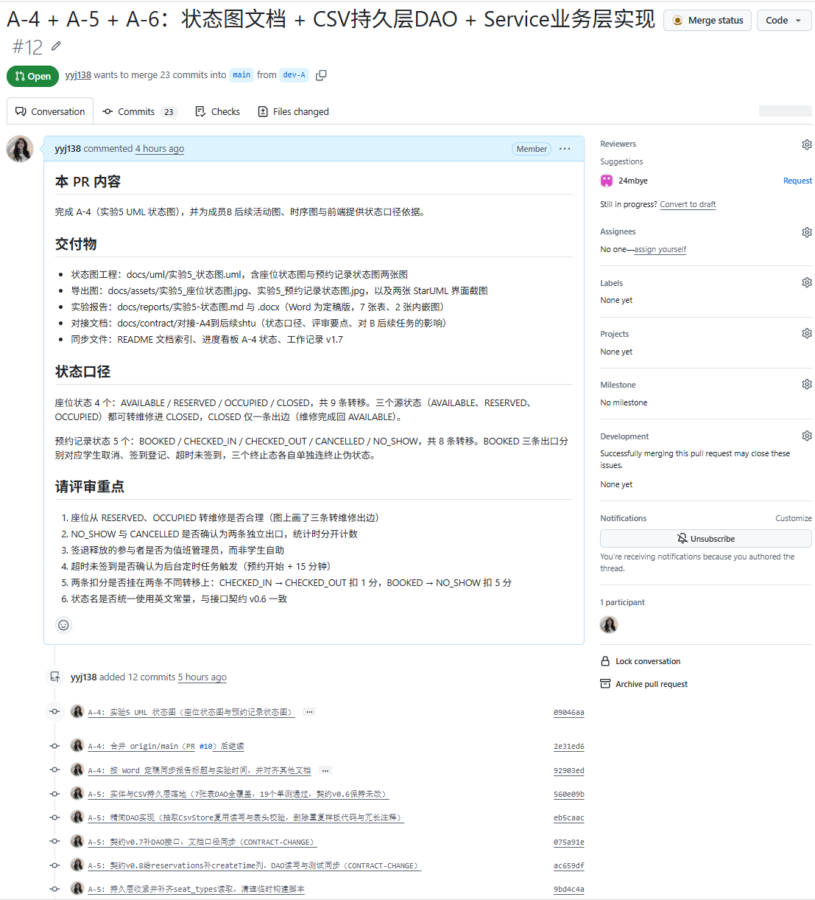

# 实验8 版本控制软件使用练习（Git 实践记录）

> **文件作用**：记录本项目成员 A 侧的版本控制实践——分支策略、提交规范、Pull Request 评审流程与问题处理，作为实验8 的实验报告与实验7 大报告的过程说明素材。
> **课程**：CST9301 软件工程  
> **作者**：易雨杰（成员A，2024611209）  
> **实验时间**：2026 年 11 月 7 日  
> **版本**：v1.4（v1.4 修正 PR #12 状态口径：由“40 个提交、状态 Open”改为“已合并 `bef565c`、合并时 41 个提交”，并注明第五节表格为截至 `2ba49c4` 的 40 条快照；Word 版为提交最终版，实验时间按 Word 统一为 2026 年 11 月 7 日；v1.1 换用终端 `git log --graph` 截图并补到 25 条提交；v1.3 提交明细表由 25 条补到 40 条）  
> **说明**：指导书实验八以 Subversion 为例，本组按团队现有环境改用 **Git + GitHub**，实验目的（理解版本控制概念、练习用版本控制工具实现版本管理）一致。

## 一、实验目的

1. 理解版本控制的基本概念：版本库、工作拷贝、提交（check in）、检出、分支、合并、冲突。
2. 练习用 Git 完成团队并行开发：分支管理、提交规范、Pull Request 评审与合并。
3. 体会版本控制在多人协作中的实际作用：可回退、可追溯、可并行、可审查。

## 二、团队环境与约定

| 项目 | 取值 |
|---|---|
| 远端仓库 | `https://github.com/STU-team/Study_Room_Reservation.git` |
| 主干分支 | `main`（受保护，只接受 PR 合并） |
| 成员分支 | A 用 `dev-A`，B 用 `dev-B-new` |
| 合并方式 | Create a merge commit（保留分支痕迹，不 Squash） |
| 评审人 | 交叉评审：A 的 PR 由 B（`24mbye`）评审，反之亦然 |
| 提交信息格式 | `A-任务号: 一句话说明`，如 `A-6: Service 业务逻辑（reserve/signIn/signOut/handleNoShow）`，禁止 emoji |
| 推送前动作 | 先 `git fetch` 确认 `dev-A..origin/main` 为 0，再 `push` |

## 三、分支拓扑

**读图说明**：每行的 `*` 是一个提交节点，左侧的竖线与斜线表示分支走向；行尾括号里的彩色标签是分支引用指针。

- 最上方 `07fab67 (HEAD -> dev-A, origin/dev-A)`：A 侧开发分支的当前位置，本地与远端一致（已推送）。
- 底部 `07e8573 (origin/main, origin/HEAD) Merge pull request #10 from STU-team/dev-A`：主干最新提交，是先前 PR 合并的结果。
- 中间一条竖线是 A 侧的 23 个提交线性排列（A-4 → A-5 → A-6），没有来回分叉，说明同一分支连续开发。
- 右侧另起一条竖线是 B 侧分支，标签为 `(dev-B-new)`、`(origin/dev-B-new)`，承载 B-1/B-2/B-4 等提交；`dd935f9 Merge branch 'main' into dev-B-new` 说明 B 也做过一次同步主干。
- 两条开发分支互不干扰，各自通过 PR 回合 `main`，是本项目并行协作的直接证据。

> 说明：本截图拍摄于 `07fab67`（A-6 收尾时点），A-7 之后的提交见第五节表格第 24 条起；提交节点较多时以表格为准逐条核对，截图负责呈现分支拓扑与并行关系。

**分支策略要点**：整门课 A 侧只维护 `dev-A` 一条开发分支，不按任务拆小分支。理由是本项目同一时刻只有一名成员在后端施工，拆分支会让 PR 数量膨胀、评审上下文割裂；长期复用一条分支则所有相关工作自动汇入同一个 PR，评审人能看到完整演进过程。

## 四、Pull Request 评审

**PR #12：`A-4 + A-5 + A-6：状态图文档 + CSV持久层DAO + Service业务层实现`**

- `dev-A` → `main`，**已合并**（`bef565c`，2026-11-08 14:41，Create a merge commit）。合并时 `dev-A` 相对 `main` 共 41 个提交（截图拍摄时为 23 个，PR 页面随推送自动刷新），评审人指定 `24mbye`；本文记录的是合并前的评审过程，PR 合并后页面状态由 Open 转为 Merged。
- 因为 A-4、A-5 尚未合并，A-5、A-6 的提交继续堆在同一条分支上，因此**不新建 PR**，而是复用同一个 PR 并更新标题与描述。这样避免了“对着 main 再开一个 PR 导致 diff 重复计算”的问题，推送后 PR 的变更列表自动刷新。
- PR 描述里单列 **`CONTRACT-CHANGE`**（最初三处：契约 v0.7 / v0.8 / v0.9，后续追加 v1.0 / v1.1 / v1.2，共六处），并写明“若评审不认可请在评论指出，按流程调整”，把接口变更交由对方确认后才进入主干。

**评审闭环流程**：
1. A 在 `dev-A` 提交 → `push`；
2. 在 PR 里 @B 评审，B 在 Files changed 里逐条评论；
3. A 按评论修改并追加提交（不 `--amend`、不 `--force`），PR 自动更新；
4. B 通过后由 B 或 A 点 Create a merge commit 合入 `main`；
5. 合并后 A 在本分支 `git fetch` + `merge origin/main` 继续保持同步。

## 五、A 侧提交记录（40 条，截至 `2ba49c4`；PR #12 合并前另有 `b144f38` 一条补表提交，合计 41 条）

| # | 提交 | 时间 | 说明 |
|---|---|---|---|
| 1 | `09046aa` | 11-06 19:01 | A-4: 实验5 UML 状态图（座位状态图与预约记录状态图） |
| 2 | `2e31ed6` | 11-06 19:01 | A-4: 合并 origin/main（PR #10）后继续 |
| 3 | `92903ed` | 11-06 19:23 | A-4: 按 Word 定稿同步报告标题与实验时间，并对齐其他文档 |
| 4 | `560e09b` | 11-06 20:40 | A-5: 实体与CSV持久层落地（7 张表 DAO 全覆盖，19 单测通过） |
| 5 | `eb5caac` | 11-06 20:47 | A-5: 精简 DAO 实现（抽取 `CsvStore` 复用读写与表头校验） |
| 6 | `075a91e` | 11-06 20:59 | A-5: 契约 v0.7 补 DAO 接口（CONTRACT-CHANGE） |
| 7 | `ac659df` | 11-06 21:08 | A-5: 契约 v0.8 给 reservations 补 createTime 列（CONTRACT-CHANGE） |
| 8 | `9bd4c4a` | 11-06 21:20 | A-5: 持久层收紧并补齐 seat_types 读取，清理临时构建脚本 |
| 9 | `4bacdea` | 11-06 21:21 | A-5: 删除无用的 countByTypeName，seatCount 改由 `CsvSeatTypeDao` 一次统计 |
| 10 | `2b4a21a` | 11-06 21:21 | A-5: 实现记录同步 seatCount 统计口径 |
| 11 | `e72db9a` | 11-06 21:49 | A-5: 补充测试通过截图与 A-6 构造顺序说明 |
| 12 | `217e3d0` | 11-06 21:53 | A-5: 补齐首次启动示例数据（seedSamples）并对齐文档 |
| 13 | `53b2cff` | 11-06 22:10 | A-6: Service 业务逻辑（reserve/signIn/signOut/handleNoShow） |
| 14 | `fa612d1` | 11-06 22:12 | A-6: 对接文档补区域列表获取方式 |
| 15 | `85a4481` | 11-06 23:03 | A-6: 对接文档补充爽约扫描与签到记录分工约定 |
| 16 | `54ae1c6` | 11-06 23:12 | A-6: 签到即落盘、签退回填，契约 v0.9 增加 `CheckinRecordDao.update`（CONTRACT-CHANGE） |
| 17 | `8ecb7ec` | 11-06 23:26 | A-6: 收尾复核，清理冗余导入与无状态化登录实现，测试截图入库 |
| 18 | `8aced04` | 11-06 23:27 | A-6: 同步 A-5 对接文档版本号至 v1.3 |
| 19 | `e66cbf7` | 11-06 23:27 | A-6: 补充座位复用限制与异常声明说明到实现记录与对接文档 |
| 20 | `49a03d4` | 11-06 23:34 | A-6: 记录实验指导书核对结论，代码类任务不另写实验报告 |
| 21 | `e8fc2f6` | 11-06 23:36 | A-6: 说明代码运行截图的用途与 A-8 联调图的替代关系 |
| 22 | `15ca5f3` | 11-06 23:45 | A-6: 工作记录回填实际提交号，A-6 交付清单复核 |
| 23 | `07fab67` | 11-06 23:49 | A-6: 补 PR 描述草稿，标注三处 CONTRACT-CHANGE 与验证方式 |
| 24 | `e2addb3` | 11-07 00:06 | A-7: 实验8 版本控制实践记录与分支拓扑、PR 截图入库 |
| 25 | `c2f3694` | 11-07 00:07 | A-7: 工作记录回填 A-7 提交号与版本 v2.8 |
| 26 | `0bddbb4` | 11-07 00:11 | A-7: 分支拓扑改用终端 `git log --graph` 截图，补 Word 版实验8 报告 |
| 27 | `499a6c0` | 11-07 00:54 | A-7: 按定稿 Word 反向同步实验3/实验5/实验8 的 Markdown（实验时间统一为 2026-11-07） |
| 28 | `36d1db3` | 11-07 01:04 | A-7: 入库 PR #12 描述最终版（覆盖 A-4 至 A-7 与三处契约变更） |
| 29 | `1ecb223` | 11-07 01:14 | A-8: 入库 A-8 联调清单与演示数据，移除 PR 描述 md（PR 描述不落文件） |
| 30 | `555635e` | 11-07 01:21 | A-8: 演示数据改为长期可演示的日期，补一条逾期未扫记录 |
| 31 | `173ae90` | 11-07 01:31 | A-8: 演示数据改为按当天生成，预约控制在 7 天窗口内 |
| 32 | `a3095aa` | 11-07 01:37 | A-8: 预约窗口限制为今天起 7 天内，契约升 v1.0（CONTRACT-CHANGE） |
| 33 | `973b733` | 11-07 01:43 | A-8: 补预约列表与在座名单查询，契约升 v1.1（CONTRACT-CHANGE） |
| 34 | `4902a42` | 11-07 01:48 | A-8: 补齐给 B 的开工对接指引（拉分支、入口骨架、表格列定义、取不到的数据） |
| 35 | `a020e33` | 11-07 01:59 | A-8: 补预约姓名手机号、`findReservation` 与 `StudentService`，契约升 v1.2（CONTRACT-CHANGE） |
| 36 | `bebf67e` | 11-07 02:09 | A-8: 终检去掉重复的 `findReservation` 与 `require`，同步联调清单版本引用与提交号 |
| 37 | `d150811` | 11-07 14:09 | A-4+A-5: 按 B 评审修正座位状态图（T-04 改 `RESERVED --签到登记-->`）、预约快照优先、示例数据补学生账号 |
| 38 | `28091db` | 11-07 14:13 | A-8: 合并 `origin/main` 的 B-2 成果（PR #11），缝合 README / 工作记录 / 进度看板三处冲突 |
| 39 | `96924d4` | 11-07 14:15 | A-8: README 任务清单按编号排序，B 侧任务归到末段 |
| 40 | `2ba49c4` | 11-07 14:38 | A-4: 座位状态图重新导出（箭头「签到登记」、备注框契约 v1.2），同步 Word 内嵌图与对接文档 |

提交粒度遵循一个原则：**一次提交只做一件可独立描述的事**。功能实现、文档同步、契约变更分三次提交，便于回退时只撤其中一部分。例如契约 v0.9 只改契约与实现和测试，文档口径在后续提交里单独补齐。

表中 37～40 条是评审修正与同步主干阶段的提交：37 按 B 的评审意见改代码与图，38 把 `origin/main` 上的 B-2 成果合进 `dev-A`（`Create a merge commit`，未 Squash），39、40 是合入后的文档与图重建提交。这一段完整保留了「评审 → 修正 → 同步主干 → 再补正」的闭环痕迹。

## 六、遇到的问题与处理

| 问题 | 处理 |
|---|---|
| 接口契约是实现与界面并行的唯一依据，曾擅自把 v0.6 改成 v0.7 | 被负责人当场否决后 `git checkout -- docs/contract/接口契约.md` 完整回退，此后确立“契约不动、字段落差由 DAO 映射消化”的口径；确需升级必须走 `CONTRACT-CHANGE` 并经对方明确同意 |
| 与 B 并行开发，B 的 PR 先合入 main，A 的分支落后 | 在 `dev-A` 执行 `git merge origin/main` 合并主干（提交 `2e31ed6`），在分支上解决冲突再继续开发，而不是 `rebase` 改写已推送的历史 |
| 同一分支堆了 23 个提交，PR 描述与实际内容脱节 | 复用同一个 PR、更新标题与描述，把 A-5、A-6 内容分段追加在原文之后，保留 A-4 的历史说明 |
| 提交里混入临时构建脚本与编辑器备份（`_a3_build.py`、`_a4_build.py`、`*.~ml`） | `git rm` 删除并在 `.gitignore` 前确认 `git status --ignored` 只剩 `target/`；此后每次交付前固定检查工作区是否干净 |
| 误把 IDE 的 import 告警当成编译错误 | 查 `mvn -o -B clean test` 的实际输出确认只是 warning，顺手删除未使用的 import 后重新提交，保持零告警 |

## 七、小结与心得

1. **版本控制的价值在回退那一刻才真正体现。** 擅自改契约那次，`git checkout --` 一条命令把文件恢复到定稿状态，没有产生任何二次污染；如果没有版本控制，只能凭记忆手改回去。
2. **分支不是越多越好。** 单人负责一个方向时，长期维护一条 `dev-A` 比每个任务开一条分支更清晰：PR 上下文连续、评审人一次能看全、合并冲突只在“同步主干”这一处发生。
3. **提交信息要能当索引用。** 统一 `A-任务号:` 前缀后，`git log --oneline` 一眼就能看出每个任务是哪几个提交做的，写实验报告时不必翻记忆。
4. **不可逆操作要留退路。** 全组约定不用 `--amend`、不用 `push --force`、不用 `reset --hard`，改错了就再提交一次修正，历史完整可查。
5. **文档与代码同批提交。** 每完成一件事就同步 `进度看板`、`工作记录`、对接文档，并与代码放在同一次提交里，避免“代码改了文档没改”的失联。

## 八、交付物

- 本记录：`docs/reports/实验8-版本控制.md`
- Word 版报告：`docs/reports/实验8-版本控制.docx`（版式与实验5 定稿一致：A4、四边 2.5cm、标题黑体、正文宋体 12pt 首行缩进 2 字符、表内 10.5pt）
- 分支拓扑截图：`docs/assets/A7_git_graph.png`
- PR 页面截图：`docs/assets/A7_pr_screenshot.png`
- 提交明细表：见本文第五节（40 条，与 `git log --reverse --oneline origin/main..2ba49c4` 逐条对应；第 41 条 `b144f38` 是把本表补到 40 条的那次提交；Word 定稿版为提交时点的 25 条快照）
